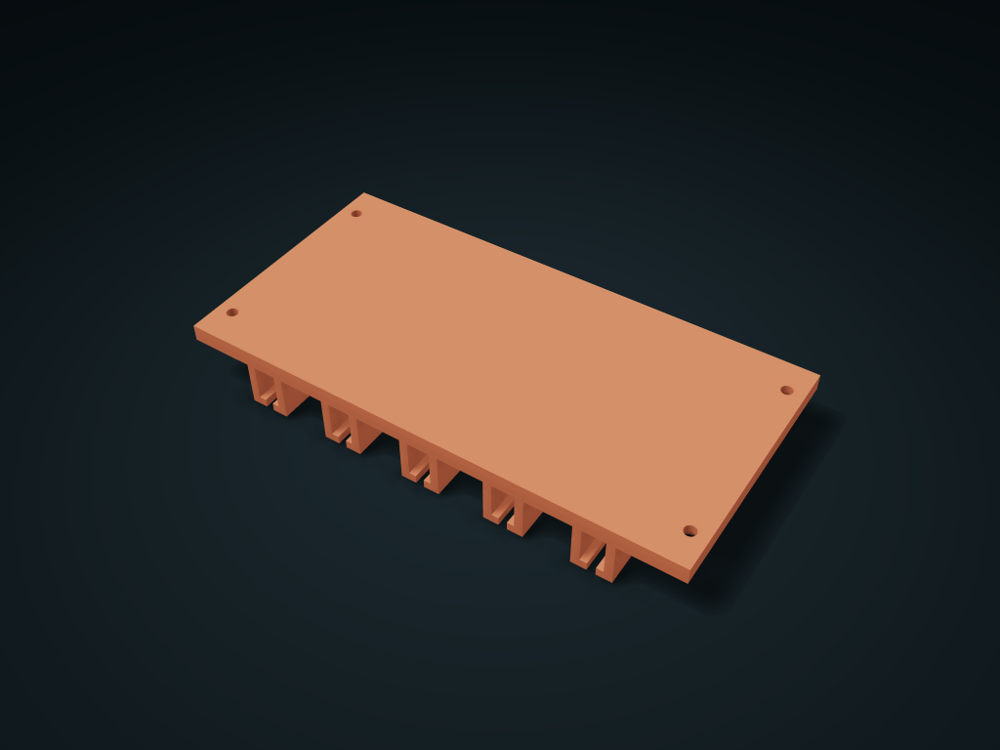

# Under-Cabinet Folded Bag Hanging Rail

The folded top edge of the package rests on double lips, and each bag pulls out from the front independently; adjustable number of rails, folded edge channels and bag neck outlet.

**[Preview this model and customize it on boxesmodel](https://boxesmodel.com/models/folded-edge-sachet-rail)**

## Default model

| Property | Value |
| --- | --- |
| Category | Desktop Organizers |
| Model version | 1.0.0 |
| Default box size | 180 × 90 × 22 mm |
| Included parts | 1 |
| Formats | STL and STEP |
| Units | Millimeters |

Dimensions include the outer outline of the box; see the specifications for usable interior space.

## Dimensions and features

| Detail | Default value |
| --- | --- |
| Separate bag fold rails | 5 |
| Folded edge channel clear thickness / clear height | 8.0 / 13.0 mm |
| Bag neck outlet | 3.0 mm |
| Neighboring rail center distance | 30.4 mm |
| Mounting hole spacing | 168.0 × 66.0 mm |

## Download the parts

Open a file below and choose **Download raw file** on GitHub. STL is for slicers; STEP is for CAD editing.

| Part | Dimensions | STL | STEP |
| --- | --- | --- | --- |
| Top mounting plate and bag fold support rails | 180 × 90 × 22 mm | [rail-rack.stl](rail-rack.stl) | [rail-rack.step](rail-rack.step) |

Each listed part has its own STL and STEP file. Preview colors are illustrative; the manufacturing files do not contain the displayed colors.

## Printing and assembly

- First measure the package thickness after folding it 2–3 times; it must be at least 0.8 mm less than the channel clear thickness; the neck should be 0.8 mm smaller than the outlet clear width. Each folded edge must rest on the support lips; soft thin bags cannot hang by friction alone.
- Each bag's folded edge no longer than 85.0 mm along the rail, with the bulging bag body below no thicker than 28.4 mm; leave space below for the real bag height, and at least one bag width in front for pulling.
- Push the folded edges and bag body in horizontally together from the front until the rear wall stops them; pull out the whole bag before unfolding it. No front lock; suited to static storage; fresh-keeping seals or preventing drops in transport cannot be guaranteed. After deburring, test-insert your actual packaging first.
- Supply 4 wood screws 3.5 × 12 mm, head diameter ≤ 7, height ≤ 3 mm. Screw up into the cabinet panel through the counterbores from below; fix it before fitting bags; screw enters wood 9.0 mm; the cabinet panel must be at least 12.0 mm thick and suit the screw; pre-drill without breaking through.
- One-piece; top flat face on the bed; the lip bridge is 3.0 mm clear wide. Check bridging, supports and your actual build plate size when slicing. Test-fit with your actual packaging and check load-bearing before use.
- Import at millimeter scale. Check your build volume, orientation, overhangs, supports and mating clearances in the slicer.

## Adjust the design

Visit the [interactive model page](https://boxesmodel.com/models/folded-edge-sachet-rail) to inspect the 3D model and adjust the available dimensions and layout options. This folder contains the default-size export shown above; custom exports follow the options and pricing shown on boxesmodel.

## License and attribution

Copyright © 2026 boxesmodel. These model files, preview and description are licensed under [CC BY 4.0](https://creativecommons.org/licenses/by/4.0/). You may share, modify and use them commercially with the required attribution. See the [full license](../../LICENSE) and [attribution guide](../../ATTRIBUTION.md).

Suggested credit:

> “Under-Cabinet Folded Bag Hanging Rail” by [boxesmodel](https://boxesmodel.com/models/folded-edge-sachet-rail), licensed under [CC BY 4.0](https://creativecommons.org/licenses/by/4.0/). Indicate any changes you make.

[Browse all models](../../CATALOG.md) · [About the collection](../../README.md)
