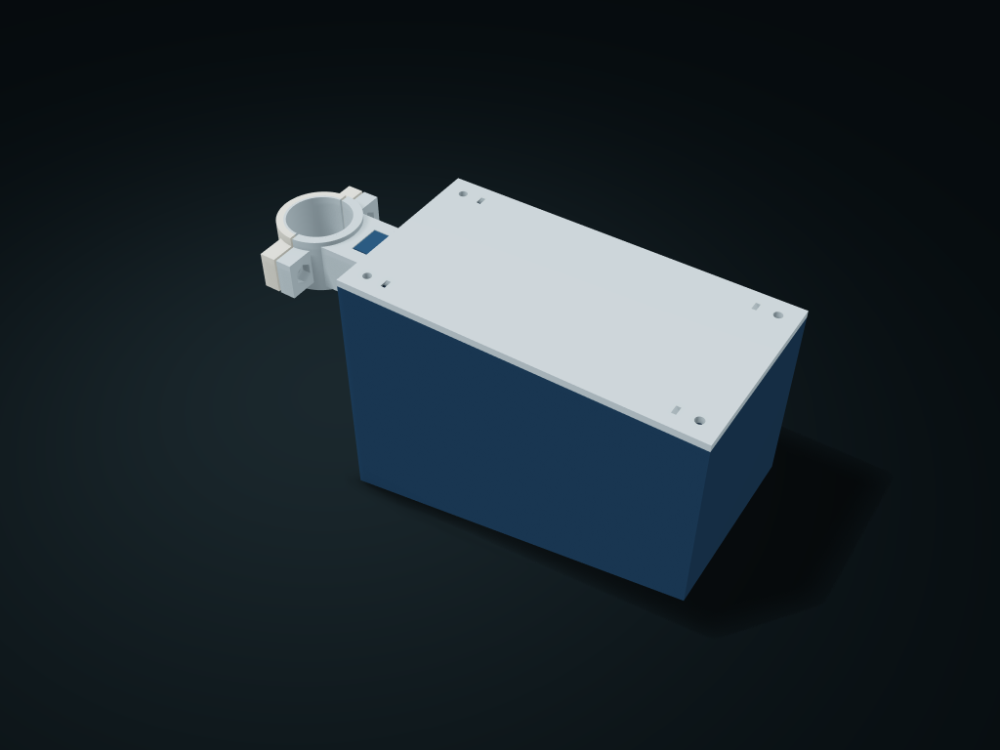

# Fork Ear Round Rod Service Box

Two half clamps for a round rod with complete TPU printed arc liners, a standard M5 fork ear joint and a four-screw lift-off lid with a service opening Rod diameter, liner thickness and sloped floor columns are linked.

**[Preview this model and customize it on boxesmodel](https://boxesmodel.com/models/fork-bolted-roundpost-repair-case)**

## Default model

| Property | Value |
| --- | --- |
| Category | Lidded Storage |
| Model version | 1.0.1 |
| Default assembly display size | 210 × 78 × 110 mm |
| Included parts | 6 |
| Formats | STL and STEP |
| Units | Millimeters |

Covers the layout of all parts in the current preview; see Files and dimensions for each part's print size.

## Dimensions and features

| Detail | Default value |
| --- | --- |
| Printed parts BOM | 6 parts: 1 each of front clamp, rear clamp fork seat, sloped box and lid, plus 1 each of TPU front and rear curved liners |
| Purchased hardware | 2 each of M4×20 and nuts; 1 each of M5×30 and nut; 4 each of M3×12 and nuts |
| Current printed liner specification | 2 printed parts / inner Ø27.2 / outer Ø29.2 / 24 tall / 1 mm radial wall / 1 mm split |
| Connecting axle and joint | DIN 912 M5×30 / 22 thread length / 4 mm nut fully on the threaded section / pull the whole rod out to take the box apart |
| Nut-holding tool for a closed lid | ≤ 1 × 3 mm thin flat screwdriver / 24 mm straight section / 30° inward-angled service opening; the lid is not sealed |
| Verification status | Software geometry; static prototype; riding retention and real use not verified |

## Download the parts

Open a file below and choose **Download raw file** on GitHub. STL is for slicers; STEP is for CAD editing.

| Part | Dimensions | STL | STEP |
| --- | --- | --- | --- |
| TPU front curved printed liner | 14.1 × 29.18 × 24 mm | [front-liner.stl](front-liner.stl) | [front-liner.step](front-liner.step) |
| TPU rear curved printed liner | 14.1 × 29.18 × 24 mm | [rear-liner.stl](rear-liner.stl) | [rear-liner.step](rear-liner.step) |
| Round rod front half clamp | 17.1 × 56.2 × 24 mm | [front-clamp.stl](front-clamp.stl) | [front-clamp.step](front-clamp.step) |
| Round rod rear half clamp and double fork seat | 40.7 × 56.2 × 24 mm | [rear-fork.stl](rear-fork.stl) | [rear-fork.step](rear-fork.step) |
| Sloped floor repair column box | 169.8 × 78 × 107 mm | [body.stl](body.stl) | [body.step](body.step) |
| Four-screw lift-off lid with a tool service opening | 150.8 × 78 × 3 mm | [lid.stl](lid.stl) | [lid.step](lid.step) |

Each listed part has its own STL and STEP file. Preview colors are illustrative; the manufacturing files do not contain the displayed colors.

## Printing and assembly

- Static round rod repair storage assembly prototype: 6 printed parts in the set — 1 front half clamp, 1 rear half clamp and fork seat, 1 sloped floor column box, 1 lift-off lid, and 1 each of TPU front and rear curved liners. The TPU liners must be printed in a separate material; the complete dedicated liners come with the 6 STL/6 STEP files, with no cut rubber sheets or custom machined parts. Hardware is bought separately and is not counted as printed parts.
- Required purchased BOM: 2 × DIN 912 M4×20 socket head screws (fully threaded 20 / coarse 0.7 / head Ø7 × 4 / H3) + 2 × DIN 934 M4 nuts (AF7 × 3.2 / pitch 0.7); 1 × DIN 912 M5×30 connecting bolt (effective thread 22 / coarse 0.8 / head Ø8.5 × 5 / H4) + 1 × DIN 934 M5 nut (AF8 × 4 / pitch 0.8); 4 × DIN 912 M3×12 lid screws (fully threaded 12 / coarse 0.5 / head Ø5.5 × 3 / H2.5) + 4 × DIN 934 M3 nuts (AF5.5 × 2.4 / pitch 0.5). 14 standard parts in total; fixed specifications, metal is not scaled. Selected in-stock Vital Parts items HSC912-M4-20-A2, HN934-M4-A2, HSC912-M5-30-A2-70, HN934-M5-A2-70, HSC912-M3-12-A4 and HN934-M3-C6-BZP; product pages checked on 2026-10-11. Do not substitute larger heads or thicker lock nuts.
- 2 TPU printed liners: front/rear curved pieces inner Ø27.2, outer Ø29.2, axle height 24, modeled radial wall 1 mm, 1 mm split kept at the X ± 0.5 edges; the clamp ring inner diameter equals the liner outer diameter. Nominal contact with no preset compression; TPU elasticity/friction is not simulated; test-fit the measured rod with a small interface sample first; clean off supports and do not stack shims. Print the liners separately from the rigid clamp rings; liners in rigid material cannot claim friction retention.
- First place the two TPU printed liners on both sides of the round rod and close the front and rear half clamps; insert the M4 from the −X side through both clamp ears, fit the nut from the +X outer recess and tighten alternately and lightly. Follow the rod maker's clamping guidance; no torque is specified; not claimed to suit carbon rods, aero rods, any brand or vehicle.
- Fit the clamp ear nuts before installing the box; before re-clamping or changing printed liners, empty and remove the box so its front wall does not block the tool path from the +X side.
- Support the empty box and slide the 14 mm box tongue horizontally from +X into the 14.8 mm wide double fork; align the Y-direction Ø5.5 holes, insert the whole M5×30 bolt from −Y, fit the nut into the recess from +Y and tighten. To remove a box, empty and support it, loosen the nut, pull the whole bolt out and move it toward +X; do not treat a half-turn loosening as released.
- Feed the four M3 nuts horizontally from the open inner compartment into the four corner side slots (H−9 to H−6.6 mm) before loading items. The lid drops onto the shell rim from above, then 4 M3×12 go straight in from above; use a thin flat screwdriver with a blade ≤ 1 thick and ≤ 3 mm wide, fed through each lid's service opening along a channel angled 30° into the compartment, to hold the inner corner of the nut against turning, then lightly tighten diagonally with an AF2.5 hex key from directly above the screw. The screwdriver's straight section is at least 24 mm and withdraws along the same path. Remove the lid the same way, holding the nuts; with all 4 screws out, lift it straight up; do not force the screwdriver through an unopened lid surface. The screw heads make the in-use total height at most 3 mm more than the printed total height.
- Assembly tools: AF2.5 hex key for the lid screws, AF3 for the clamp screws, AF4 for the fork axle; thin flat screwdriver blade ≤ 1 × 3 mm, straight section ≥ 24 mm. The tool service opening is for holding the nut with the lid closed; the lid is not sealed; with items inside, the short blade section of the service opening is within the lid nut seat; do not force a thicker blade in.
- The printed outer envelope 210 × 78 × 110 mm includes the clamps and fork seat; the shell is 150.80 mm long excluding the clamp seat. The rear floor rises 28 mm, a 10.52° slope; the long tool column is 24 mm clear wide, and the repair bag compartment 45 mm clear wide.
- Item envelope assumptions: two 100 × 10 × 8 mm tire levers, a 70 × 25 × 25 mm sleeve tool and a 25 × 25 × 8 mm sealed patch bag. The pry bar sits in the middle of the tool column, two bags lie compactly at about 50/106 mm from the compartment front on the sloped floor, and with the lid off each item is taken straight from the top. The full path was checked against a 130 mm clear compartment boundary; do not treat the printed outer length as the clear length, and do not store bare blades, hot parts or pressurized cans.
- Bolted lid fixing and strap retention need a real check. Check slicing before printing; before use, actually check retention, load-bearing and creep; no assurance for use while cycling; for a real bike frame, check tire and leg clearance over the full travel, the allowed clamping range and measured retention separately.
- Box bottom and lid bottom down; slice-check layer direction for the front and rear clamps and fork ears, and clear supports from the cross holes/nut pockets. The 0.4 mm single-side fork clearance must be test-printed with the mating interface; no sealing, quick-release locking or freely rotating hinge is claimed.
- Import at millimeter scale. Check your build volume, orientation, overhangs, supports and mating clearances in the slicer.

### Additional hardware

2 × DIN 912 M4×20 mm socket head screws, 2 × DIN 934 M4 nuts (AF7 × 3.2); 1 × DIN 912 M5×30 mm bolt (22 mm thread length), 1 × DIN 934 M5 nut (AF8 × 4); 4 × DIN 912 M3×12 mm lid screws, 4 × DIN 934 M3 nuts (AF5.5 × 2.4). The dedicated TPU front and rear arc liners are included with the print files; see the current list for full hardware specifications and assembly tools.

## Adjust the design

Visit the [interactive model page](https://boxesmodel.com/models/fork-bolted-roundpost-repair-case) to inspect the 3D model and adjust the available dimensions and layout options. This folder contains the default-size export shown above; custom exports follow the options and pricing shown on boxesmodel.

## License and attribution

Copyright © 2026 boxesmodel. These model files, preview and description are licensed under [CC BY 4.0](https://creativecommons.org/licenses/by/4.0/). You may share, modify and use them commercially with the required attribution. See the [full license](../../LICENSE) and [attribution guide](../../ATTRIBUTION.md).

Suggested credit:

> “Fork Ear Round Rod Service Box” by [boxesmodel](https://boxesmodel.com/models/fork-bolted-roundpost-repair-case), licensed under [CC BY 4.0](https://creativecommons.org/licenses/by/4.0/). Indicate any changes you make.

[Browse all models](../../CATALOG.md) · [About the collection](../../README.md)
