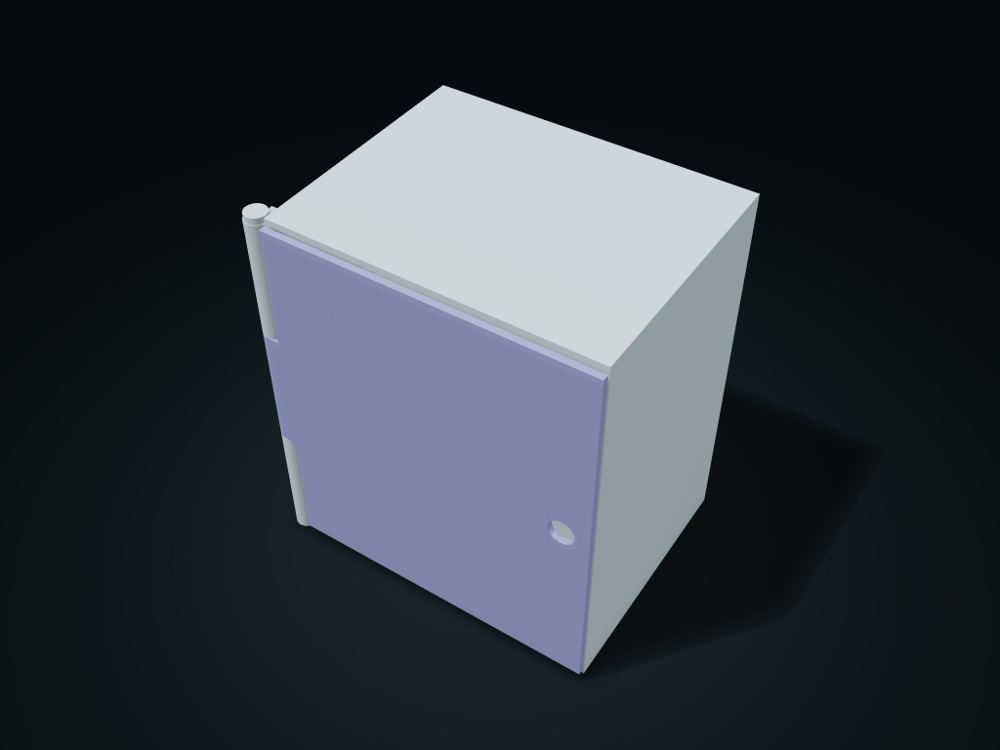

# Vertical-Hinge Front Door Shelf Cabinet

The front door closes to a narrow gap against the cabinet, and the vertical pin hinge can be taken apart; with the door open, the shelves and divided bottom tray come out from the front.

**[Preview this model and customize it on boxesmodel](https://boxesmodel.com/models/front-door-shelf-cabinet)**

## Default model

| Property | Value |
| --- | --- |
| Category | Drawer Storage |
| Model version | 1.0.2 |
| Default assembly display size | 160 × 120 × 180 mm |
| Included parts | 6 |
| Formats | STL and STEP |
| Units | Millimeters |

Covers the layout of all parts in the current preview; see Files and dimensions for each part's print size.

## Dimensions and features

| Detail | Default value |
| --- | --- |
| Cabinet interior clear width × depth | 142.8 × 113.5 mm |
| Closed door back gap / top and bottom gaps | 0.5 / 0.4 mm (nominal) |
| Upper level clear height | 56.5 mm (clear of the side rails) |
| Bottom tray cell clear width / clear height | 66.5 / 48.6 mm |
| Shelves / total parts | 2 / 6 |

## Download the parts

Open a file below and choose **Download raw file** on GitHub. STL is for slicers; STEP is for CAD editing.

| Part | Dimensions | STL | STEP |
| --- | --- | --- | --- |
| Narrow-gap cabinet shell with paired shelf rails | 160 × 120 × 180 mm | [cabinet.stl](cabinet.stl) | [cabinet.step](cabinet.step) |
| Vertical-axis front door with finger hole | 159.6 × 10.8 × 173.2 mm | [door.stl](door.stl) | [door.step](door.step) |
| Headed vertical pin | 10 × 10 × 179.6 mm | [pin.stl](pin.stl) | [pin.step](pin.step) |
| Pull-forward shelf 1 | 142 × 112.7 × 3 mm | [shelf_0.stl](shelf_0.stl) | [shelf_0.step](shelf_0.step) |
| Pull-forward shelf 2 | 142 × 112.7 × 3 mm | [shelf_1.stl](shelf_1.stl) | [shelf_1.step](shelf_1.step) |
| Bottom pull-out column inner box | 142 × 112.7 × 51.6 mm | [inner_bin.stl](inner_bin.stl) | [inner_bin.step](inner_bin.step) |

Each listed part has its own STL and STEP file. Preview colors are illustrative; the manufacturing files do not contain the displayed colors.

## Printing and assembly

- Complete set of 6 printed parts: 1 cabinet shell, 1 front door, 1 headed vertical pin, 2 sliding shelves and 1 divided bottom tray; no purchased hardware needed.
- When closed, the door's back face sits 0.5 mm (nominal) from the cabinet front edge, with 0.4 mm to the inner top and bottom; the cabinet extends behind the door, and the hinge neck clears it accordingly. Not a sealed or locking structure; confirm the real tolerances with a fit sample.
- First place the door's center hinge knuckle between the cabinet's upper and lower knuckles, then insert the printed pin from the top. Hole diameter 4.8 mm, pin diameter 4 mm, nominal clearance 0.4 mm per side.
- After opening the door 90 degrees to the front left, the shelves and bottom tray slide straight out from the front; shelves slide in along paired upper and lower rails, and the bottom tray sits on the cabinet floor. Empty it before removing the shelves, and steady the cabinet while taking items out.
- Leave at least 160 mm in front for the door to swing, and room on the left for the hinge to move; leave at least 180 mm above to pull out the pin. Shelf and bottom tray depths follow the outer size and front edge position; matching parts must use the same version and parameters.
- The door has no latch, and the finger hole goes all the way through; only for light small items on a level desk; empty it before moving. Slice the cabinet shell back-down on the bed, the front door flat, and the shelves and tray floor-down; check the printed pin's orientation and strength.
- CAD assembly and opening/closing and take-out path checks have been done; Check fit, pin retention, load and tip-over resistance before use.
- Import at millimeter scale. Check your build volume, orientation, overhangs, supports and mating clearances in the slicer.

## Adjust the design

Visit the [interactive model page](https://boxesmodel.com/models/front-door-shelf-cabinet) to inspect the 3D model and adjust the available dimensions and layout options. This folder contains the default-size export shown above; custom exports follow the options and pricing shown on boxesmodel.

## License and attribution

Copyright © 2026 boxesmodel. These model files, preview and description are licensed under [CC BY 4.0](https://creativecommons.org/licenses/by/4.0/). You may share, modify and use them commercially with the required attribution. See the [full license](../../LICENSE) and [attribution guide](../../ATTRIBUTION.md).

Suggested credit:

> “Vertical-Hinge Front Door Shelf Cabinet” by [boxesmodel](https://boxesmodel.com/models/front-door-shelf-cabinet), licensed under [CC BY 4.0](https://creativecommons.org/licenses/by/4.0/). Indicate any changes you make.

[Browse all models](../../CATALOG.md) · [About the collection](../../README.md)
