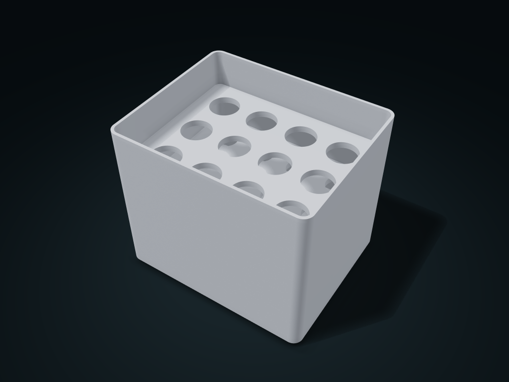

# Graded Sieve Stacking Trays

Three progressive sieve levels sort by hand, and a solid catch tray collects the smallest items; adjust sieve hole size and count to your use.

**[Preview this model and customize it on boxesmodel](https://boxesmodel.com/models/graded-sieve-stack)**

## Default model

| Property | Value |
| --- | --- |
| Category | Stackable Storage |
| Model version | 1.0.0 |
| Default assembly display size | 160 × 130 × 135 mm |
| Included parts | 4 |
| Formats | STL and STEP |
| Units | Millimeters |

Covers the layout of all parts in the current preview; see Files and dimensions for each part's print size.

## Dimensions and features

| Detail | Default value |
| --- | --- |
| Sieve holes per level | 12 |
| Usable clear height between levels | 27.6 mm |
| Sieve holes from bottom to top | Ø17 / Ø21 / Ø25 mm |

## Download the parts

Open a file below and choose **Download raw file** on GitHub. STL is for slicers; STEP is for CAD editing.

| Part | Dimensions | STL | STEP |
| --- | --- | --- | --- |
| Solid catch tray | 160 × 130 × 36 mm | [collector.stl](collector.stl) | [collector.step](collector.step) |
| Level 1 sieve tray Ø17 | 160 × 130 × 36 mm | [sieve-1.stl](sieve-1.stl) | [sieve-1.step](sieve-1.step) |
| Level 2 sieve tray Ø21 | 160 × 130 × 36 mm | [sieve-2.stl](sieve-2.stl) | [sieve-2.step](sieve-2.step) |
| Level 3 sieve tray Ø25 | 160 × 130 × 36 mm | [sieve-3.stl](sieve-3.stl) | [sieve-3.step](sieve-3.step) |

Each listed part has its own STL and STEP file. Preview colors are illustrative; the manufacturing files do not contain the displayed colors.

## Printing and assembly

- From the bottom up, stack the solid tray, then the small, medium and large hole trays; put items on the top level, shake gently and take them out level by level.
- Set hole diameter for your actual items plus passing allowance; flat pieces may stand up and pass through holes; precise automatic coin sorting is not guaranteed.
- Locating between levels uses fixed specifications; only mates with parts from the same set; test-print first to check base shoulder support and sieve hole quality.
- Import at millimeter scale. Check your build volume, orientation, overhangs, supports and mating clearances in the slicer.

## Adjust the design

Visit the [interactive model page](https://boxesmodel.com/models/graded-sieve-stack) to inspect the 3D model and adjust the available dimensions and layout options. This folder contains the default-size export shown above; custom exports follow the options and pricing shown on boxesmodel.

## License and attribution

Copyright © 2026 boxesmodel. These model files, preview and description are licensed under [CC BY 4.0](https://creativecommons.org/licenses/by/4.0/). You may share, modify and use them commercially with the required attribution. See the [full license](../../LICENSE) and [attribution guide](../../ATTRIBUTION.md).

Suggested credit:

> “Graded Sieve Stacking Trays” by [boxesmodel](https://boxesmodel.com/models/graded-sieve-stack), licensed under [CC BY 4.0](https://creativecommons.org/licenses/by/4.0/). Indicate any changes you make.

[Browse all models](../../CATALOG.md) · [About the collection](../../README.md)
