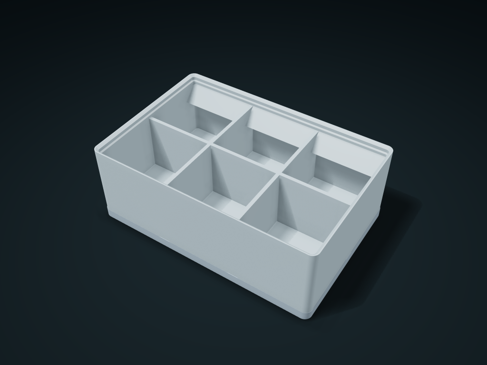

# 42 mm Grid Locating Bin

Gridfinity-style 42 mm grid bin with an open baseplate. Set grid footprint, height units and compartments; rear label ledge and magnet holes are optional.

**[Preview this model and customize it on boxesmodel](https://boxesmodel.com/models/grid-seat-bin)**

## Default model

| Property | Value |
| --- | --- |
| Category | Desktop Organizers |
| Model version | 1.0.0 |
| Default assembly display size | 126 × 84 × 45.8 mm |
| Included parts | 2 |
| Formats | STL and STEP |
| Units | Millimeters |

Covers the layout of all parts in the current preview; see Files and dimensions for each part's print size.

## Intended use

- Small-item sorting in drawers and on workbenches; same-footprint bins stack, the rear label ledge helps identify contents, and bins can be rearranged on the baseplate.
- Built to Gridfinity nominal dimensions; test-print before mixing with other Gridfinity parts. Magnets are not included and the supplied baseplate has no magnet seats.

## Dimensions and features

| Detail | Default value |
| --- | --- |
| Outer grid footprint | 3 × 2 / 42 mm |
| Box shape | 125.5 × 83.5 × 45.8 mm |
| Interior compartments | 3 × 2 / 6 compartments |
| Straight-side clear cells | 39.2 × 38.8 mm |
| Clear depth in front of the back row labels | 30.3 mm |
| Bottom magnet blind holes | 24 |

## Download the parts

Open a file below and choose **Download raw file** on GitHub. STL is for slicers; STEP is for CAD editing.

| Part | Dimensions | STL | STEP |
| --- | --- | --- | --- |
| 42 mm grid baseplate | 126 × 84 × 5 mm | [base.stl](base.stl) | [base.step](base.step) |
| Grid-located compartment box | 125.5 × 83.5 × 45.8 mm | [bin.stl](bin.stl) | [bin.step](bin.step) |

Each listed part has its own STL and STEP file. Preview colors are illustrative; the manufacturing files do not contain the displayed colors.

## Printing and assembly

- The box's base feet drop vertically into the included base plate; the 42 mm pitch and mating profile are fixed; the number of interior cells does not change the interface. The base plate is 5 mm tall, and the box bottom bridging surface starts at 5 mm.
- Boxes with the same footprint can stack upward; dividers and the label deck are below the locating lip, and the top box's feet rest on the nominal bevel. Slice the base plate and box separately, each with its local Z = 0 face down.
- Optional magnet holes are bottom blind holes 6.5 mm in diameter and 2.4 mm deep, 26 mm apart, sized for 6 × 2 mm magnets; magnets are not included, and the included open base plate has no magnet seats.
- The label deck slope is 12 mm wide in the back row; its horizontal projection is already deducted when setting cell counts. Equal interior cells; arbitrary merging is not offered.
- Uses the Gridfinity community's nominal dimensions; test-print and test-fit before mating with external printed parts. The stacking lip tip is about 0.6 mm; confirm in the slicer that it prints as a line; magnet fixing method and warping still to be measured.
- Import at millimeter scale. Check your build volume, orientation, overhangs, supports and mating clearances in the slicer.

## Adjust the design

Visit the [interactive model page](https://boxesmodel.com/models/grid-seat-bin) to inspect the 3D model and adjust the available dimensions and layout options. This folder contains the default-size export shown above; custom exports follow the options and pricing shown on boxesmodel.

## License and attribution

Copyright © 2026 boxesmodel. These model files, preview and description are licensed under [CC BY 4.0](https://creativecommons.org/licenses/by/4.0/). You may share, modify and use them commercially with the required attribution. See the [full license](../../LICENSE) and [attribution guide](../../ATTRIBUTION.md).

Suggested credit:

> “42 mm Grid Locating Bin” by [boxesmodel](https://boxesmodel.com/models/grid-seat-bin), licensed under [CC BY 4.0](https://creativecommons.org/licenses/by/4.0/). Indicate any changes you make.

[Browse all models](../../CATALOG.md) · [About the collection](../../README.md)
