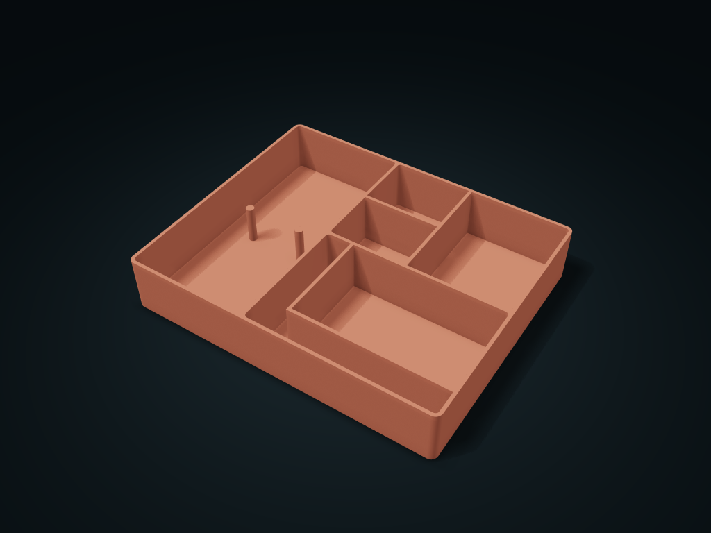

# Hair Accessory Return Tray

Place hair ties on posts, pins in an angled channel and claw clips separately; adjust post spacing, channel width and compartment ratio.

**[Preview this model and customize it on boxesmodel](https://boxesmodel.com/models/hair-routine-station)**

## Default model

| Property | Value |
| --- | --- |
| Category | Desktop Organizers |
| Model version | 1.0.0 |
| Default box size | 226 × 184 × 40 mm |
| Included parts | 1 |
| Formats | STL and STEP |
| Units | Millimeters |

Dimensions include the outer outline of the box; see the specifications for usable interior space.

## Intended use

- Hair ties, fine hairpins and claw clips, accessed separately on a vanity.
- For stationary desktop storage, not a carrying case or locking fixture. Internal features reduce usable space; allow for actual item dimensions, not brand assumptions.

## Dimensions and features

| Detail | Default value |
| --- | --- |
| Hair tie compartment boundary | 87.28 × 179.2 mm； The internal functional structure takes up extra space; check against your items' maximum envelope |
| Thin hairpin compartment boundary | 131.52 × 88.4 mm； The internal functional structure takes up extra space; check against your items' maximum envelope |
| Claw clip compartment boundary | 131.52 × 88.4 mm； The internal functional structure takes up extra space; check against your items' maximum envelope |

## Download the parts

Open a file below and choose **Download raw file** on GitHub. STL is for slicers; STEP is for CAD editing.

| Part | Dimensions | STL | STEP |
| --- | --- | --- | --- |
| Hair Accessory Return Tray | 226 × 184 × 40 mm | [body.stl](body.stl) | [body.step](body.step) |

Each listed part has its own STL and STEP file. Preview colors are illustrative; the manufacturing files do not contain the displayed colors.

## Printing and assembly

- On the dressing table, hair ties hang on posts, thin hairpins line up along the corner compartment and claw clips have their own zone.
- One-piece, no assembly hardware needed; the three functional zones share dividing walls. Items go in from above and lift out vertically; rod-like items lie across V-rests and flat pieces on twin rails or shoulders; do not treat the compartment's outer frame as all usable clearance.
- Print base down; open top with no closed bridges; the V-rests and sloped floors spread upward level by level. Set clearance by the measured maximum shape of your items; the surround tubes and rod rests do not assume brand fit.
- Preview colors are for reference only; you can print in a single color; open static desk storage; not a carry case or locking fixture.
- Units are millimeters. Check your printer, material and actual items before printing.
- Import at millimeter scale. Check your build volume, orientation, overhangs, supports and mating clearances in the slicer.

## Adjust the design

Visit the [interactive model page](https://boxesmodel.com/models/hair-routine-station) to inspect the 3D model and adjust the available dimensions and layout options. This folder contains the default-size export shown above; custom exports follow the options and pricing shown on boxesmodel.

## License and attribution

Copyright © 2026 boxesmodel. These model files, preview and description are licensed under [CC BY 4.0](https://creativecommons.org/licenses/by/4.0/). You may share, modify and use them commercially with the required attribution. See the [full license](../../LICENSE) and [attribution guide](../../ATTRIBUTION.md).

Suggested credit:

> “Hair Accessory Return Tray” by [boxesmodel](https://boxesmodel.com/models/hair-routine-station), licensed under [CC BY 4.0](https://creativecommons.org/licenses/by/4.0/). Indicate any changes you make.

[Browse all models](../../CATALOG.md) · [About the collection](../../README.md)
