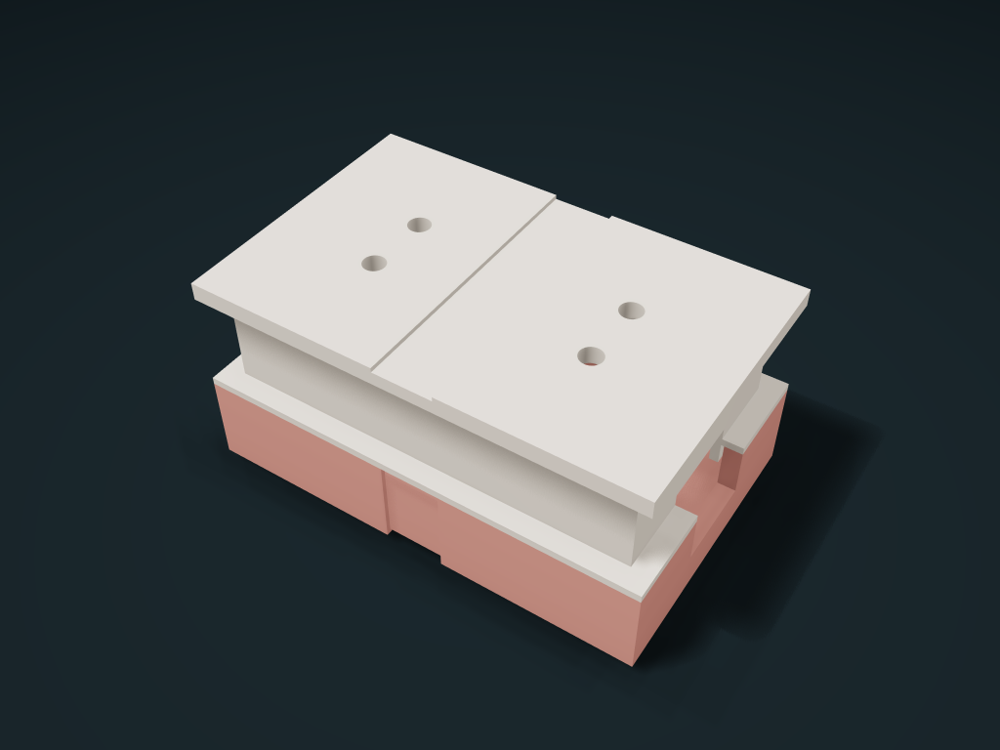

# Vented Brush Head Guard Box with Handle Opening

The brush back rests on two supports with the handle through the end opening; a lift-off lid located by a skirt and an elastic strap hold it, and top and bottom vent holes help drying.

**[Preview this model and customize it on boxesmodel](https://boxesmodel.com/models/handle-port-brush-pod)**

## Default model

| Property | Value |
| --- | --- |
| Category | Lidded Storage |
| Model version | 1.0.0 |
| Default assembly display size | 60 × 38 × 28 mm |
| Included parts | 2 |
| Formats | STL and STEP |
| Units | Millimeters |

Covers the layout of all parts in the current preview; see Files and dimensions for each part's print size.

## Dimensions and features

| Detail | Default value |
| --- | --- |
| Lid skirt inner clear length / width | 52 / 30 mm |
| Brush back support top / bristle top | 5.6 / 23.6 mm |
| Clear height under the lid / top allowance | 20 / 2 mm |
| Handle opening and outer strap | 12 × 9 mm / 8 mm wide |

## Download the parts

Open a file below and choose **Download raw file** on GitHub. STL is for slicers; STEP is for CAD editing.

| Part | Dimensions | STL | STEP |
| --- | --- | --- | --- |
| Brush back support and handle-through lower box | 60 × 38 × 12 mm | [body.stl](body.stl) | [body.step](body.step) |
| Vented located lift-off lid | 60 × 38 × 19 mm | [lift-cap.stl](lift-cap.stl) | [lift-cap.step](lift-cap.step) |

Each listed part has its own STL and STEP file. Preview colors are illustrative; the manufacturing files do not contain the displayed colors.

## Printing and assembly

- Manual toothbrush head maximum envelope 44 × 18 × 18 mm; the plastic back rests down on twin supports whose height follows the head height, with 2 mm above the bristles; fit is not assumed by brand.
- Handle opening 12 clear wide and 9 mm clear high, 1 mm less than the handle's maximum envelope each way; remove the strap, lift the lid straight up, place the toothbrush from above with the handle out through the end opening. 0.4 mm per side at the lid skirt, 3 mm insertion.
- Provide an 8 mm wide elastic strap separately to wrap along the recessed band for both parts; test the length and tension with real items; the locating skirt does not lock and cannot serve as a latch or seal. For travel, the protruding long handle should be restrained; the brush head has clearance and may touch the lid when upside down.
- Lower box base faces the bed; flip the lid top face down onto the plate in the slicer before printing, with the locating skirt up. Vents and bottom holes help drying but are no promise of sterility or waterproofing; clean and dry thoroughly before use.
- Mm; check slicing before printing; before use, check the real fit, strap retention and hygiene durability.
- Import at millimeter scale. Check your build volume, orientation, overhangs, supports and mating clearances in the slicer.

## Adjust the design

Visit the [interactive model page](https://boxesmodel.com/models/handle-port-brush-pod) to inspect the 3D model and adjust the available dimensions and layout options. This folder contains the default-size export shown above; custom exports follow the options and pricing shown on boxesmodel.

## License and attribution

Copyright © 2026 boxesmodel. These model files, preview and description are licensed under [CC BY 4.0](https://creativecommons.org/licenses/by/4.0/). You may share, modify and use them commercially with the required attribution. See the [full license](../../LICENSE) and [attribution guide](../../ATTRIBUTION.md).

Suggested credit:

> “Vented Brush Head Guard Box with Handle Opening” by [boxesmodel](https://boxesmodel.com/models/handle-port-brush-pod), licensed under [CC BY 4.0](https://creativecommons.org/licenses/by/4.0/). Indicate any changes you make.

[Browse all models](../../CATALOG.md) · [About the collection](../../README.md)
