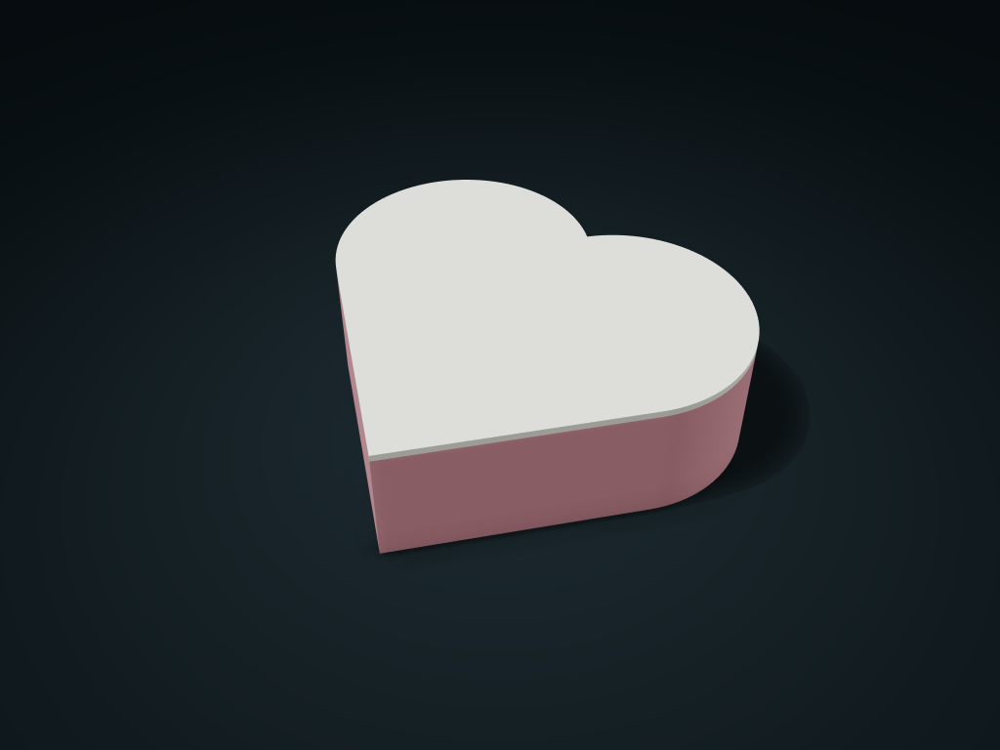

# Heart-Shaped Zoned Box

Store jewelry and keepsakes in one, two or three heart-shaped spaces; width follows length, and the three-space cross-divider can be positioned.

**[Preview this model and customize it on boxesmodel](https://boxesmodel.com/models/heart-keepsake-box)**

## Default model

| Property | Value |
| --- | --- |
| Category | Lidded Storage |
| Model version | 1.0.0 |
| Default assembly display size | 150 × 137.13 × 45 mm |
| Included parts | 2 |
| Formats | STL and STEP |
| Units | Millimeters |

Covers the layout of all parts in the current preview; see Files and dimensions for each part's print size.

## Intended use

- Jewelry and small keepsakes; the locating lid has no latch or seal. Check physical fit; cross-divider position only affects the three-space layout.

## Dimensions and features

| Detail | Default value |
| --- | --- |
| Actual zones | 3 |
| Usable depth under the lid | 36.8 mm |
| Divider position | 40% from the tip |

## Download the parts

Open a file below and choose **Download raw file** on GitHub. STL is for slicers; STEP is for CAD editing.

| Part | Dimensions | STL | STEP |
| --- | --- | --- | --- |
| Heart-shaped zoned box body | 150 × 137.13 × 42.6 mm | [box.stl](box.stl) | [box.step](box.step) |
| Heart-shaped locating lid | 150 × 137.13 × 5.4 mm | [lid.stl](lid.stl) | [lid.step](lid.step) |

Each listed part has its own STL and STEP file. Preview colors are illustrative; the manufacturing files do not contain the displayed colors.

## Printing and assembly

- Length is the outermost left-to-right distance, and width follows the heart proportions; wall thickness stays normal to the outline.
- The three-compartment divider position is measured from the tip of the heart; with one or two compartments, this position does not change the layout.
- The locating lid has a fixed 0.4 mm single-side clearance and 3 mm insertion, with no latch or seal; divider tops are below the lid.
- Box bottom down; lid locating face down; check the overhangs when slicing. Check the real fit before use.
- Import at millimeter scale. Check your build volume, orientation, overhangs, supports and mating clearances in the slicer.

## Adjust the design

Visit the [interactive model page](https://boxesmodel.com/models/heart-keepsake-box) to inspect the 3D model and adjust the available dimensions and layout options. This folder contains the default-size export shown above; custom exports follow the options and pricing shown on boxesmodel.

## License and attribution

Copyright © 2026 boxesmodel. These model files, preview and description are licensed under [CC BY 4.0](https://creativecommons.org/licenses/by/4.0/). You may share, modify and use them commercially with the required attribution. See the [full license](../../LICENSE) and [attribution guide](../../ATTRIBUTION.md).

Suggested credit:

> “Heart-Shaped Zoned Box” by [boxesmodel](https://boxesmodel.com/models/heart-keepsake-box), licensed under [CC BY 4.0](https://creativecommons.org/licenses/by/4.0/). Indicate any changes you make.

[Browse all models](../../CATALOG.md) · [About the collection](../../README.md)
