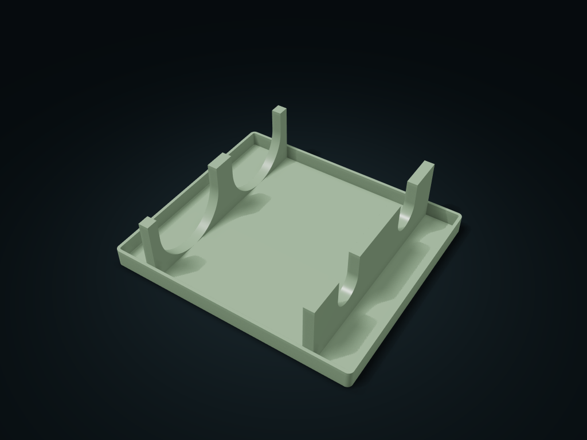

# Neck & Body Twin-Cradle Bottle Box

Coaxial twin cradles hold the bottle body and thin neck separately, and a heel stop limits backward movement.

**[Preview this model and customize it on boxesmodel](https://boxesmodel.com/models/heel-stop-bottle-cellar)**

## Default model

| Property | Value |
| --- | --- |
| Category | Open Storage |
| Model version | 1.0.0 |
| Default box size | 240 × 210 × 65 mm |
| Included parts | 1 |
| Formats | STL and STEP |
| Units | Millimeters |

Dimensions include the outer outline of the box; see the specifications for usable interior space.

## Dimensions and features

| Detail | Default value |
| --- | --- |
| Bottle positions / clear diameter | 2 positions / 80, 32 mm |
| Neck and body cradle center distance | 160 mm |
| Recommended total length with cap | ≤ 232 mm |
| Printed parts / purchased | 1 part / no required purchases |

## Download the parts

Open a file below and choose **Download raw file** on GitHub. STL is for slicers; STEP is for CAD editing.

| Part | Dimensions | STL | STEP |
| --- | --- | --- | --- |
| Coaxial neck and body cradles with a heel stop tray | 240 × 210 × 65 mm | [bed.stl](bed.stl) | [bed.step](bed.step) |

Each listed part has its own STL and STEP file. Preview colors are illustrative; the manufacturing files do not contain the displayed colors.

## Printing and assembly

- 1 complete printed part; nothing must be bought. Only for light round bottles that can lie horizontally and are sealed; check with empty bottles first; long-term loads of full glass bottles are not guaranteed.
- 2 lying bottle positions; bottle body/neck slots are 80/32 mm clear; recommended actual envelope diameters no more than 78/30 mm respectively. Both profiles have a nominal axis height of 43 mm; a real round bottle has 1 mm of radial play.
- The two support points are 160 mm apart with 10 mm axial support thickness; 192 mm from the inner face of the rear stop to the near side of the front rest. The bottle shoulder transition must end before the near side of the front cradle; only the thin neck is within the front cradle thickness.
- Recommended complete lidded bottle length ≤ 232 mm; maximum sideways envelope per position ≤ 98 mm. If the real bottle is longer, increase the outer length; checking the two diameters alone is not enough.
- Lower the bottle body and neck into their cradles together from above, with the heel against the rear stop and the label up; bottles lift straight up; neighboring positions do not need emptying. The rear stop limits backward movement; the front is not locked; rest horizontally only; do not carry, stack high or wall-mount.
- Print flat on its base with the cradles facing up. Check slicing and test-print before printing; before use, check the fit with your specific bottle shoulders, load, material creep and tip resistance; leave enough cabinet height and hand room for taking bottles.
- Import at millimeter scale. Check your build volume, orientation, overhangs, supports and mating clearances in the slicer.

## Adjust the design

Visit the [interactive model page](https://boxesmodel.com/models/heel-stop-bottle-cellar) to inspect the 3D model and adjust the available dimensions and layout options. This folder contains the default-size export shown above; custom exports follow the options and pricing shown on boxesmodel.

## License and attribution

Copyright © 2026 boxesmodel. These model files, preview and description are licensed under [CC BY 4.0](https://creativecommons.org/licenses/by/4.0/). You may share, modify and use them commercially with the required attribution. See the [full license](../../LICENSE) and [attribution guide](../../ATTRIBUTION.md).

Suggested credit:

> “Neck & Body Twin-Cradle Bottle Box” by [boxesmodel](https://boxesmodel.com/models/heel-stop-bottle-cellar), licensed under [CC BY 4.0](https://creativecommons.org/licenses/by/4.0/). Indicate any changes you make.

[Browse all models](../../CATALOG.md) · [About the collection](../../README.md)
