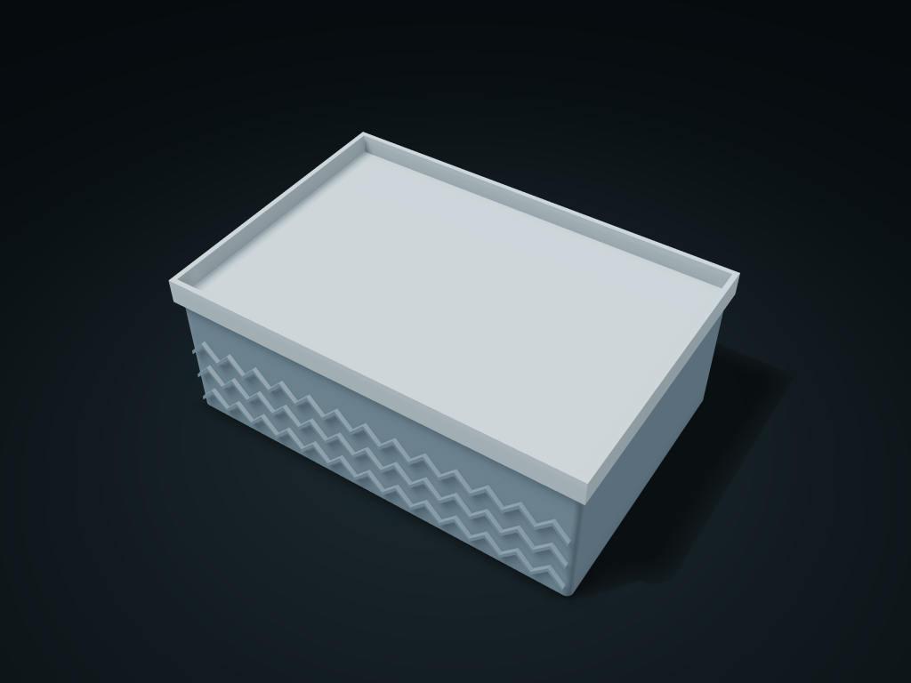

# Herringbone Weave Tray Lid Box

Sort stationery by compartment and use the lifted lid as a separate tray; adjust divider counts, tray rim height and lid clearance.

**[Preview this model and customize it on boxesmodel](https://boxesmodel.com/models/herringbone-tray-case)**

## Default model

| Property | Value |
| --- | --- |
| Category | Lidded Storage |
| Model version | 1.0.0 |
| Default assembly display size | 190 × 130 × 72 mm |
| Included parts | 2 |
| Formats | STL and STEP |
| Units | Millimeters |

Covers the layout of all parts in the current preview; see Files and dimensions for each part's print size.

## Intended use

- Stationery; the tray lid does not seal or lock for transport. Measure clearances for actual items.

## Download the parts

Open a file below and choose **Download raw file** on GitHub. STL is for slicers; STEP is for CAD editing.

| Part | Dimensions | STL | STEP |
| --- | --- | --- | --- |
| Textured divided box | 186 × 130 × 60.6 mm | [body.stl](body.stl) | [body.step](body.step) |
| Double-rimmed tray lid | 190 × 130 × 16.4 mm | [lid.stl](lid.stl) | [lid.step](lid.step) |

Each listed part has its own STL and STEP file. Preview colors are illustrative; the manufacturing files do not contain the displayed colors.

## Printing and assembly

- Box flat base down; check supports for the double-rimmed tray lid when slicing; flip it if needed. The lid rim inserts 5 mm vertically and lifts off; no screws; the inner dividers are lower than the locating rim. The tray lid can be used on its own; not for sealing or transport locking.
- Units are millimeters. Measure clearance from your actual items first; check slicing before printing and test-fit the key mating parts.
- Import at millimeter scale. Check your build volume, orientation, overhangs, supports and mating clearances in the slicer.

## Adjust the design

Visit the [interactive model page](https://boxesmodel.com/models/herringbone-tray-case) to inspect the 3D model and adjust the available dimensions and layout options. This folder contains the default-size export shown above; custom exports follow the options and pricing shown on boxesmodel.

## License and attribution

Copyright © 2026 boxesmodel. These model files, preview and description are licensed under [CC BY 4.0](https://creativecommons.org/licenses/by/4.0/). You may share, modify and use them commercially with the required attribution. See the [full license](../../LICENSE) and [attribution guide](../../ATTRIBUTION.md).

Suggested credit:

> “Herringbone Weave Tray Lid Box” by [boxesmodel](https://boxesmodel.com/models/herringbone-tray-case), licensed under [CC BY 4.0](https://creativecommons.org/licenses/by/4.0/). Indicate any changes you make.

[Browse all models](../../CATALOG.md) · [About the collection](../../README.md)
