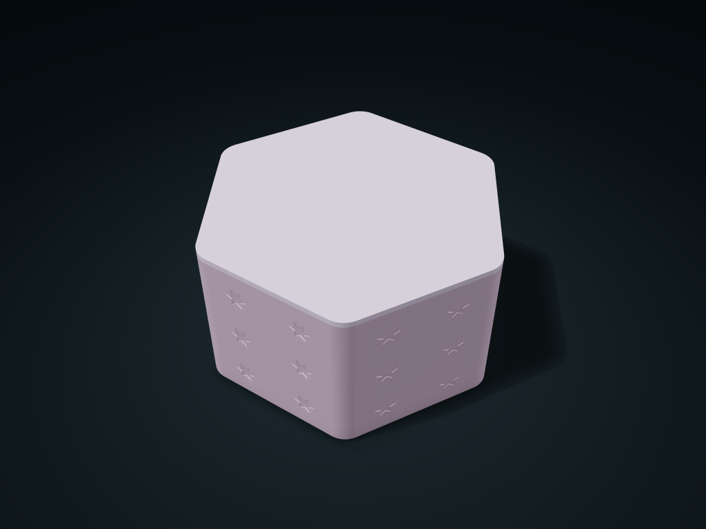

# Hexagonal Star Motif Lift-Off Case

Rounded hexagonal solid walls with shallow star motifs, a lift-off lid and optional compartments.

**[Preview this model and customize it on boxesmodel](https://boxesmodel.com/models/hex-rosette-lift-case)**

## Default model

| Property | Value |
| --- | --- |
| Category | Desktop Organizers |
| Model version | 1.0.0 |
| Default assembly display size | 156 × 138.32 × 82 mm |
| Included parts | 2 |
| Formats | STL and STEP |
| Units | Millimeters |

Covers the layout of all parts in the current preview; see Files and dimensions for each part's print size.

## Dimensions and features

| Detail | Default value |
| --- | --- |
| Minimum internal distance across flats | 132.7 mm |
| Ring clearance per side | 0.45 mm |
| Number of inner compartments | 1 compartment |

## Download the parts

Open a file below and choose **Download raw file** on GitHub. STL is for slicers; STEP is for CAD editing.

| Part | Dimensions | STL | STEP |
| --- | --- | --- | --- |
| Hexagonal Star Motif Body | 156 × 138.32 × 79.2 mm | [body.stl](body.stl) | [body.step](body.step) |
| Hexagonal Ring Lift-Off Lid | 156 × 138.32 × 6.8 mm | [lid.stl](lid.stl) | [lid.step](lid.step) |

Each listed part has its own STL and STEP file. Preview colors are illustrative; the manufacturing files do not contain the displayed colors.

## Printing and assembly

- Load and remove items from above. Measure the widest item envelope and leave handling clearance; corners, dividers and curved walls occupy interior space.
- Two parts form the kit. The ring inserts vertically by 4 mm and the lid rests on the rim; lift upwards to remove. Shallow star motifs do not pierce the wall. The lid is neither sealed nor locked.
- Print the body base down. In the slicer, orient the lid with its flat outer face down and ring up. Test the clearance first.
- All custom parts are included in the download; no purchased parts are required. Preview colors are for display only; manufacturing STL/STEP files are uncolored.
- Check overhangs, supports and fit before printing; support-free printing, load capacity, sealing and food-contact safety are not promised.
- Import at millimeter scale. Check your build volume, orientation, overhangs, supports and mating clearances in the slicer.

## Adjust the design

Visit the [interactive model page](https://boxesmodel.com/models/hex-rosette-lift-case) to inspect the 3D model and adjust the available dimensions and layout options. This folder contains the default-size export shown above; custom exports follow the options and pricing shown on boxesmodel.

## License and attribution

Copyright © 2026 boxesmodel. These model files, preview and description are licensed under [CC BY 4.0](https://creativecommons.org/licenses/by/4.0/). You may share, modify and use them commercially with the required attribution. See the [full license](../../LICENSE) and [attribution guide](../../ATTRIBUTION.md).

Suggested credit:

> “Hexagonal Star Motif Lift-Off Case” by [boxesmodel](https://boxesmodel.com/models/hex-rosette-lift-case), licensed under [CC BY 4.0](https://creativecommons.org/licenses/by/4.0/). Indicate any changes you make.

[Browse all models](../../CATALOG.md) · [About the collection](../../README.md)
