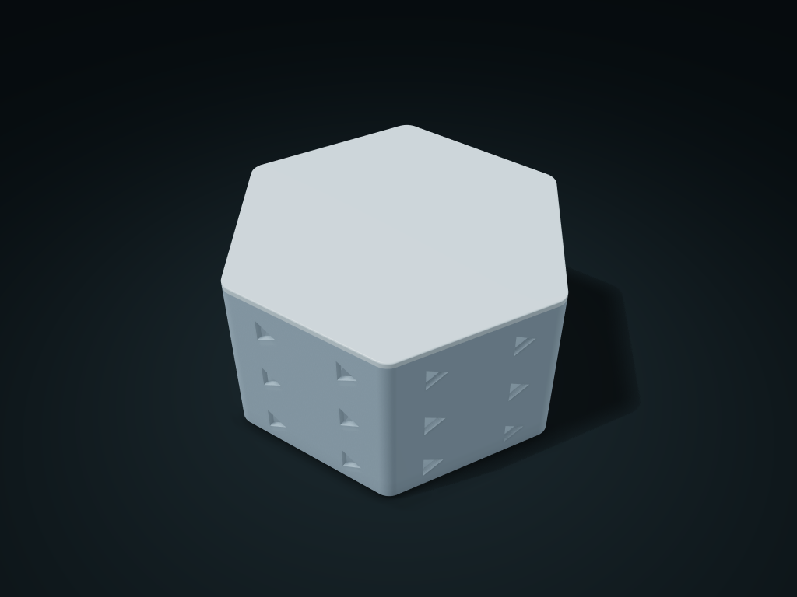

# Hex Triangle Window Lift Lid Box

A hexagonal box with triangular windows and an integral locating-ring lid, with an optional two-compartment interior

**[Preview this model and customize it on boxesmodel](https://boxesmodel.com/models/hex-triangle-lift-box)**

## Default model

| Property | Value |
| --- | --- |
| Category | Desktop Organizers |
| Model version | 1.0.0 |
| Default assembly display size | 160 × 140.71 × 85 mm |
| Included parts | 2 |
| Formats | STL and STEP |
| Units | Millimeters |

Covers the layout of all parts in the current preview; see Files and dimensions for each part's print size.

## Dimensions and features

| Detail | Default value |
| --- | --- |
| Minimum internal distance across flats | 135.1 mm |
| Ring clearance per side | 0.40 mm |
| Number of compartments | 2 compartments |

## Download the parts

Open a file below and choose **Download raw file** on GitHub. STL is for slicers; STEP is for CAD editing.

| Part | Dimensions | STL | STEP |
| --- | --- | --- | --- |
| Triangle Window Hex Body | 160 × 140.71 × 82.2 mm | [body.stl](body.stl) | [body.step](body.step) |
| Lift-off lid with integrated locating ring | 160 × 140.71 × 6.8 mm | [lid.stl](lid.stl) | [lid.step](lid.step) |

Each listed part has its own STL and STEP file. Preview colors are illustrative; the manufacturing files do not contain the displayed colors.

## Printing and assembly

- Two parts: the body and a lift-off lid with an integral locating ring. Lower the ring vertically into the opening and lift the lid to access contents; there are no threads, snap catches, or separate pins.
- Print the body with its bottom down. Flip the lid in the slicer so its complete outer face rests on the bed and the locating ring points up. Test the fit clearance first.
- The lid rests directly on the rim with its locating ring inserted 4 mm. It provides no transport lock, airtight seal, or waterproofing.
- Insert and remove items from above, leaving handling clearance within the actual usable space. Use an inner pouch for items smaller than the windows; do not hold liquids or food directly.
- All custom parts are included in the download; no purchased hardware is required. Preview colors are for display only; the STL/STEP manufacturing files contain no colors.
- Check overhangs, supports, and actual fit before printing; no support-free, load-bearing, sealing, or food-contact safety claim is made.
- Rounded edges are part of the manufacturing geometry and change with the style parameters. Allow for curved corners when checking usable space; use the generated model for actual external dimensions.
- Import at millimeter scale. Check your build volume, orientation, overhangs, supports and mating clearances in the slicer.

## Adjust the design

Visit the [interactive model page](https://boxesmodel.com/models/hex-triangle-lift-box) to inspect the 3D model and adjust the available dimensions and layout options. This folder contains the default-size export shown above; custom exports follow the options and pricing shown on boxesmodel.

## License and attribution

Copyright © 2026 boxesmodel. These model files, preview and description are licensed under [CC BY 4.0](https://creativecommons.org/licenses/by/4.0/). You may share, modify and use them commercially with the required attribution. See the [full license](../../LICENSE) and [attribution guide](../../ATTRIBUTION.md).

Suggested credit:

> “Hex Triangle Window Lift Lid Box” by [boxesmodel](https://boxesmodel.com/models/hex-triangle-lift-box), licensed under [CC BY 4.0](https://creativecommons.org/licenses/by/4.0/). Indicate any changes you make.

[Browse all models](../../CATALOG.md) · [About the collection](../../README.md)
