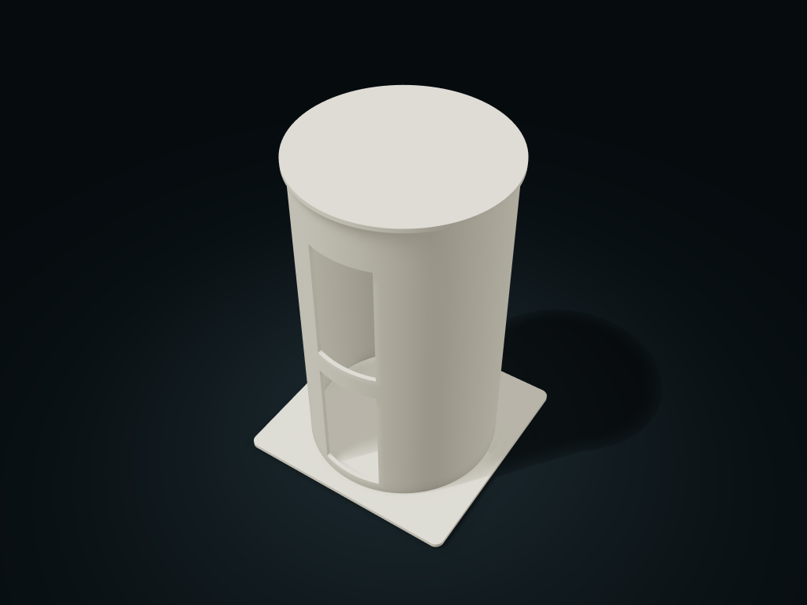

# Windowed Spare Toilet Roll Cover Box

A complete spare paper roll stands upright; lift the lid to refill and check what is left through the side window.

**[Preview this model and customize it on boxesmodel](https://boxesmodel.com/models/hooded-roll-reserve)**

## Default model

| Property | Value |
| --- | --- |
| Category | Lidded Storage |
| Model version | 1.0.0 |
| Default assembly display size | 160 × 160 × 240 mm |
| Included parts | 2 |
| Formats | STL and STEP |
| Units | Millimeters |

Covers the layout of all parts in the current preview; see Files and dimensions for each part's print size.

## Dimensions and features

| Detail | Default value |
| --- | --- |
| Roll compartment clear diameter / clear height | Ø130 / 228 mm |
| Full roll capacity | 2 rolls (each roll 105 mm tall) |
| Viewing window clear width and height | 44 × 89 mm |
| Printed parts / purchased | 2 parts / no required purchases |

## Download the parts

Open a file below and choose **Download raw file** on GitHub. STL is for slicers; STEP is for CAD editing.

| Part | Dimensions | STL | STEP |
| --- | --- | --- | --- |
| Round tube with viewing windows and wide base | 160 × 160 × 237 mm | [canister.stl](canister.stl) | [canister.step](canister.step) |
| Lift-off lid with round locating lip | 142 × 142 × 9 mm | [lid.stl](lid.stl) | [lid.step](lid.step) |

Each listed part has its own STL and STEP file. Preview colors are illustrative; the manufacturing files do not contain the displayed colors.

## Printing and assembly

- 2 complete printed parts: one-piece tube base and lipped lift-off lid. No tubing, axles, screws or glue to buy. For storing spare full rolls; not a tissue or paper dispenser.
- The round compartment is 130 mm clear inside; recommended maximum roll outer diameter 128 mm; clear height with the lid is 228 mm; with each roll measured at 105 mm plus 2 mm overall top allowance, it holds 2 full rolls. Leave extra allowance for the loose outer envelope of the paper.
- Each roll has a 44 mm wide, 89 mm tall viewing window starting 11 mm from the bottom; windows rearrange with the single roll height. The window is for checking stock; do not force a whole roll out through it.
- The lid lip is 6 mm deep with 0.4 mm radial single-side clearance, leaving space between the lid bottom and the top of the rolls. Lift the top lid, then take or add rolls straight up one at a time; leave extra roll height and hand space above
- Place the base on a level, dry surface; the viewing window is not waterproof or sealed; do not carry the whole box by the lid. Print base down on the bed; the lid can be flipped top down; check slicing supports before printing; before use, check the actual fit and leak resistance.
- Import at millimeter scale. Check your build volume, orientation, overhangs, supports and mating clearances in the slicer.

## Adjust the design

Visit the [interactive model page](https://boxesmodel.com/models/hooded-roll-reserve) to inspect the 3D model and adjust the available dimensions and layout options. This folder contains the default-size export shown above; custom exports follow the options and pricing shown on boxesmodel.

## License and attribution

Copyright © 2026 boxesmodel. These model files, preview and description are licensed under [CC BY 4.0](https://creativecommons.org/licenses/by/4.0/). You may share, modify and use them commercially with the required attribution. See the [full license](../../LICENSE) and [attribution guide](../../ATTRIBUTION.md).

Suggested credit:

> “Windowed Spare Toilet Roll Cover Box” by [boxesmodel](https://boxesmodel.com/models/hooded-roll-reserve), licensed under [CC BY 4.0](https://creativecommons.org/licenses/by/4.0/). Indicate any changes you make.

[Browse all models](../../CATALOG.md) · [About the collection](../../README.md)
