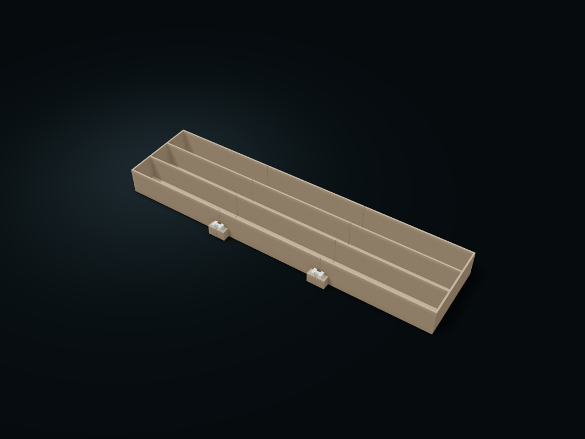

# Joined Long Channel Tray

Short box sections join into a long box, with the overlapping floor keeping support; connecting keys stand vertically on both sides with matching lengthwise columns.

**[Preview this model and customize it on boxesmodel](https://boxesmodel.com/models/joined-channel-tray)**

## Default model

| Property | Value |
| --- | --- |
| Category | Desktop Organizers |
| Model version | 1.0.0 |
| Default assembly display size | 451.2 × 130 × 38 mm |
| Included parts | 7 |
| Formats | STL and STEP |
| Units | Millimeters |

Covers the layout of all parts in the current preview; see Files and dimensions for each part's print size.

## Dimensions and features

| Detail | Default value |
| --- | --- |
| Number of joined sections | 3 segments / 4 keys |
| Through columns | 3 columns / clear width 33.5 mm |
| Total assembled length | 451.2 mm |
| Maximum box section length | 156.6 mm |
| Overlapping floor at the seam | 6 mm, vertical clearance 0.4 mm |

## Download the parts

Open a file below and choose **Download raw file** on GitHub. STL is for slicers; STEP is for CAD editing.

| Part | Dimensions | STL | STEP |
| --- | --- | --- | --- |
| Joined box section 1 | 156.6 × 130 × 38 mm | [section-1.stl](section-1.stl) | [section-1.step](section-1.step) |
| Joined box section 2 | 156.6 × 130 × 38 mm | [section-2.stl](section-2.stl) | [section-2.step](section-2.step) |
| Joined box section 3 | 150 × 130 × 38 mm | [section-3.stl](section-3.stl) | [section-3.step](section-3.step) |
| Vertical connecting key 1 | 14 × 8 × 16 mm | [key-1.stl](key-1.stl) | [key-1.step](key-1.step) |
| Vertical connecting key 2 | 14 × 8 × 16 mm | [key-2.stl](key-2.stl) | [key-2.step](key-2.step) |
| Vertical connecting key 3 | 14 × 8 × 16 mm | [key-3.stl](key-3.stl) | [key-3.step](key-3.step) |
| Vertical connecting key 4 | 14 × 8 × 16 mm | [key-4.stl](key-4.stl) | [key-4.step](key-4.step) |

Each listed part has its own STL and STEP file. Preview colors are illustrative; the manufacturing files do not contain the displayed colors.

## Printing and assembly

- Lay each section flat, slide the lower overlap tongue into the recess under the next section, then insert the connecting keys on both sides of the seam from above; to take it apart, lift the keys straight out first, then separate horizontally.
- Lengthwise columns line up across sections, with 0.6 mm at the seams; the base plates overlap each other; not sealed for liquids or powders, and not Gridfinity compatible.
- Only for horizontal drawers or desks with a flat base; connecting keys sit by gravity with no anti-inversion lock; support the whole bottom when moving it. Slice each section base down; the receiving recess overhangs and needs a support check; test-print to check the real fit and load-bearing first.
- Import at millimeter scale. Check your build volume, orientation, overhangs, supports and mating clearances in the slicer.

## Adjust the design

Visit the [interactive model page](https://boxesmodel.com/models/joined-channel-tray) to inspect the 3D model and adjust the available dimensions and layout options. This folder contains the default-size export shown above; custom exports follow the options and pricing shown on boxesmodel.

## License and attribution

Copyright © 2026 boxesmodel. These model files, preview and description are licensed under [CC BY 4.0](https://creativecommons.org/licenses/by/4.0/). You may share, modify and use them commercially with the required attribution. See the [full license](../../LICENSE) and [attribution guide](../../ATTRIBUTION.md).

Suggested credit:

> “Joined Long Channel Tray” by [boxesmodel](https://boxesmodel.com/models/joined-channel-tray), licensed under [CC BY 4.0](https://creativecommons.org/licenses/by/4.0/). Indicate any changes you make.

[Browse all models](../../CATALOG.md) · [About the collection](../../README.md)
