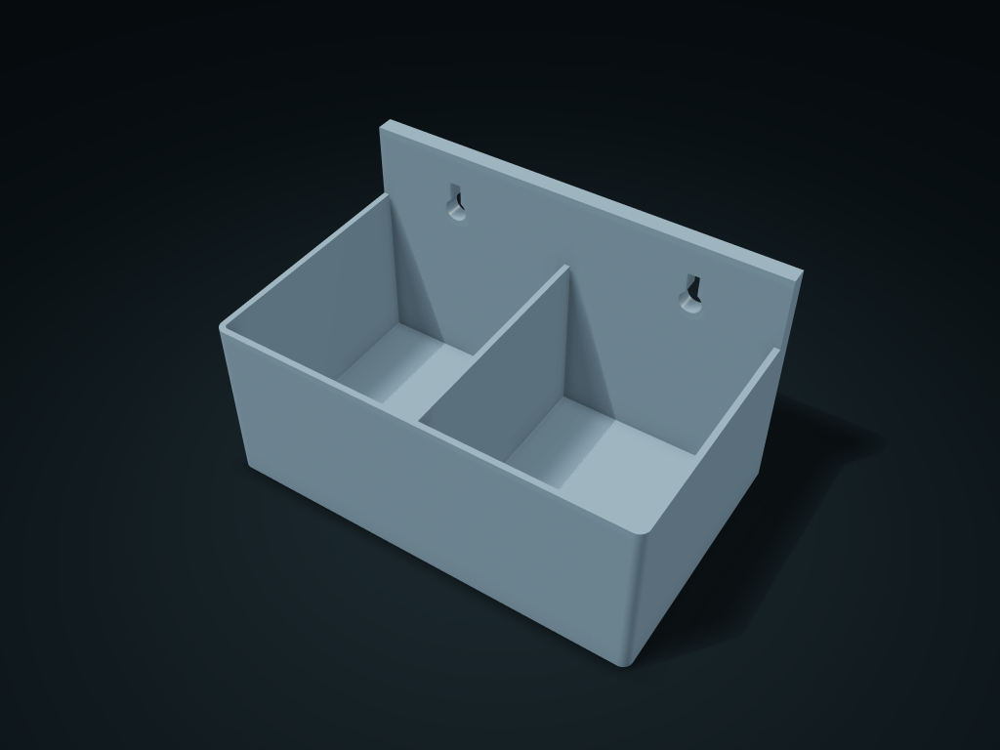

# Keyhole Wall-Mount Column Box

Mount the compartment bin over screw heads and lower to hang; lift and pull away to remove. Configure mounting spacing, holes and dividers.

**[Preview this model and customize it on boxesmodel](https://boxesmodel.com/models/keyhole-wall-bin)**

## Default model

| Property | Value |
| --- | --- |
| Category | Desktop Organizers |
| Model version | 1.0.0 |
| Default box size | 170 × 105 × 100 mm |
| Included parts | 1 |
| Formats | STL and STEP |
| Units | Millimeters |

Dimensions include the outer outline of the box; see the specifications for usable interior space.

## Intended use

- Choose items for actual compartment clearances; confirm substrate, screw length and anchoring. The reference records no load trial.
- Supply two substrate-appropriate round-head screws: shanks narrower than slots, heads wider than slots but smaller than entry holes. Leave about 7.5 mm under the heads.

## Dimensions and features

| Detail | Default value |
| --- | --- |
| Use | Screw heads go into two large holes and drop into narrow slots for a removable hang mount |

## Download the parts

Open a file below and choose **Download raw file** on GitHub. STL is for slicers; STEP is for CAD editing.

| Part | Dimensions | STL | STEP |
| --- | --- | --- | --- |
| Keyhole Wall-Mount Column Box | 170 × 105 × 100 mm | [body.stl](body.stl) | [body.step](body.step) |

Each listed part has its own STL and STEP file. Preview colors are illustrative; the manufacturing files do not contain the displayed colors.

## Printing and assembly

- Supply two round-head screws that suit the mounting surface: shank smaller than the narrow slot, head larger than the slot and smaller than the large hole; about 7.5 mm of assembly space is left under the screw head.
- Line the large holes up with the screw heads, push in, then move the box down so the shanks enter the upper narrow slots; lift, then take it off outward. Confirm the mounting substrate, screw length and anchoring yourself; no load testing has been done.
- Import at millimeter scale. Check your build volume, orientation, overhangs, supports and mating clearances in the slicer.

## Adjust the design

Visit the [interactive model page](https://boxesmodel.com/models/keyhole-wall-bin) to inspect the 3D model and adjust the available dimensions and layout options. This folder contains the default-size export shown above; custom exports follow the options and pricing shown on boxesmodel.

## License and attribution

Copyright © 2026 boxesmodel. These model files, preview and description are licensed under [CC BY 4.0](https://creativecommons.org/licenses/by/4.0/). You may share, modify and use them commercially with the required attribution. See the [full license](../../LICENSE) and [attribution guide](../../ATTRIBUTION.md).

Suggested credit:

> “Keyhole Wall-Mount Column Box” by [boxesmodel](https://boxesmodel.com/models/keyhole-wall-bin), licensed under [CC BY 4.0](https://creativecommons.org/licenses/by/4.0/). Indicate any changes you make.

[Browse all models](../../CATALOG.md) · [About the collection](../../README.md)
