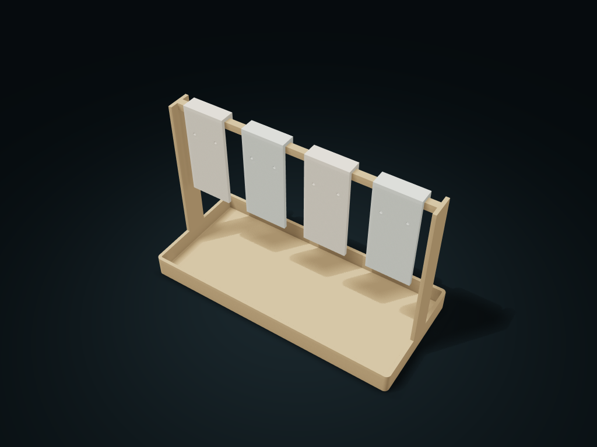

# Lift-Card Earring Holder

Mount each light earring pair on its own removable card, leaving others in place; keep backs below. Adjust card count, size and hole spacing.

**[Preview this model and customize it on boxesmodel](https://boxesmodel.com/models/lift-card-earring-caddy)**

## Default model

| Property | Value |
| --- | --- |
| Category | Desktop Organizers |
| Model version | 1.0.0 |
| Default assembly display size | 220 × 100 × 150 mm |
| Included parts | 5 |
| Formats | STL and STEP |
| Units | Millimeters |

Covers the layout of all parts in the current preview; see Files and dimensions for each part's print size.

## Intended use

- Light earrings; suggested drop ≤104 mm, pair width <32 mm and front and rear depth each <36 mm. Size holes for posts or hooks; backs may not pass. Remove cards before loading.
- Lift the card 12 mm before moving forward; leave at least 15 mm and finger space above. No transport lock; never carry the whole box by a card. Check fit, weight support and tipping resistance before use.

## Dimensions and features

| Detail | Default value |
| --- | --- |
| Paired storage positions | 4 pairs / 5 printed parts |
| Perforation / center distance | Ø2.4 / 20 mm |
| Recommended maximum earring drop length | 104 mm |
| Inverted catch single-side clearance | 0.4 mm |

## Download the parts

Open a file below and choose **Download raw file** on GitHub. STL is for slicers; STEP is for CAD editing.

| Part | Dimensions | STL | STEP |
| --- | --- | --- | --- |
| Shallow box and hanging card gantry | 220 × 100 × 147 mm | [frame.stl](frame.stl) | [frame.step](frame.step) |
| Paired earring hanging card 1 | 36 × 12.8 × 80 mm | [card_1.stl](card_1.stl) | [card_1.step](card_1.step) |
| Paired earring hanging card 2 | 36 × 12.8 × 80 mm | [card_2.stl](card_2.stl) | [card_2.step](card_2.step) |
| Paired earring hanging card 3 | 36 × 12.8 × 80 mm | [card_3.stl](card_3.stl) | [card_3.step](card_3.step) |
| Paired earring hanging card 4 | 36 × 12.8 × 80 mm | [card_4.stl](card_4.stl) | [card_4.step](card_4.step) |

Each listed part has its own STL and STEP file. Preview colors are illustrative; the manufacturing files do not contain the displayed colors.

## Printing and assembly

- 5 complete printed parts: 1 one-piece gantry base tray and 4 inverted hanging cards; no required purchased axles, screws or glue.
- Each hanging card holds one pair of light earrings, with 20 mm between the two holes and 2.4 mm hole diameter. Choose holes by the measured earring post/hook; not every earring back is guaranteed to pass; remove the hanging card first, then fit the earrings.
- Clear height from below the hole positions to the tray rim is 109 mm; recommended hanging length no more than 104 mm. Each pair's sideways envelope under 32 mm and front-to-back depth under 36 mm, so they do not touch neighboring cards or the gantry.
- The inverted catch slot is 6.8 mm clear, matching a 6 mm square beam with 0.4 mm per side. Lower it from above until the top shoulder sits on the beam; to remove, lift the whole plate 12 mm and slide it forward; leave at least 15 mm above plus room for fingers.
- The hanging cards need no long through axle; other hanging cards can stay in place. No transport lock; do not carry the whole box by the hanging cards; the base tray is for earring backs and small trinkets.
- Gantry flat base down; slicing the hanging cards front face down is recommended, checking the inverted catch overhangs; the crossbar also needs a support check. Before use, check slicing, real fit, load-bearing and tip resistance.
- Default light apricot base tray, with alternating cream and coral hanging cards; optional haze blue base with light gray and cream.
- Import at millimeter scale. Check your build volume, orientation, overhangs, supports and mating clearances in the slicer.

## Adjust the design

Visit the [interactive model page](https://boxesmodel.com/models/lift-card-earring-caddy) to inspect the 3D model and adjust the available dimensions and layout options. This folder contains the default-size export shown above; custom exports follow the options and pricing shown on boxesmodel.

## License and attribution

Copyright © 2026 boxesmodel. These model files, preview and description are licensed under [CC BY 4.0](https://creativecommons.org/licenses/by/4.0/). You may share, modify and use them commercially with the required attribution. See the [full license](../../LICENSE) and [attribution guide](../../ATTRIBUTION.md).

Suggested credit:

> “Lift-Card Earring Holder” by [boxesmodel](https://boxesmodel.com/models/lift-card-earring-caddy), licensed under [CC BY 4.0](https://creativecommons.org/licenses/by/4.0/). Indicate any changes you make.

[Browse all models](../../CATALOG.md) · [About the collection](../../README.md)
