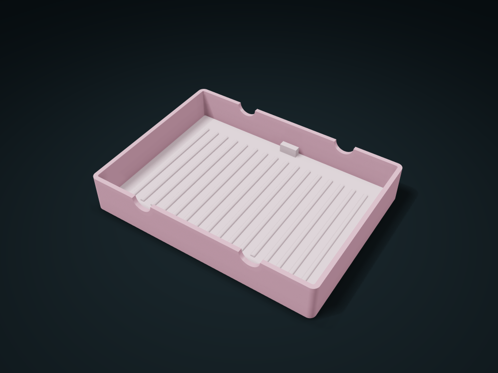

# Lift-Mat Textured Brush Shallow Box

Sweep bristles gently over the lift-out ribbed mat and rest handles briefly in slots. Remove, rinse and dry the mat; adjust rib spacing and slots.

**[Preview this model and customize it on boxesmodel](https://boxesmodel.com/models/lift-mat-brush-basin)**

## Default model

| Property | Value |
| --- | --- |
| Category | Open Storage |
| Model version | 1.0.0 |
| Default assembly display size | 150 × 110 × 25 mm |
| Included parts | 2 |
| Formats | STL and STEP |
| Units | Millimeters |

Covers the layout of all parts in the current preview; see Files and dimensions for each part's print size.

## Intended use

- Default handle limit is 12 mm; straight handles must span the 110 mm outer width with extra support at both ends. Check brush-head position. For brief resting, not hanging brushes upside down.
- Keep liquid below the 18.4 mm slot opening; not for long-term liquid storage. After use, lift out the mat, clean underneath and between ribs, and dry fully.
- No cleaning-efficiency, disinfection or skin-use suitability claim. Check printed layer roughness, cleaning-liquid compatibility, hygiene and leakage with a trial print.

## Dimensions and features

| Detail | Default value |
| --- | --- |
| Number of scrubbing ribs / clear groove spacing | 16 / 4.8 mm |
| Brush handle rests / clear hole diameter | 2 / 13.2 mm |
| Bottom mat lift tab | Rear 12 × 4 × 8 mm |
| Lowest static overflow height at the slot openings | 18.4 mm |

## Download the parts

Open a file below and choose **Download raw file** on GitHub. STL is for slicers; STEP is for CAD editing.

| Part | Dimensions | STL | STEP |
| --- | --- | --- | --- |
| Shallow basin with a flat brush handle slot | 150 × 110 × 25 mm | [body.stl](body.stl) | [body.step](body.step) |
| Lift-out dome-textured mat | 143.2 × 103.2 × 8 mm | [mat.stl](mat.stl) | [mat.step](mat.step) |

Each listed part has its own STL and STEP file. Preview colors are illustrative; the manufacturing files do not contain the displayed colors.

## Printing and assembly

- The bottom mat has 16 domed ribs, 1.6 mm tall and 8 mm apart; for light brushing only; no cleaning efficiency, disinfection or skin use suitability is claimed.
- 2 pairs of coaxial brush handle slots, maximum diameter 12 mm; the straight rod must span at least the 110 mm outer width with extra support at both ends; check brush head positions against real items. For temporary resting only; not for hanging brushes upside down to dry.
- The lowest point of the slot openings is 18.4 mm high; the liquid level must stay below it; check printed parts for leaks before use; do not store liquids long term.
- A rear lift tab takes out the bottom mat, with a 0.6 mm per side sliding fit; after use, lift the mat out, clean the base and the gaps between the round ribs separately, and let them dry fully.
- The basin and mat print flat side down separately; the mat can be tried in suitable filaments; first check layer roughness and cleaner compatibility; check cleaning, hygiene and leakage before use.
- Import at millimeter scale. Check your build volume, orientation, overhangs, supports and mating clearances in the slicer.

## Adjust the design

Visit the [interactive model page](https://boxesmodel.com/models/lift-mat-brush-basin) to inspect the 3D model and adjust the available dimensions and layout options. This folder contains the default-size export shown above; custom exports follow the options and pricing shown on boxesmodel.

## License and attribution

Copyright © 2026 boxesmodel. These model files, preview and description are licensed under [CC BY 4.0](https://creativecommons.org/licenses/by/4.0/). You may share, modify and use them commercially with the required attribution. See the [full license](../../LICENSE) and [attribution guide](../../ATTRIBUTION.md).

Suggested credit:

> “Lift-Mat Textured Brush Shallow Box” by [boxesmodel](https://boxesmodel.com/models/lift-mat-brush-basin), licensed under [CC BY 4.0](https://creativecommons.org/licenses/by/4.0/). Indicate any changes you make.

[Browse all models](../../CATALOG.md) · [About the collection](../../README.md)
