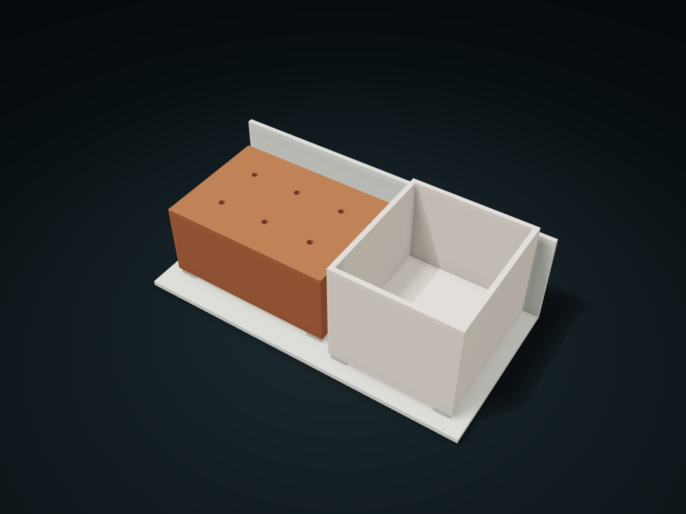

# Lift-Out Hole Box Rotary Tool Station

Bit diameter sets a sparse hole pitch; lift the whole box away to change workspaces, and the loose-part bag compartment comes off separately; located by four posts and supported by ring shoulders.

**[Preview this model and customize it on boxesmodel](https://boxesmodel.com/models/lift-out-rotary-service-dock)**

## Default model

| Property | Value |
| --- | --- |
| Category | Desktop Organizers |
| Model version | 1.0.0 |
| Default assembly display size | 200 × 100 × 70 mm |
| Included parts | 3 |
| Formats | STL and STEP |
| Units | Millimeters |

Covers the layout of all parts in the current preview; see Files and dimensions for each part's print size.

## Dimensions and features

| Detail | Default value |
| --- | --- |
| Printed parts BOM | 1 service seat / 1 blind-hole box / 1 loose-parts bag compartment |
| Purchased parts | No assembly hardware needed |
| Handle hole / insertion depth | 3.6 / 20 mm |
| Maximum bit diameter / hole pitch | 24 / 30 mm |
| Lift-off release travel | 7 mm； Z not locked |

## Download the parts

Open a file below and choose **Download raw file** on GitHub. STL is for slicers; STEP is for CAD editing.

| Part | Dimensions | STL | STEP |
| --- | --- | --- | --- |
| Four-shoulder locating service seat | 200 × 100 × 60 mm | [dock.stl](dock.stl) | [dock.step](dock.step) |
| Sparse blind-hole lift-out box | 102 × 72 × 45 mm | [cassette.stl](cassette.stl) | [cassette.step](cassette.step) |
| Lift-out loose parts bag compartment | 74 × 84 × 63 mm | [bin.stl](bin.stl) | [bin.step](bin.step) |

Each listed part has its own STL and STEP file. Preview colors are illustrative; the manufacturing files do not contain the displayed colors.

## Printing and assembly

- 3 printed parts in the set: 1 service seat, 1 blind-hole box and 1 loose-parts bag compartment; no assembly hardware to buy. For static desk use; no wall mounting or carry locking is provided.
- Full-load reference: 2 × 3 rotary tool accessories, shank maximum diameter 3.2 mm, shank length 32 mm, head maximum diameter 24 mm, height 14 mm; these are measurement assumptions, not brand fit. After the handle inserts 20 mm it rests on the hole bottom; the head must stick out to be gripped.
- Hole centers 30 mm apart, leaving 6 mm between the largest heads; the hole box is 102 × 72 mm wide/deep, driven by head diameter and number of columns. Loose-parts compartment 68 × 78 mm clear wide/deep, 9 mm floor.
- Loose parts reference: a closed sanding ring bag 45 × 28 × 25 mm and a polishing cotton tin Ø20 × 20 mm, loaded and unloaded from above; the loose-parts compartment is not a washing/drain container.
- Line each box up with its own four posts from directly above and lower it straight onto the four ring shoulders; bottom hole Ø6.8, post Ø6 × 6, hole depth 6.4 mm; the bottom holes do not go through. To take out a box, lift at least 7 mm first, then move it forward; the handled box can be carried away together with its accessories.
- Locating posts only limit sideways movement and do not lock lifting; part spacing in the preview is not part of the manufacturing size. Test-print the 0.4 mm nominal single-side clearance first; no tip stability, retention or load-bearing is claimed.
- Service seat and loose-parts compartment base down; flip the hole box top plate down in the slicer so the open-bottom frame and blind tubes grow upward, and check the closing layers of the small holes. The hole box is a thin-walled open-bottom frame with separate blind tubes, not a large solid block. Check slicing first, and test-print a small sample of the same hole-and-post interface.
- Import at millimeter scale. Check your build volume, orientation, overhangs, supports and mating clearances in the slicer.

## Adjust the design

Visit the [interactive model page](https://boxesmodel.com/models/lift-out-rotary-service-dock) to inspect the 3D model and adjust the available dimensions and layout options. This folder contains the default-size export shown above; custom exports follow the options and pricing shown on boxesmodel.

## License and attribution

Copyright © 2026 boxesmodel. These model files, preview and description are licensed under [CC BY 4.0](https://creativecommons.org/licenses/by/4.0/). You may share, modify and use them commercially with the required attribution. See the [full license](../../LICENSE) and [attribution guide](../../ATTRIBUTION.md).

Suggested credit:

> “Lift-Out Hole Box Rotary Tool Station” by [boxesmodel](https://boxesmodel.com/models/lift-out-rotary-service-dock), licensed under [CC BY 4.0](https://creativecommons.org/licenses/by/4.0/). Indicate any changes you make.

[Browse all models](../../CATALOG.md) · [About the collection](../../README.md)
