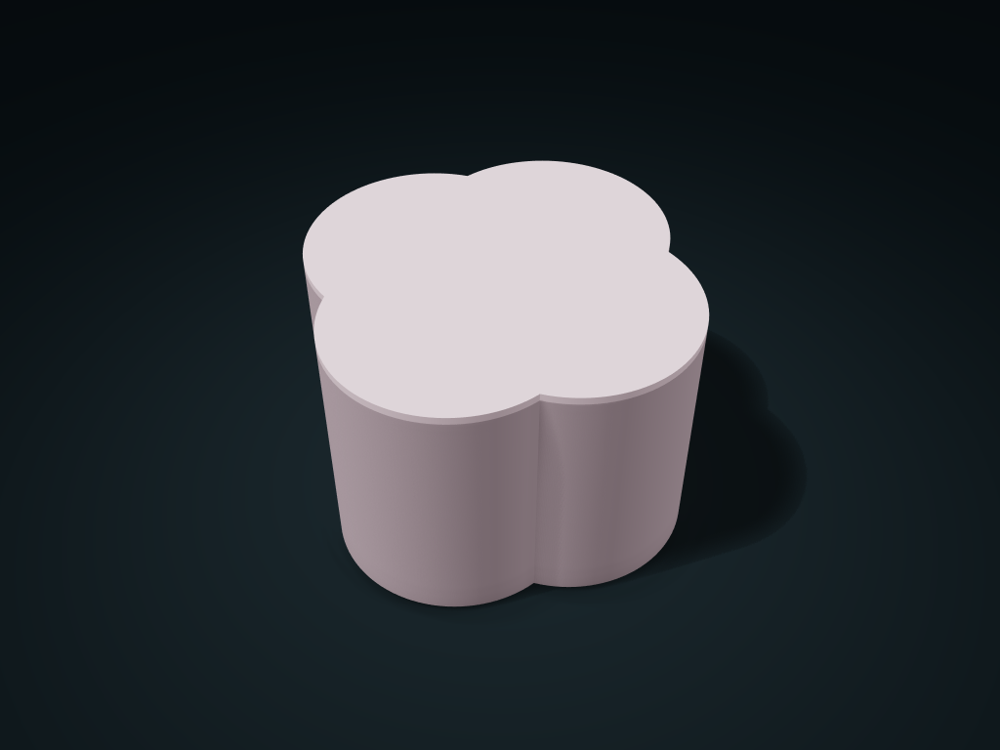

# Four-Lobe Lift-Lid Canister

Four rounded lobes form a soft outline, with a matching lid that locates inside the opening

**[Preview this model and customize it on boxesmodel](https://boxesmodel.com/models/lobed-quartet-lift-jar)**

## Default model

| Property | Value |
| --- | --- |
| Category | Lidded Storage |
| Model version | 1.0.0 |
| Default assembly display size | 136 × 136 × 88 mm |
| Included parts | 2 |
| Formats | STL and STEP |
| Units | Millimeters |

Covers the layout of all parts in the current preview; see Files and dimensions for each part's print size.

## Dimensions and features

| Detail | Default value |
| --- | --- |
| Inner outline boundary | Maximum width 130.8 mm; the interior is not a complete circle |
| Compartment layout | 2 compartments; clear height below lid 78.8 mm |
| Lid fit clearance | Per-side clearance 0.40 mm; locating ring depth 4 mm |

## Download the parts

Open a file below and choose **Download raw file** on GitHub. STL is for slicers; STEP is for CAD editing.

| Part | Dimensions | STL | STEP |
| --- | --- | --- | --- |
| Four-lobe canister with shared-wall dividers | 136 × 136 × 85.4 mm | [body.stl](body.stl) | [body.step](body.step) |
| Four-lobe lid with locating ring | 136 × 136 × 6.6 mm | [lid.stl](lid.stl) | [lid.step](lid.step) |

Each listed part has its own STL and STEP file. Preview colors are illustrative; the manufacturing files do not contain the displayed colors.

## Printing and assembly

- 2 parts: four-lobe body and locating lid; align the four-lobe outlines and lower the lid vertically. Do not force a misaligned lid into place.
- The open-interior mode has no upright dividers; when using compartments, check the usable space around the lobed corners against the actual shape of your items.
- All required printed parts are included; no purchased hardware is needed. Preview colors are for display only; the STL/STEP manufacturing files contain no color.
- Test the fit clearance with a sample on your printer and material first; sealing, leak-proofing, load capacity, and food-contact safety are not guaranteed.
- Import at millimeter scale. Check your build volume, orientation, overhangs, supports and mating clearances in the slicer.

## Adjust the design

Visit the [interactive model page](https://boxesmodel.com/models/lobed-quartet-lift-jar) to inspect the 3D model and adjust the available dimensions and layout options. This folder contains the default-size export shown above; custom exports follow the options and pricing shown on boxesmodel.

## License and attribution

Copyright © 2026 boxesmodel. These model files, preview and description are licensed under [CC BY 4.0](https://creativecommons.org/licenses/by/4.0/). You may share, modify and use them commercially with the required attribution. See the [full license](../../LICENSE) and [attribution guide](../../ATTRIBUTION.md).

Suggested credit:

> “Four-Lobe Lift-Lid Canister” by [boxesmodel](https://boxesmodel.com/models/lobed-quartet-lift-jar), licensed under [CC BY 4.0](https://creativecommons.org/licenses/by/4.0/). Indicate any changes you make.

[Browse all models](../../CATALOG.md) · [About the collection](../../README.md)
