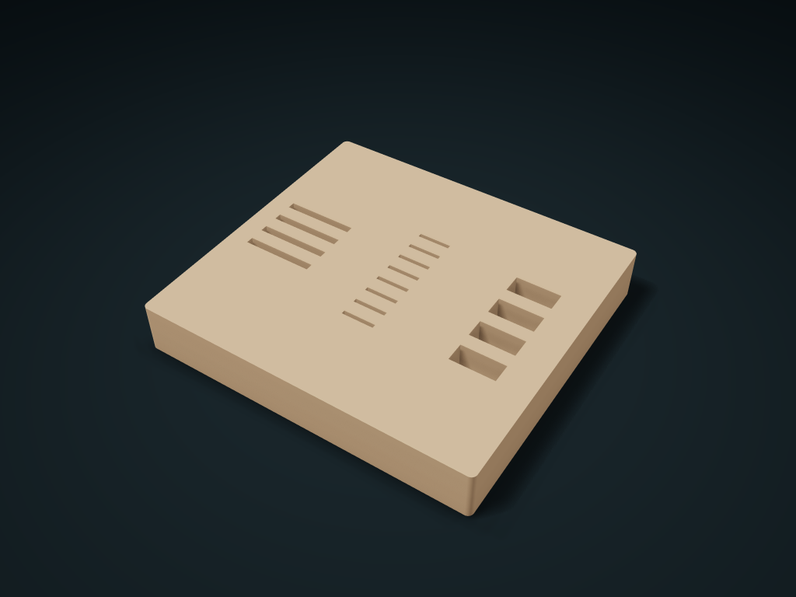

# Memory Card & USB Drive Locating Box

Slot SD cards, microSD cards and USB drives into separate sections, leaving tops exposed. Set counts, slot widths and thicknesses for each type.

**[Preview this model and customize it on boxesmodel](https://boxesmodel.com/models/media-slot-caddy)**

## Default model

| Property | Value |
| --- | --- |
| Category | Desktop Organizers |
| Model version | 1.0.1 |
| Default box size | 120 × 110 × 18 mm |
| Included parts | 1 |
| Formats | STL and STEP |
| Units | Millimeters |

Dimensions include the outer outline of the box; see the specifications for usable interior space.

## Intended use

- microSD slots are 5 mm deep; SD and USB insertion depth is adjustable. Leave at least 5 mm exposed and allow insertion clearance around housings; no clamping.
- Bottomed slots only locate items; they are not electrical connectors. No lid, antistatic or water protection; trial-print to check actual fit.

## Dimensions and features

| Detail | Default value |
| --- | --- |
| Total number of locating slots | 16 |
| microSD insertion depth | 5 mm |

## Download the parts

Open a file below and choose **Download raw file** on GitHub. STL is for slicers; STEP is for CAD editing.

| Part | Dimensions | STL | STEP |
| --- | --- | --- | --- |
| Three-Media Locating Box | 120 × 110 × 18 mm | [organizer.stl](organizer.stl) | [organizer.step](organizer.step) |

Each listed part has its own STL and STEP file. Preview colors are illustrative; the manufacturing files do not contain the displayed colors.

## Printing and assembly

- Facing the front, from left to right: SD, microSD, USB drive; count and slot clear width/thickness are set per type; sizes include the access gap you leave.
- Fixed 5 mm depth for microSD blind slots; SD cards and USB drives are set by insertion depth. Measure the actual housing and let items stick out at least 5 mm; it does not rely on clamping.
- All three are bottomed locating slots, not electrical connectors; no lid, not anti-static and not waterproof; test-print first to check the fit with your actual items.
- Import at millimeter scale. Check your build volume, orientation, overhangs, supports and mating clearances in the slicer.

## Adjust the design

Visit the [interactive model page](https://boxesmodel.com/models/media-slot-caddy) to inspect the 3D model and adjust the available dimensions and layout options. This folder contains the default-size export shown above; custom exports follow the options and pricing shown on boxesmodel.

## License and attribution

Copyright © 2026 boxesmodel. These model files, preview and description are licensed under [CC BY 4.0](https://creativecommons.org/licenses/by/4.0/). You may share, modify and use them commercially with the required attribution. See the [full license](../../LICENSE) and [attribution guide](../../ATTRIBUTION.md).

Suggested credit:

> “Memory Card & USB Drive Locating Box” by [boxesmodel](https://boxesmodel.com/models/media-slot-caddy), licensed under [CC BY 4.0](https://creativecommons.org/licenses/by/4.0/). Indicate any changes you make.

[Browse all models](../../CATALOG.md) · [About the collection](../../README.md)
