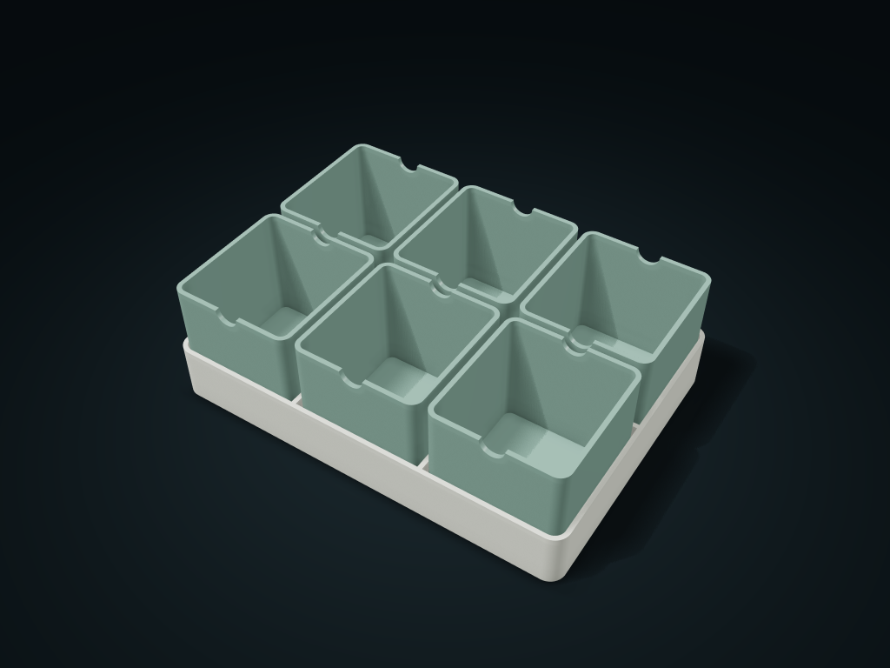

# Modular Inner Box Storage Tray

Small boxes can be taken out one by one and the whole tray returned after sorting.

**[Preview this model and customize it on boxesmodel](https://boxesmodel.com/models/modular-caddy)**

## Default model

| Property | Value |
| --- | --- |
| Category | Desktop Organizers |
| Model version | 1.0.0 |
| Default assembly display size | 210 × 150 × 65 mm |
| Included parts | 7 |
| Formats | STL and STEP |
| Units | Millimeters |

Covers the layout of all parts in the current preview; see Files and dimensions for each part's print size.

## Dimensions and features

| Detail | Default value |
| --- | --- |
| Removable inner box | 6 |
| Single box interior clear size | 61.2 × 65.8 × 60.2 mm |

## Download the parts

Open a file below and choose **Download raw file** on GitHub. STL is for slicers; STEP is for CAD editing.

| Part | Dimensions | STL | STEP |
| --- | --- | --- | --- |
| Divided base tray | 210 × 150 × 29.25 mm | [carrier.stl](carrier.stl) | [carrier.step](carrier.step) |
| Inner box 1-1 | 66 × 70.6 × 62.6 mm | [cup-1-1.stl](cup-1-1.stl) | [cup-1-1.step](cup-1-1.step) |
| Inner box 1-2 | 66 × 70.6 × 62.6 mm | [cup-1-2.stl](cup-1-2.stl) | [cup-1-2.step](cup-1-2.step) |
| Inner box 1-3 | 66 × 70.6 × 62.6 mm | [cup-1-3.stl](cup-1-3.stl) | [cup-1-3.step](cup-1-3.step) |
| Inner box 2-1 | 66 × 70.6 × 62.6 mm | [cup-2-1.stl](cup-2-1.stl) | [cup-2-1.step](cup-2-1.step) |
| Inner box 2-2 | 66 × 70.6 × 62.6 mm | [cup-2-2.stl](cup-2-2.stl) | [cup-2-2.step](cup-2-2.step) |
| Inner box 2-3 | 66 × 70.6 × 62.6 mm | [cup-2-3.stl](cup-2-3.stl) | [cup-2-3.step](cup-2-3.step) |

Each listed part has its own STL and STEP file. Preview colors are illustrative; the manufacturing files do not contain the displayed colors.

## Printing and assembly

- Print the base tray and inner boxes base down separately; inner boxes lift out vertically.
- The inner boxes have a fixed 0.4 mm single-side design gap and only fit the base tray from the same set; this is not a Gridfinity interface.
- Dimensions include the base tray and the inner boxes once placed; check the real fit and load-bearing before use.
- Import at millimeter scale. Check your build volume, orientation, overhangs, supports and mating clearances in the slicer.

## Adjust the design

Visit the [interactive model page](https://boxesmodel.com/models/modular-caddy) to inspect the 3D model and adjust the available dimensions and layout options. This folder contains the default-size export shown above; custom exports follow the options and pricing shown on boxesmodel.

## License and attribution

Copyright © 2026 boxesmodel. These model files, preview and description are licensed under [CC BY 4.0](https://creativecommons.org/licenses/by/4.0/). You may share, modify and use them commercially with the required attribution. See the [full license](../../LICENSE) and [attribution guide](../../ATTRIBUTION.md).

Suggested credit:

> “Modular Inner Box Storage Tray” by [boxesmodel](https://boxesmodel.com/models/modular-caddy), licensed under [CC BY 4.0](https://creativecommons.org/licenses/by/4.0/). Indicate any changes you make.

[Browse all models](../../CATALOG.md) · [About the collection](../../README.md)
