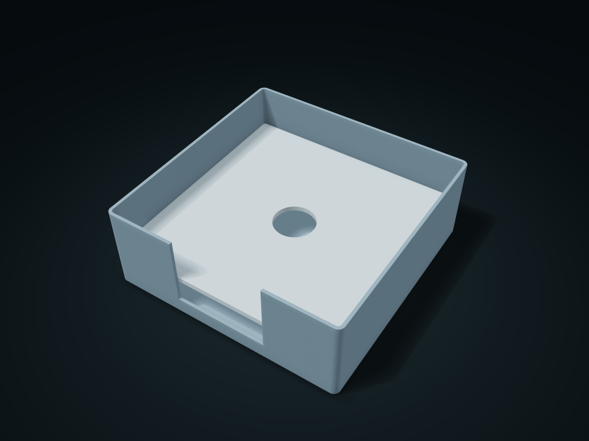

# Napkin Holder with Weight Plate

A lift-out pressing plate drops with the paper stack, and a central grip hole makes refilling and taking easy

**[Preview this model and customize it on boxesmodel](https://boxesmodel.com/models/napkin-follower-box)**

## Default model

| Property | Value |
| --- | --- |
| Category | Desktop Organizers |
| Model version | 1.0.0 |
| Default assembly display size | 180 × 180 × 65 mm |
| Included parts | 2 |
| Formats | STL and STEP |
| Units | Millimeters |

Covers the layout of all parts in the current preview; see Files and dimensions for each part's print size.

## Dimensions and features

| Detail | Default value |
| --- | --- |
| Pressing plate single-side clearance | 0.5 mm |

## Download the parts

Open a file below and choose **Download raw file** on GitHub. STL is for slicers; STEP is for CAD editing.

| Part | Dimensions | STL | STEP |
| --- | --- | --- | --- |
| Open napkin box | 180 × 180 × 65 mm | [body.stl](body.stl) | [body.step](body.step) |
| Pressing plate with lift hole | 174.2 × 174.2 × 4 mm | [follower.stl](follower.stl) | [follower.step](follower.step) |

Each listed part has its own STL and STEP file. Preview colors are illustrative; the manufacturing files do not contain the displayed colors.

## Printing and assembly

- Print both parts with the flat base down; once tissues are loaded, the pressing plate rests directly on the stack with 0.5 mm per side; lift it out by the hole.
- The current paper stack height controls where it sits in the assembly preview; it actually drops by gravity, with no springs or hardware. Lift the pressing plate before taking paper; single-sheet dispensing is not guaranteed.
- A tissue separates the printed surface from the side in use; before use, check hygiene, real item weight and sliding resistance.
- Import at millimeter scale. Check your build volume, orientation, overhangs, supports and mating clearances in the slicer.

## Adjust the design

Visit the [interactive model page](https://boxesmodel.com/models/napkin-follower-box) to inspect the 3D model and adjust the available dimensions and layout options. This folder contains the default-size export shown above; custom exports follow the options and pricing shown on boxesmodel.

## License and attribution

Copyright © 2026 boxesmodel. These model files, preview and description are licensed under [CC BY 4.0](https://creativecommons.org/licenses/by/4.0/). You may share, modify and use them commercially with the required attribution. See the [full license](../../LICENSE) and [attribution guide](../../ATTRIBUTION.md).

Suggested credit:

> “Napkin Holder with Weight Plate” by [boxesmodel](https://boxesmodel.com/models/napkin-follower-box), licensed under [CC BY 4.0](https://creativecommons.org/licenses/by/4.0/). Indicate any changes you make.

[Browse all models](../../CATALOG.md) · [About the collection](../../README.md)
