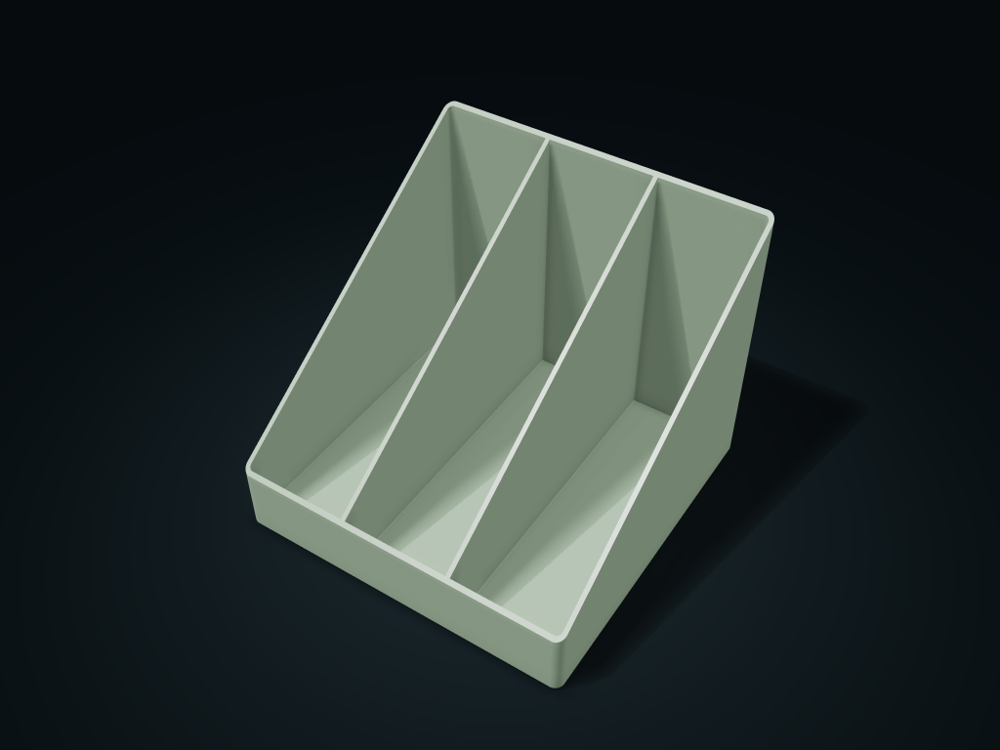

# Upright Document Box

A low front edge makes access easy, while the high back and sloped sides keep zones separate.

**[Preview this model and customize it on boxesmodel](https://boxesmodel.com/models/open-file-rack)**

## Default model

| Property | Value |
| --- | --- |
| Category | Open Storage |
| Model version | 1.0.0 |
| Default box size | 180 × 180 × 150 mm |
| Included parts | 1 |
| Formats | STL and STEP |
| Units | Millimeters |

Dimensions include the outer outline of the box; see the specifications for usable interior space.

## Dimensions and features

| Detail | Default value |
| --- | --- |
| Separate document compartments | 3 |
| Straight-side clear width per compartment | 56.8 mm |
| Front edge height | 35.0 mm |

## Download the parts

Open a file below and choose **Download raw file** on GitHub. STL is for slicers; STEP is for CAD editing.

| Part | Dimensions | STL | STEP |
| --- | --- | --- | --- |
| Sloped-side document box | 180 × 180 × 150 mm | [file-bin.stl](file-bin.stl) | [file-bin.step](file-bin.step) |

Each listed part has its own STL and STEP file. Preview colors are illustrative; the manufacturing files do not contain the displayed colors.

## Printing and assembly

- Print base down; documents go in and out from the top and the low front edge, with each compartment molded with the box.
- Set by actual item thickness and width; A4 or any specific document size is not assumed; the back is taller; test-print to check load-bearing and stability first.
- Import at millimeter scale. Check your build volume, orientation, overhangs, supports and mating clearances in the slicer.

## Adjust the design

Visit the [interactive model page](https://boxesmodel.com/models/open-file-rack) to inspect the 3D model and adjust the available dimensions and layout options. This folder contains the default-size export shown above; custom exports follow the options and pricing shown on boxesmodel.

## License and attribution

Copyright © 2026 boxesmodel. These model files, preview and description are licensed under [CC BY 4.0](https://creativecommons.org/licenses/by/4.0/). You may share, modify and use them commercially with the required attribution. See the [full license](../../LICENSE) and [attribution guide](../../ATTRIBUTION.md).

Suggested credit:

> “Upright Document Box” by [boxesmodel](https://boxesmodel.com/models/open-file-rack), licensed under [CC BY 4.0](https://creativecommons.org/licenses/by/4.0/). Indicate any changes you make.

[Browse all models](../../CATALOG.md) · [About the collection](../../README.md)
