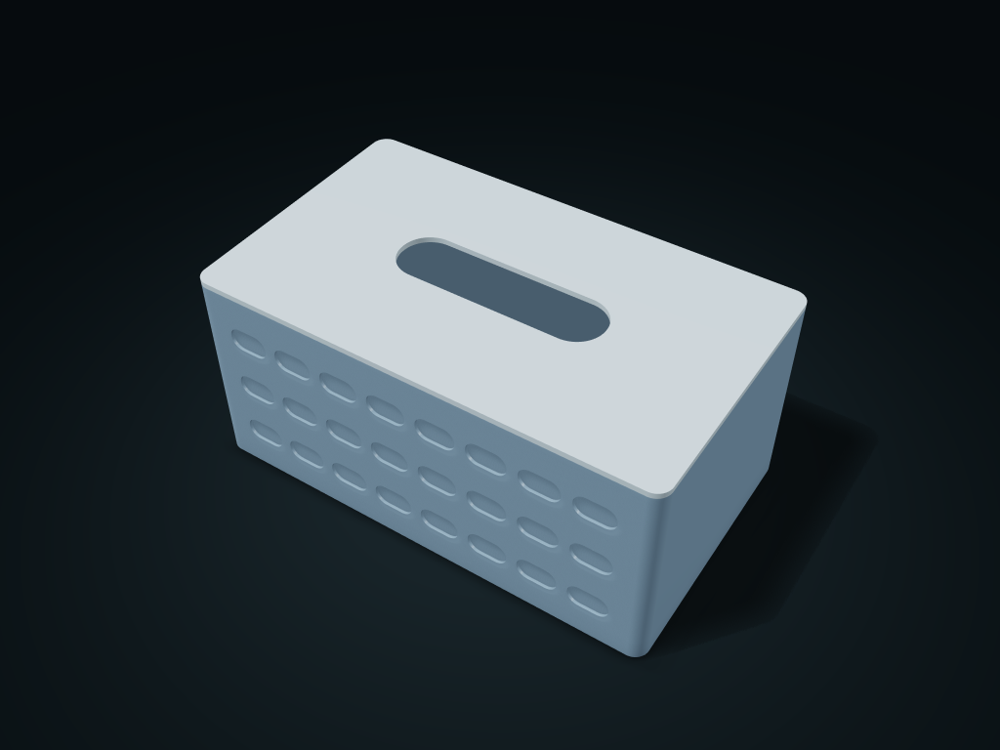

# Pebble Recess Tissue Box

Staggered oblong shallow recesses, distinct from raised dots.

**[Preview this model and customize it on boxesmodel](https://boxesmodel.com/models/pebble-panel-tissue-case)**

## Default model

| Property | Value |
| --- | --- |
| Category | Lidded Storage |
| Model version | 1.0.0 |
| Default assembly display size | 220 × 130 × 100 mm |
| Included parts | 2 |
| Formats | STL and STEP |
| Units | Millimeters |

Covers the layout of all parts in the current preview; see Files and dimensions for each part's print size.

## Dimensions and features

| Detail | Default value |
| --- | --- |
| Usable clear cavity for tissues | 212.0 × 122.0 × 90.8 mm (keep clear of the corners) |
| Dispensing slot | 100.0 × 28.0 mm |
| Lid fit clearance | 0.40 mm per side; 2 printed parts |

## Download the parts

Open a file below and choose **Download raw file** on GitHub. STL is for slicers; STEP is for CAD editing.

| Part | Dimensions | STL | STEP |
| --- | --- | --- | --- |
| Box body with patterned solid inner wall | 220 × 130 × 97.4 mm | [body.stl](body.stl) | [body.step](body.step) |
| Lift-off lid with rounded dispensing slot (integrated locating ring) | 220 × 130 × 6.6 mm | [lid.stl](lid.stl) | [lid.step](lid.step) |

Each listed part has its own STL and STEP file. Preview colors are illustrative; the manufacturing files do not contain the displayed colors.

## Printing and assembly

- Compare the outer outline of the full tissue pack with the clear cavity; leave 1 mm per side for taking items in and out; compatibility with every package is not promised.
- Lift the lid vertically; the locating ring fits inside the solid inner wall; no magnets, snap fits or purchased parts.
- The exterior has shallow recessed patterns that do not pierce the inner wall; must not be used as a moisture-proof or airtight box.
- Box body upright; flip the lid plate and place it on the build plate separately; STL/STEP files carry no color.
- Import at millimeter scale. Check your build volume, orientation, overhangs, supports and mating clearances in the slicer.

## Adjust the design

Visit the [interactive model page](https://boxesmodel.com/models/pebble-panel-tissue-case) to inspect the 3D model and adjust the available dimensions and layout options. This folder contains the default-size export shown above; custom exports follow the options and pricing shown on boxesmodel.

## License and attribution

Copyright © 2026 boxesmodel. These model files, preview and description are licensed under [CC BY 4.0](https://creativecommons.org/licenses/by/4.0/). You may share, modify and use them commercially with the required attribution. See the [full license](../../LICENSE) and [attribution guide](../../ATTRIBUTION.md).

Suggested credit:

> “Pebble Recess Tissue Box” by [boxesmodel](https://boxesmodel.com/models/pebble-panel-tissue-case), licensed under [CC BY 4.0](https://creativecommons.org/licenses/by/4.0/). Indicate any changes you make.

[Browse all models](../../CATALOG.md) · [About the collection](../../README.md)
