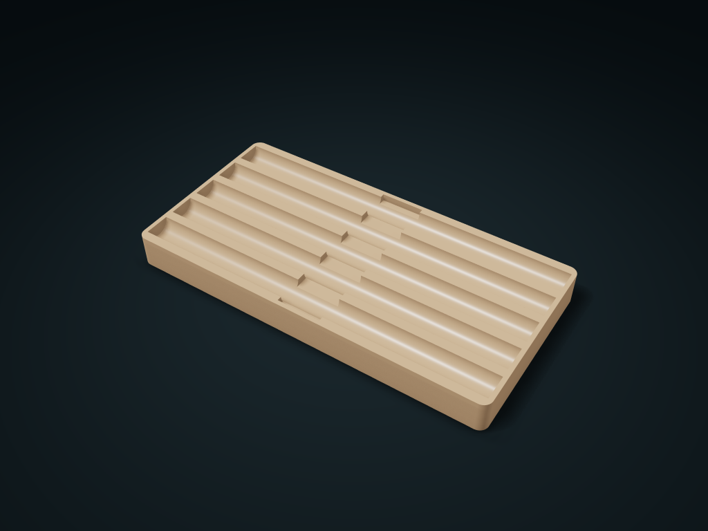

# Pen Lay-Flat Slot Tray

Lay pens, brushes and slender items in curved grooves and lift at the center recess; adjust groove count, support diameter and tray length.

**[Preview this model and customize it on boxesmodel](https://boxesmodel.com/models/pen-tip-tray)**

## Default model

| Property | Value |
| --- | --- |
| Category | Open Storage |
| Model version | 1.0.0 |
| Default box size | 200 × 100 × 18 mm |
| Included parts | 1 |
| Formats | STL and STEP |
| Units | Millimeters |

Dimensions include the outer outline of the box; see the specifications for usable interior space.

## Intended use

- Pens, brushes and slender items; groove diameter describes an open support curve, not a locating hole. Check end clearance for pen length.

## Dimensions and features

| Detail | Default value |
| --- | --- |
| Number of support slots | 5 |
| Usable straight slot length | 195.2 mm |
| Minimum arc slot floor thickness | 11.0 mm |

## Download the parts

Open a file below and choose **Download raw file** on GitHub. STL is for slicers; STEP is for CAD editing.

| Part | Dimensions | STL | STEP |
| --- | --- | --- | --- |
| Arc slot pen tray | 200 × 100 × 18 mm | [cradle-tray.stl](cradle-tray.stl) | [cradle-tray.step](cradle-tray.step) |

Each listed part has its own STL and STEP file. Preview colors are illustrative; the manufacturing files do not contain the displayed colors.

## Printing and assembly

- Print base down; lengthwise arc slots hold pens, with cross notches in the middle so fingers can pick them up.
- The slot diameter is the support curve diameter, not a closed locating hole; check the clear distance at both ends against pen length.
- Import at millimeter scale. Check your build volume, orientation, overhangs, supports and mating clearances in the slicer.

## Adjust the design

Visit the [interactive model page](https://boxesmodel.com/models/pen-tip-tray) to inspect the 3D model and adjust the available dimensions and layout options. This folder contains the default-size export shown above; custom exports follow the options and pricing shown on boxesmodel.

## License and attribution

Copyright © 2026 boxesmodel. These model files, preview and description are licensed under [CC BY 4.0](https://creativecommons.org/licenses/by/4.0/). You may share, modify and use them commercially with the required attribution. See the [full license](../../LICENSE) and [attribution guide](../../ATTRIBUTION.md).

Suggested credit:

> “Pen Lay-Flat Slot Tray” by [boxesmodel](https://boxesmodel.com/models/pen-tip-tray), licensed under [CC BY 4.0](https://creativecommons.org/licenses/by/4.0/). Indicate any changes you make.

[Browse all models](../../CATALOG.md) · [About the collection](../../README.md)
