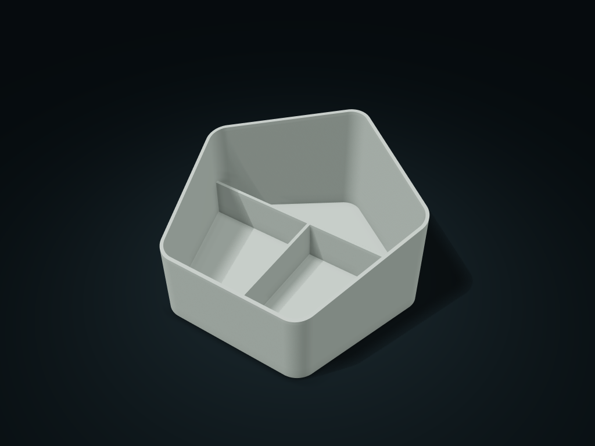

# Pentagon Rising-Rim Caddy

A rounded pentagonal caddy with a rising rim, uninterrupted rear long pocket and shared-wall front pockets for access to tall and short items.

**[Preview this model and customize it on boxesmodel](https://boxesmodel.com/models/pentagon-rise-caddy)**

## Default model

| Property | Value |
| --- | --- |
| Category | Desktop Organizers |
| Model version | 1.0.0 |
| Default box size | 200 × 191.97 × 105 mm |
| Included parts | 1 |
| Formats | STL and STEP |
| Units | Millimeters |

Dimensions include the outer outline of the box; see the specifications for usable interior space.

## Dimensions and features

| Detail | Default value |
| --- | --- |
| Actual Filleted Outer Width | 192.0 mm |
| Conservative Rear Long-Pocket Clear Length | 115.5 mm |
| Rear Long-Pocket Clear Width | 30.0 mm |
| Conservative Front Pocket Clear Length | 56.4 mm |
| Conservative Front Pocket Clear Width | 82.7 mm |
| Usable Depth Below the Lowest Rim | 62.2 mm |
| Front Pocket Count | 2 compartments |
| Rear Long-Pocket Count | 1 compartment |
| Shared Divider Top | 38.0 mm |

## Download the parts

Open a file below and choose **Download raw file** on GitHub. STL is for slicers; STEP is for CAD editing.

| Part | Dimensions | STL | STEP |
| --- | --- | --- | --- |
| Pentagon Rising-Rim Caddy Body | 200 × 191.97 × 105 mm | [body.stl](body.stl) | [body.step](body.step) |

Each listed part has its own STL and STEP file. Preview colors are illustrative; the manufacturing files do not contain the displayed colors.

## Printing and assembly

- The complete body is one printed part. The rear long pocket shares a wall with the front pockets; changing the front pocket count does not divide the rear pocket.
- Clearance describes conservative rectangular regions; spare corner areas are excluded. Load and remove items from above, leaving additional handling room around their widest outline.
- Print with the flat base down. There is no lid, latch or wall-mounting hardware. Compartment capacity depends on the chosen configuration; check the capacity against the items you intend to store.
- The front flat edge has the low rim and the rear rounded tip is the highest point. All dividers remain at least 3 mm below the lowest front rim.
- All custom parts are included in the download; no purchased parts are required. Preview colors are for display only; manufacturing STL/STEP files are uncolored.
- Check overhangs, supports and fit before printing; support-free printing, load capacity, sealing and food-contact safety are not promised.
- Import at millimeter scale. Check your build volume, orientation, overhangs, supports and mating clearances in the slicer.

## Adjust the design

Visit the [interactive model page](https://boxesmodel.com/models/pentagon-rise-caddy) to inspect the 3D model and adjust the available dimensions and layout options. This folder contains the default-size export shown above; custom exports follow the options and pricing shown on boxesmodel.

## License and attribution

Copyright © 2026 boxesmodel. These model files, preview and description are licensed under [CC BY 4.0](https://creativecommons.org/licenses/by/4.0/). You may share, modify and use them commercially with the required attribution. See the [full license](../../LICENSE) and [attribution guide](../../ATTRIBUTION.md).

Suggested credit:

> “Pentagon Rising-Rim Caddy” by [boxesmodel](https://boxesmodel.com/models/pentagon-rise-caddy), licensed under [CC BY 4.0](https://creativecommons.org/licenses/by/4.0/). Indicate any changes you make.

[Browse all models](../../CATALOG.md) · [About the collection](../../README.md)
