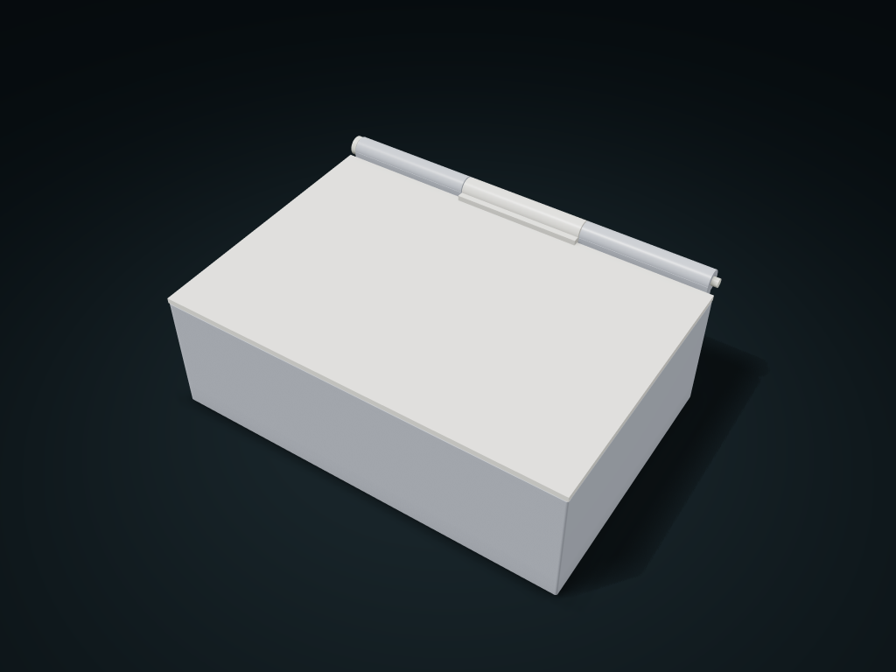

# Pinned Flip Lid Divided Box

Three coaxial hinge knuckles with a removable pin; the inner row and column layout is adjustable.

**[Preview this model and customize it on boxesmodel](https://boxesmodel.com/models/pin-hinge-box)**

## Default model

| Property | Value |
| --- | --- |
| Category | Lidded Storage |
| Model version | 1.0.1 |
| Default assembly display size | 180 × 130 × 65 mm |
| Included parts | 3 |
| Formats | STL and STEP |
| Units | Millimeters |

Covers the layout of all parts in the current preview; see Files and dimensions for each part's print size.

## Dimensions and features

| Detail | Default value |
| --- | --- |
| Inner compartment clear height | 52.6 mm |
| Pin diameter | 4.0 mm |

## Download the parts

Open a file below and choose **Download raw file** on GitHub. STL is for slicers; STEP is for CAD editing.

| Part | Dimensions | STL | STEP |
| --- | --- | --- | --- |
| Compartment box with side hinge knuckles | 180 × 130 × 65 mm | [body.stl](body.stl) | [body.step](body.step) |
| Central knuckle flip lid | 180 × 130 × 9.6 mm | [lid.stl](lid.stl) | [lid.step](lid.step) |
| Headed pull-out pin | 179.6 × 8.8 × 8.8 mm | [pin.stl](pin.stl) | [pin.step](pin.step) |

Each listed part has its own STL and STEP file. Preview colors are illustrative; the manufacturing files do not contain the displayed colors.

## Printing and assembly

- Box, lid and pin print separately; first line up the three knuckles on one axis, insert the pin from the left, and lift the front edge to open the lid.
- Compartments follow length, width and height; the hinge has a fixed 0.4 mm radial and axial design clearance; pin diameter is adjustable.
- This model is a desktop flip-lid box, with no latch, seal or pin tail lock; keep level, and make sure the pins have not backed out before moving it. Check supports and strength when printing the pin horizontally.
- Import at millimeter scale. Check your build volume, orientation, overhangs, supports and mating clearances in the slicer.

## Adjust the design

Visit the [interactive model page](https://boxesmodel.com/models/pin-hinge-box) to inspect the 3D model and adjust the available dimensions and layout options. This folder contains the default-size export shown above; custom exports follow the options and pricing shown on boxesmodel.

## License and attribution

Copyright © 2026 boxesmodel. These model files, preview and description are licensed under [CC BY 4.0](https://creativecommons.org/licenses/by/4.0/). You may share, modify and use them commercially with the required attribution. See the [full license](../../LICENSE) and [attribution guide](../../ATTRIBUTION.md).

Suggested credit:

> “Pinned Flip Lid Divided Box” by [boxesmodel](https://boxesmodel.com/models/pin-hinge-box), licensed under [CC BY 4.0](https://creativecommons.org/licenses/by/4.0/). Indicate any changes you make.

[Browse all models](../../CATALOG.md) · [About the collection](../../README.md)
