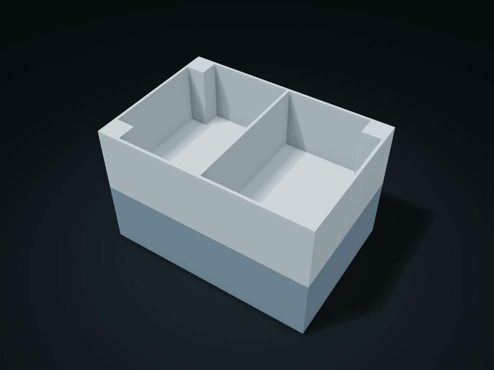

# Four-Pin Aligned Stacking Boxes

Upper and lower boxes are aligned by four removable round pins; the separate pins and the base sockets are output separately

**[Preview this model and customize it on boxesmodel](https://boxesmodel.com/models/pin-stack-box)**

## Default model

| Property | Value |
| --- | --- |
| Category | Stackable Storage |
| Model version | 1.0.0 |
| Default assembly display size | 175 × 120 × 110 mm |
| Included parts | 6 |
| Formats | STL and STEP |
| Units | Millimeters |

Covers the layout of all parts in the current preview; see Files and dimensions for each part's print size.

## Download the parts

Open a file below and choose **Download raw file** on GitHub. STL is for slicers; STEP is for CAD editing.

| Part | Dimensions | STL | STEP |
| --- | --- | --- | --- |
| Lower box | 175 × 120 × 55 mm | [lower.stl](lower.stl) | [lower.step](lower.step) |
| Upper box | 175 × 120 × 55 mm | [upper.stl](upper.stl) | [upper.step](upper.step) |
| Locating pin 1 | 6 × 6 × 14 mm | [pin-0.stl](pin-0.stl) | [pin-0.step](pin-0.step) |
| Locating pin 2 | 6 × 6 × 14 mm | [pin-1.stl](pin-1.stl) | [pin-1.step](pin-1.step) |
| Locating pin 3 | 6 × 6 × 14 mm | [pin-2.stl](pin-2.stl) | [pin-2.step](pin-2.step) |
| Locating pin 4 | 6 × 6 × 14 mm | [pin-3.stl](pin-3.stl) | [pin-3.step](pin-3.step) |

Each listed part has its own STL and STEP file. Preview colors are illustrative; the manufacturing files do not contain the displayed colors.

## Printing and assembly

- Insert the four pins into the lower box's blind pockets, then lower the upper box straight down. To take it apart, lift the upper box first, then pull the pins; no screws are used. The pins only align and do not lock for lifting; test-print to check load-bearing first.
- Units are millimeters. Measure clearance from your actual items first; check slicing before printing and test-fit the key mating parts.
- Import at millimeter scale. Check your build volume, orientation, overhangs, supports and mating clearances in the slicer.

## Adjust the design

Visit the [interactive model page](https://boxesmodel.com/models/pin-stack-box) to inspect the 3D model and adjust the available dimensions and layout options. This folder contains the default-size export shown above; custom exports follow the options and pricing shown on boxesmodel.

## License and attribution

Copyright © 2026 boxesmodel. These model files, preview and description are licensed under [CC BY 4.0](https://creativecommons.org/licenses/by/4.0/). You may share, modify and use them commercially with the required attribution. See the [full license](../../LICENSE) and [attribution guide](../../ATTRIBUTION.md).

Suggested credit:

> “Four-Pin Aligned Stacking Boxes” by [boxesmodel](https://boxesmodel.com/models/pin-stack-box), licensed under [CC BY 4.0](https://creativecommons.org/licenses/by/4.0/). Indicate any changes you make.

[Browse all models](../../CATALOG.md) · [About the collection](../../README.md)
