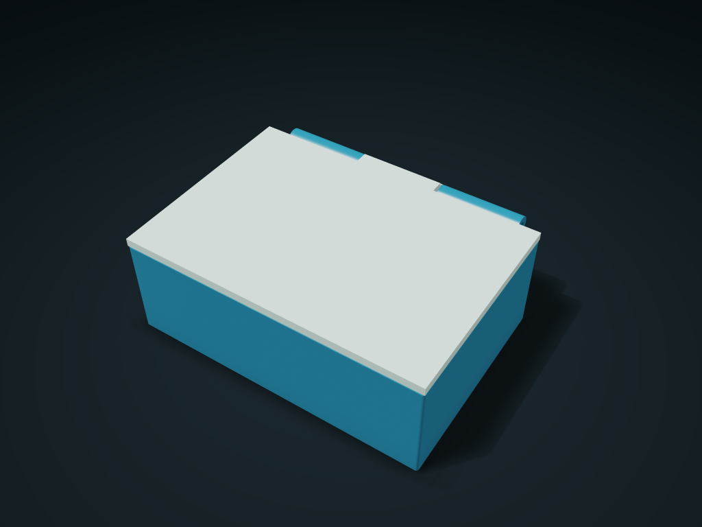

# Strap-Base Pinned Quick-Release Flip Lid Box

The separate strap base stays in place, the T-rail box comes off whole once the pin is withdrawn, with a coaxial flip lid and configurable columns.

**[Preview this model and customize it on boxesmodel](https://boxesmodel.com/models/pinned-webbing-flip-case)**

## Default model

| Property | Value |
| --- | --- |
| Category | Lidded Storage |
| Model version | 1.0.0 |
| Default assembly display size | 110 × 95 × 40 mm |
| Included parts | 4 |
| Formats | STL and STEP |
| Units | Millimeters |

Covers the layout of all parts in the current preview; see Files and dimensions for each part's print size.

## Dimensions and features

| Detail | Default value |
| --- | --- |
| Clear width per column | 104.0 mm |
| Inner compartment clear depth/height | 69.6 / 33.6 mm |
| T-rail effective height | 18 mm |
| Strap clear width/thickness | 25 / 3 mm |

## Download the parts

Open a file below and choose **Download raw file** on GitHub. STL is for slicers; STEP is for CAD editing.

| Part | Dimensions | STL | STEP |
| --- | --- | --- | --- |
| Column box with T-shaped slide rails | 110 × 84 × 39 mm | [body.stl](body.stl) | [body.step](body.step) |
| Middle knuckle flip lid | 110 × 84 × 9 mm | [lid.stl](lid.stl) | [lid.step](lid.step) |
| Twin strap loop separate slider | 36 × 19 × 23 mm | [base.stl](base.stl) | [base.step](base.step) |
| Stop pin with a tail lock hole | 46 × 8 × 8 mm | [lock-pin.stl](lock-pin.stl) | [lock-pin.step](lock-pin.step) |

Each listed part has its own STL and STEP file. Preview colors are illustrative; the manufacturing files do not contain the displayed colors.

## Printing and assembly

- The complete kit includes a separate strap base, T-rail box, lid and stop pin; this set's own interface; QUICK-CLIP/MOLLE or other system compatibility is not promised.
- One vertical strap passes through the two closed loops on the base; strap/buckle supplied separately. Strap width and thickness include the actual wrapping and fold-back thickening; do not force a large sewn fold through. Fix the base first, then slide the box in from above all the way down.
- After aligning the cross holes, insert the Ø5 stop pin from the left, then a Ø1.2 mm short split pin (8 mm straight legs) through the cross hole at tail X21 mm, with the bent legs facing the back away from the box. Withdraw the tail pin → pull the stop pin out to the left → lift at least 20 mm → take the box forward; the base and strap stay in place; check the pins have not backed out before transport.
- Hinge hole Ø3.8 mm; supply a Ø3 mm round shaft 100 mm long and shaft clips at both ends with outer diameter ≤ 6 mm and thickness ≤ 2 mm. Line up the box and lid on one axis, insert the axle from the left, then fix both ends; the front edge lifts 0–90°. 0.4 mm clearance at the lid edge, no seal/clip; use an elastic strap to hold the lid when moving.
- For static hanging of light items only; measure cards, small tools and similar by their actual envelope; not body safety equipment or for direct food contact. Slice-check the base slots/strap loop bridges, hinge holes and horizontal pins; Check friction, shaft-clip retention and strength for the intended use; avoid drops and dynamic loads.
- Import at millimeter scale. Check your build volume, orientation, overhangs, supports and mating clearances in the slicer.

## Adjust the design

Visit the [interactive model page](https://boxesmodel.com/models/pinned-webbing-flip-case) to inspect the 3D model and adjust the available dimensions and layout options. This folder contains the default-size export shown above; custom exports follow the options and pricing shown on boxesmodel.

## License and attribution

Copyright © 2026 boxesmodel. These model files, preview and description are licensed under [CC BY 4.0](https://creativecommons.org/licenses/by/4.0/). You may share, modify and use them commercially with the required attribution. See the [full license](../../LICENSE) and [attribution guide](../../ATTRIBUTION.md).

Suggested credit:

> “Strap-Base Pinned Quick-Release Flip Lid Box” by [boxesmodel](https://boxesmodel.com/models/pinned-webbing-flip-case), licensed under [CC BY 4.0](https://creativecommons.org/licenses/by/4.0/). Indicate any changes you make.

[Browse all models](../../CATALOG.md) · [About the collection](../../README.md)
