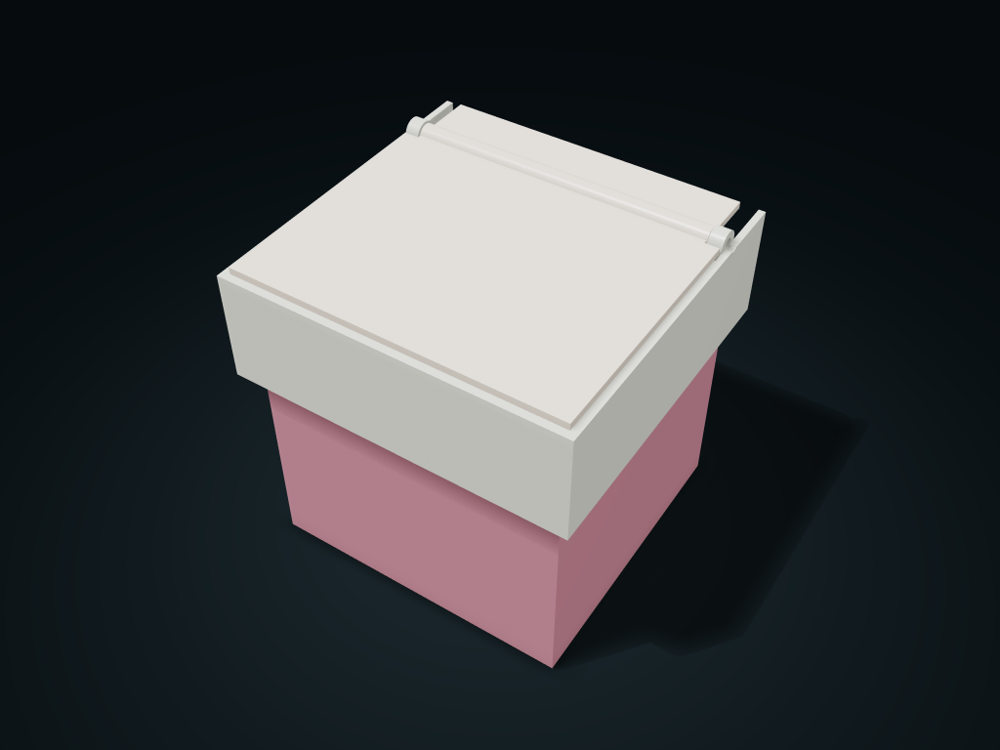

# Rear-Press Wide-Mouth Liner Bin

The rear press arm lifts the one-piece lid, and a separate bag press ring and isolated rear well keep a wide drop opening.

**[Preview this model and customize it on boxesmodel](https://boxesmodel.com/models/rear-press-liner-bin)**

## Default model

| Property | Value |
| --- | --- |
| Category | Lidded Storage |
| Model version | 1.0.0 |
| Default assembly display size | 150 × 145 × 150 mm |
| Included parts | 4 |
| Formats | STL and STEP |
| Units | Millimeters |

Covers the layout of all parts in the current preview; see Files and dimensions for each part's print size.

## Dimensions and features

| Detail | Default value |
| --- | --- |
| Liner clear opening | 125.4 × 92.3 mm |
| Maximum straight-down drop opening with the lid open | 125.4 × 53.1 mm |
| Rear press arm / solid stop angle | 25 mm / 65° |
| Liner single-side and top clearance | 0.8 mm； Outward fold-down ≤ 6 mm |
| M4 threaded rod supplied separately | 166 mm, 2 washers + 2 nuts |

## Download the parts

Open a file below and choose **Download raw file** on GitHub. STL is for slicers; STEP is for CAD editing.

| Part | Dimensions | STL | STEP |
| --- | --- | --- | --- |
| Bucket body with press ring ledge | 143 × 138 × 107 mm | [bin.stl](bin.stl) | [bin.step](bin.step) |
| Separate bag clamp ring and rear lid plate | 143 × 138 × 13.8 mm | [liner-collar.stl](liner-collar.stl) | [liner-collar.step](liner-collar.step) |
| Isolated rear pedal well supporting the upper frame | 150 × 145 × 56 mm | [pivot-frame.stl](pivot-frame.stl) | [pivot-frame.step](pivot-frame.step) |
| Rear-press one-piece swing lid | 143.2 × 138.2 × 9.2 mm | [lid.stl](lid.stl) | [lid.step](lid.step) |

Each listed part has its own STL and STEP file. Preview colors are illustrative; the manufacturing files do not contain the displayed colors.

## Printing and assembly

- 4 printed parts in total; supply a 166 mm M4 threaded rod, 2 thin M4 flat washers (outer diameter ≤ 9 mm, 0.8 mm thick) and 2 plain M4 nuts (7 mm across flats, 3.2 mm thick). Metal hardware is not within the printed part envelope; leave another 8 mm for axle ends on each side.
- Fold the bag mouth over the outside of the bin, no more than 6 mm down, and do not bunch folds on the ring's bottom ledge; first fit the separate bag clamp ring onto the outer ledge, then place the upper frame. Side and top clearances allow for sleeves; try the actual bag thickness, grip and fit.
- Align the holes at both ends of the upper frame with the lid's center hole, pass the axle in from the left, then fit washers and nuts on both sides; each washer's inner side is 0.4 mm from the frame's outer wall, keeping about 0.8 mm of total axial play without clamping the lid. Fitting or removing the axle needs at least one axle rod length of space on the left.
- Press down on the rear flat area and the whole front lid tips up to 65°; once the pad under the lid touches, the pedal well's solid stop takes over. The rear pedal well and bag opening are separated by the back plate and divider; keep trash out of the rear well. Hold the lid and the bucket when in use.
- Fill no higher than 6 mm below the bucket top (98.0 mm above the base plate). This full-level space is isolated from the lid movement; once the lid is open, the straight-down drop opening is about 125.4 × 53.1 mm; leave edge clearance for your actual items.
- With uniform material, the lid's center of gravity is in front of the rear axle, so it only tends to stay closed by gravity; before use, check hole friction, pressing force, return, pin retention, strength, load-bearing, bag clamping and actual fall prevention. Not a locking lid, liquid-sealed, odor-proof or in-car spill-proof container.
- Bucket bottom down; choose orientation and check supports for the press ring and the upper frame's horizontal rear plate, support shoulders and cross axle holes; adjust the manufacturing orientation when the lid's wide face is on the bed. The source's vase mode / support-free conclusions are not inherited.
- Import at millimeter scale. Check your build volume, orientation, overhangs, supports and mating clearances in the slicer.

## Adjust the design

Visit the [interactive model page](https://boxesmodel.com/models/rear-press-liner-bin) to inspect the 3D model and adjust the available dimensions and layout options. This folder contains the default-size export shown above; custom exports follow the options and pricing shown on boxesmodel.

## License and attribution

Copyright © 2026 boxesmodel. These model files, preview and description are licensed under [CC BY 4.0](https://creativecommons.org/licenses/by/4.0/). You may share, modify and use them commercially with the required attribution. See the [full license](../../LICENSE) and [attribution guide](../../ATTRIBUTION.md).

Suggested credit:

> “Rear-Press Wide-Mouth Liner Bin” by [boxesmodel](https://boxesmodel.com/models/rear-press-liner-bin), licensed under [CC BY 4.0](https://creativecommons.org/licenses/by/4.0/). Indicate any changes you make.

[Browse all models](../../CATALOG.md) · [About the collection](../../README.md)
