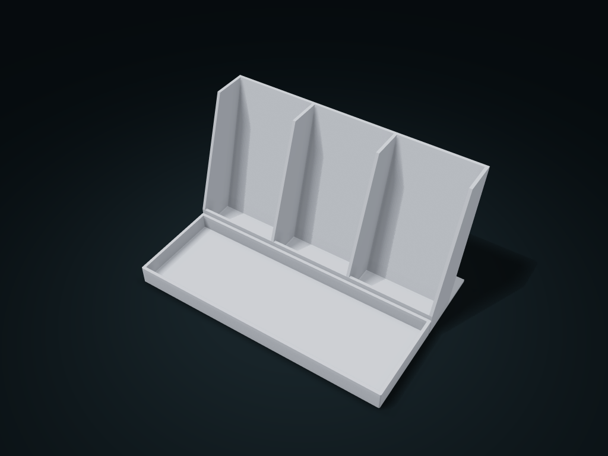

# Angled Remote Control Box

Rest remotes in separate slanted slots with open fronts and bottom stops; keep small items in front. Adjust slot count, case thickness allowance and angle.

**[Preview this model and customize it on boxesmodel](https://boxesmodel.com/models/remote-control-dock)**

## Default model

| Property | Value |
| --- | --- |
| Category | Desktop Organizers |
| Model version | 1.0.1 |
| Default box size | 200 × 130 × 110 mm |
| Included parts | 1 |
| Formats | STL and STEP |
| Units | Millimeters |

Dimensions include the outer outline of the box; see the specifications for usable interior space.

## Intended use

- Allow clearance for remote thickness including its case. Tilt is measured from vertical and fixed after generation; remotes are not clamped.
- Trial-fit actual remotes to check stability and fit.

## Dimensions and features

| Detail | Default value |
| --- | --- |
| Single remote slot clear width | 63.5 mm |
| Front tray clear depth | 66.7 mm |

## Download the parts

Open a file below and choose **Download raw file** on GitHub. STL is for slicers; STEP is for CAD editing.

| Part | Dimensions | STL | STEP |
| --- | --- | --- | --- |
| Angled rest positions and front tray | 200 × 130 × 110 mm | [dock.stl](dock.stl) | [dock.step](dock.step) |

Each listed part has its own STL and STEP file. Preview colors are illustrative; the manufacturing files do not contain the displayed colors.

## Printing and assembly

- Leave allowance on the measured thickness of the remote with its case; the tilt is measured from vertical and fixed after generation.
- Each position is open at the front with a bottom lip for support, and a front tray holds small items; does not clamp the remote. Try placing it to check actual stability and fit.
- Import at millimeter scale. Check your build volume, orientation, overhangs, supports and mating clearances in the slicer.

## Adjust the design

Visit the [interactive model page](https://boxesmodel.com/models/remote-control-dock) to inspect the 3D model and adjust the available dimensions and layout options. This folder contains the default-size export shown above; custom exports follow the options and pricing shown on boxesmodel.

## License and attribution

Copyright © 2026 boxesmodel. These model files, preview and description are licensed under [CC BY 4.0](https://creativecommons.org/licenses/by/4.0/). You may share, modify and use them commercially with the required attribution. See the [full license](../../LICENSE) and [attribution guide](../../ATTRIBUTION.md).

Suggested credit:

> “Angled Remote Control Box” by [boxesmodel](https://boxesmodel.com/models/remote-control-dock), licensed under [CC BY 4.0](https://creativecommons.org/licenses/by/4.0/). Indicate any changes you make.

[Browse all models](../../CATALOG.md) · [About the collection](../../README.md)
