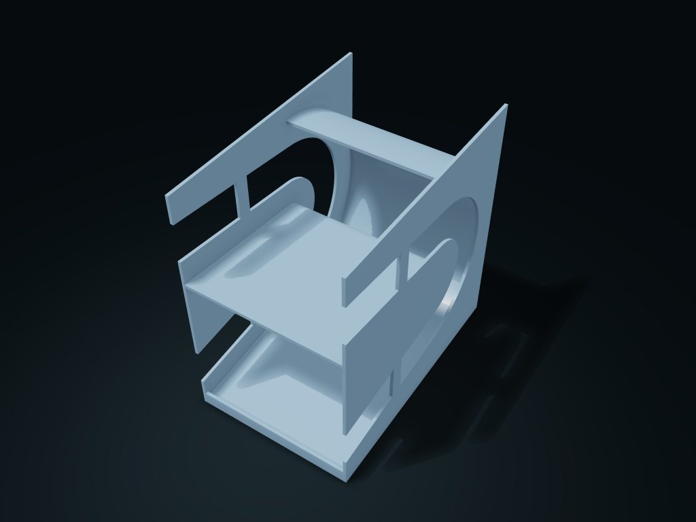

# Up-and-Over Rotating Jar Rack

Refill at the top, items turn around at the back and are taken from the front of the lower level; channel and capacity follow the actual jar size.

**[Preview this model and customize it on boxesmodel](https://boxesmodel.com/models/return-can-rack)**

## Default model

| Property | Value |
| --- | --- |
| Category | Open Storage |
| Model version | 1.0.0 |
| Default box size | 121.8 × 190.39 × 190.02 mm |
| Included parts | 1 |
| Formats | STL and STEP |
| Units | Millimeters |

Dimensions include the outer outline of the box; see the specifications for usable interior space.

## Dimensions and features

| Detail | Default value |
| --- | --- |
| Configured capacity | 4 jars |
| Supported jars | Ø66 × 115 mm |
| Channel slope | 6° |
| Jar lift for removal | 8 mm |
| Outer size in use | 121.8 × 190.4 × 190.0 mm |

## Download the parts

Open a file below and choose **Download raw file** on GitHub. STL is for slicers; STEP is for CAD editing.

| Part | Dimensions | STL | STEP |
| --- | --- | --- | --- |
| Two-level rotating channel and jar retrieval lip | 121.8 × 190.39 × 190.02 mm | [body.stl](body.stl) | [body.step](body.step) |

Each listed part has its own STL and STEP file. Preview colors are illustrative; the manufacturing files do not contain the displayed colors.

## Printing and assembly

- Use jars of the same size on one rack, and enter the maximum outer diameter and total length including the rolled rim; refill sideways at the front of the upper level; at the front of the lower level, lift 8 mm and take items forward.
- Capacity is calculated from the arrangement of the chosen jar size; the channel cannot take extra dividers, which would block the rotation. The front stop lip stops items rolling straight off the lower level.
- One-piece print; consider slicing with a side end face on the bed and check supports; the current model pose is the in-use pose. Before use, check real gravity feeding, friction, full-load stability and load-bearing.
- Import at millimeter scale. Check your build volume, orientation, overhangs, supports and mating clearances in the slicer.

## Adjust the design

Visit the [interactive model page](https://boxesmodel.com/models/return-can-rack) to inspect the 3D model and adjust the available dimensions and layout options. This folder contains the default-size export shown above; custom exports follow the options and pricing shown on boxesmodel.

## License and attribution

Copyright © 2026 boxesmodel. These model files, preview and description are licensed under [CC BY 4.0](https://creativecommons.org/licenses/by/4.0/). You may share, modify and use them commercially with the required attribution. See the [full license](../../LICENSE) and [attribution guide](../../ATTRIBUTION.md).

Suggested credit:

> “Up-and-Over Rotating Jar Rack” by [boxesmodel](https://boxesmodel.com/models/return-can-rack), licensed under [CC BY 4.0](https://creativecommons.org/licenses/by/4.0/). Indicate any changes you make.

[Browse all models](../../CATALOG.md) · [About the collection](../../README.md)
