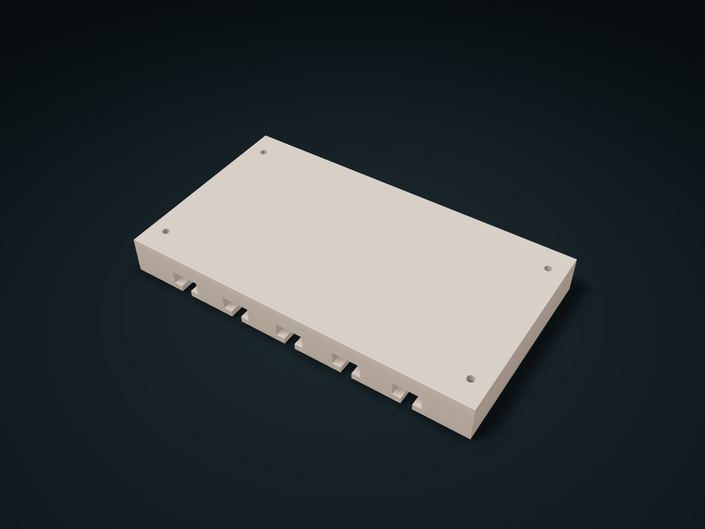

# Under-Cabinet Lid Rim Hanging Bay

A wide cavity takes the rim and a narrow gap lets the thin neck through; upright lid plates slide along the cabinet front into the top bay under the cabinet.

**[Preview this model and customize it on boxesmodel](https://boxesmodel.com/models/rim-hung-lid-cassette)**

## Default model

| Property | Value |
| --- | --- |
| Category | Open Storage |
| Model version | 1.0.0 |
| Default box size | 168 × 95 × 18 mm |
| Included parts | 1 |
| Formats | STL and STEP |
| Units | Millimeters |

Dimensions include the outer outline of the box; see the specifications for usable interior space.

## Dimensions and features

| Detail | Default value |
| --- | --- |
| Hanging slots / center distance | 5 / 28.0 mm |
| Effective flange support per side | 3.4 mm |
| Cabinet panel screw hole center distance | 152 × 71 mm |

## Download the parts

Open a file below and choose **Download raw file** on GitHub. STL is for slicers; STEP is for CAD editing.

| Part | Dimensions | STL | STEP |
| --- | --- | --- | --- |
| Under-cabinet lid rim support bay | 168 × 95 × 18 mm | [body.stl](body.stl) | [body.step](body.step) |

Each listed part has its own STL and STEP file. Preview colors are illustrative; the manufacturing files do not contain the displayed colors.

## Printing and assembly

- Only suits continuous straight flanges: width ≤ 12, height ≤ 6 mm, thin neck ≤ 4 mm; another 0.6 mm per side; effective insertion length of the lid rim ≤ 91 mm. Lids with latches, curved edges or no flange are not guaranteed to fit.
- The top sits against the underside of the cabinet panel; four 3.4 mm holes take 3 mm screws, with 7 mm holes at the bottom for the heads and driver shaft. Choose screws and embedding depth for your cabinet panel material; no panel threads or hardware are provided.
- The plate under the screw head is 3 mm thick; screw length is this thickness plus the effective embedding depth; measure the cabinet panel first; never drill through. The lid and latch hang down, so their full envelope must also be reserved inside the cabinet.
- Push each slot in flat from the front to the rear stop, with the flange resting on the twin shoulders; mount horizontally; no anti-slip lock; for light plastic lids only. Before use, check load-bearing, cabinet panel joint strength and wobble.
- In the slicer, flip the top face onto the build plate and check T-slot overhangs and removable supports; test-print a single slot cross-section first to check the lid rim; do not scale the mounting holes as a whole.
- Import at millimeter scale. Check your build volume, orientation, overhangs, supports and mating clearances in the slicer.

## Adjust the design

Visit the [interactive model page](https://boxesmodel.com/models/rim-hung-lid-cassette) to inspect the 3D model and adjust the available dimensions and layout options. This folder contains the default-size export shown above; custom exports follow the options and pricing shown on boxesmodel.

## License and attribution

Copyright © 2026 boxesmodel. These model files, preview and description are licensed under [CC BY 4.0](https://creativecommons.org/licenses/by/4.0/). You may share, modify and use them commercially with the required attribution. See the [full license](../../LICENSE) and [attribution guide](../../ATTRIBUTION.md).

Suggested credit:

> “Under-Cabinet Lid Rim Hanging Bay” by [boxesmodel](https://boxesmodel.com/models/rim-hung-lid-cassette), licensed under [CC BY 4.0](https://creativecommons.org/licenses/by/4.0/). Indicate any changes you make.

[Browse all models](../../CATALOG.md) · [About the collection](../../README.md)
