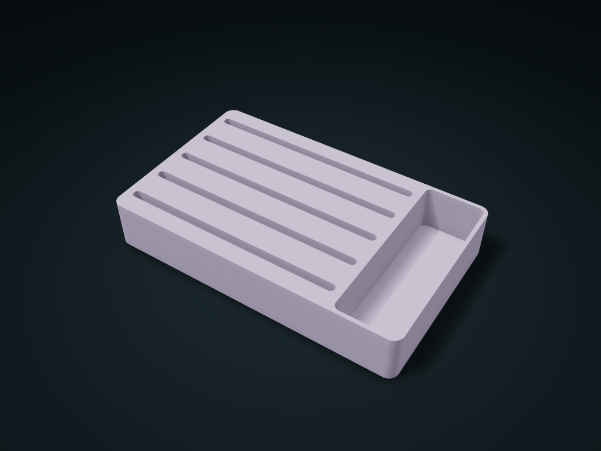

# Ring Slot Box

Insert rings into rounded slots and place earrings beside them; size slots for band thickness and grip access, and adjust the side space.

**[Preview this model and customize it on boxesmodel](https://boxesmodel.com/models/ring-slot-box)**

## Default model

| Property | Value |
| --- | --- |
| Category | Desktop Organizers |
| Model version | 1.0.0 |
| Default box size | 180 × 110 × 30 mm |
| Included parts | 1 |
| Formats | STL and STEP |
| Units | Millimeters |

Dimensions include the outer outline of the box; see the specifications for usable interior space.

## Intended use

- Rings and small earrings; slot depth must be less than ring outer diameter. No foam-like grip. Hard surfaces may scratch; recheck clearance after adding lining.

## Dimensions and features

| Detail | Default value |
| --- | --- |
| Number of ring slots | 5 |
| Slot clear width/depth | 5.0 / 12.0 mm |
| Side compartment clear width | 35.0 mm |

## Download the parts

Open a file below and choose **Download raw file** on GitHub. STL is for slicers; STEP is for CAD editing.

| Part | Dimensions | STL | STEP |
| --- | --- | --- | --- |
| Ring slots and side compartment | 180 × 110 × 30 mm | [body.stl](body.stl) | [body.step](body.step) |

Each listed part has its own STL and STEP file. Preview colors are illustrative; the manufacturing files do not contain the displayed colors.

## Printing and assembly

- Choose slot width by actual ring thickness plus allowance; slot depth must be less than the ring's outer diameter so it can be picked up; sponge clamping is not simulated.
- Hard printed parts may rub jewelry; add a soft liner yourself and recheck the clear sizes; print base down.
- Import at millimeter scale. Check your build volume, orientation, overhangs, supports and mating clearances in the slicer.

## Adjust the design

Visit the [interactive model page](https://boxesmodel.com/models/ring-slot-box) to inspect the 3D model and adjust the available dimensions and layout options. This folder contains the default-size export shown above; custom exports follow the options and pricing shown on boxesmodel.

## License and attribution

Copyright © 2026 boxesmodel. These model files, preview and description are licensed under [CC BY 4.0](https://creativecommons.org/licenses/by/4.0/). You may share, modify and use them commercially with the required attribution. See the [full license](../../LICENSE) and [attribution guide](../../ATTRIBUTION.md).

Suggested credit:

> “Ring Slot Box” by [boxesmodel](https://boxesmodel.com/models/ring-slot-box), licensed under [CC BY 4.0](https://creativecommons.org/licenses/by/4.0/). Indicate any changes you make.

[Browse all models](../../CATALOG.md) · [About the collection](../../README.md)
