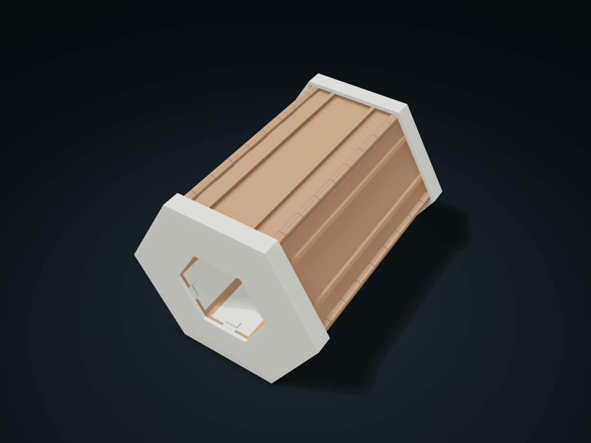

# Six-Compartment Roll-Up Case

Sort dice or craft parts in six rows; remove end rings, unfold and slide lids out. Set dividers per row and close all lids before rolling up.

**[Preview this model and customize it on boxesmodel](https://boxesmodel.com/models/rollup-cell-case)**

## Default model

| Property | Value |
| --- | --- |
| Category | Lidded Storage |
| Model version | 1.0.1 |
| Default assembly display size | 122.93 × 145.6 × 106.46 mm |
| Included parts | 14 |
| Formats | STL and STEP |
| Units | Millimeters |

Covers the layout of all parts in the current preview; see Files and dimensions for each part's print size.

## Intended use

- Dice and craft parts; supply five 1.75 mm filament pins cut flush to the row length. Support both ends when moving; no transport locking, water protection or spill-prevention claim.
- Check ring friction, pin fit, repeated-use strength and drop behavior before use; push all six lids to the rear stops before rolling and fitting rings.

## Dimensions and features

| Detail | Default value |
| --- | --- |
| Six-compartment cells | 1 / 2 / 3 / 4 / 5 / 6 |
| Total independent compartments | 21 cells |
| Clear depth under the lid | 14.1 mm |
| Extra pins | 5 lengths of 1.75 mm filament, 140 mm each |

## Download the parts

Open a file below and choose **Download raw file** on GitHub. STL is for slicers; STEP is for CAD editing.

| Part | Dimensions | STL | STEP |
| --- | --- | --- | --- |
| Strip compartment 1 | 57.8 × 140 × 22.8 mm | [tray-1.stl](tray-1.stl) | [tray-1.step](tray-1.step) |
| Sliding lid 1 | 31.66 × 137.2 × 3.6 mm | [lid-1.stl](lid-1.stl) | [lid-1.step](lid-1.step) |
| Strip compartment 2 | 41.85 × 140 × 53.23 mm | [tray-2.stl](tray-2.stl) | [tray-2.step](tray-2.step) |
| Sliding lid 2 | 17.21 × 137.2 × 27.42 mm | [lid-2.stl](lid-2.stl) | [lid-2.step](lid-2.step) |
| Strip compartment 3 | 41.85 × 140 × 53.23 mm | [tray-3.stl](tray-3.stl) | [tray-3.step](tray-3.step) |
| Sliding lid 3 | 17.21 × 137.2 × 27.42 mm | [lid-3.stl](lid-3.stl) | [lid-3.step](lid-3.step) |
| Strip compartment 4 | 60.6 × 140 × 22.8 mm | [tray-4.stl](tray-4.stl) | [tray-4.step](tray-4.step) |
| Sliding lid 4 | 31.66 × 137.2 × 3.6 mm | [lid-4.stl](lid-4.stl) | [lid-4.step](lid-4.step) |
| Strip compartment 5 | 41.85 × 140 × 53.23 mm | [tray-5.stl](tray-5.stl) | [tray-5.step](tray-5.step) |
| Sliding lid 5 | 17.21 × 137.2 × 27.42 mm | [lid-5.stl](lid-5.stl) | [lid-5.step](lid-5.step) |
| Strip compartment 6 | 41.85 × 140 × 50.43 mm | [tray-6.stl](tray-6.stl) | [tray-6.step](tray-6.step) |
| Sliding lid 6 | 17.21 × 137.2 × 27.42 mm | [lid-6.stl](lid-6.stl) | [lid-6.step](lid-6.step) |
| Front end ring | 122.93 × 10.8 × 106.46 mm | [collar-front.stl](collar-front.stl) | [collar-front.step](collar-front.step) |
| Rear end ring | 122.93 × 10.8 × 106.46 mm | [collar-back.stl](collar-back.stl) | [collar-back.step](collar-back.step) |

Each listed part has its own STL and STEP file. Preview colors are illustrative; the manufacturing files do not contain the displayed colors.

## Printing and assembly

- Set the number of cells for each of the six compartments separately; six sliding lids close their own compartments, then roll up into a hexagon and slip into the front and rear rings.
- Supply 5 lengths of 1.75 mm filament as hinge pins, each cut to the strip compartment length and flush at both ends; axle hole 2.2 mm.
- Remove the rings at both ends, then unroll it; slide out the matching lid to take items. To close, push all six lids to the rear stop, then roll it up and slip the rings back over both ends.
- The ring is located with clearance; check friction retention before use; support both ends when moving; no transport locking, waterproofing or spill protection is claimed.
- The flat preview places the rings alongside, and the envelope includes those parts; the open/closed display does not change the manufactured parts.
- Check the overhang under the hinge and print supports for the box compartment; print the sliding lids with their large flat face on the plate and the rings with their end faces on the plate. Before use, check the pin fit, repeated opening strength and drop resistance.
- Import at millimeter scale. Check your build volume, orientation, overhangs, supports and mating clearances in the slicer.

## Adjust the design

Visit the [interactive model page](https://boxesmodel.com/models/rollup-cell-case) to inspect the 3D model and adjust the available dimensions and layout options. This folder contains the default-size export shown above; custom exports follow the options and pricing shown on boxesmodel.

## License and attribution

Copyright © 2026 boxesmodel. These model files, preview and description are licensed under [CC BY 4.0](https://creativecommons.org/licenses/by/4.0/). You may share, modify and use them commercially with the required attribution. See the [full license](../../LICENSE) and [attribution guide](../../ATTRIBUTION.md).

Suggested credit:

> “Six-Compartment Roll-Up Case” by [boxesmodel](https://boxesmodel.com/models/rollup-cell-case), licensed under [CC BY 4.0](https://creativecommons.org/licenses/by/4.0/). Indicate any changes you make.

[Browse all models](../../CATALOG.md) · [About the collection](../../README.md)
