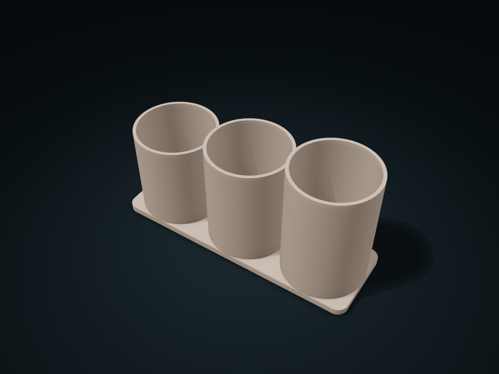

# Round Tiered Brush Cups

Sort short pencils into low round cups and long brushes into taller cups. Adjust cup count, height steps and overall dimensions.

**[Preview this model and customize it on boxesmodel](https://boxesmodel.com/models/round-tiered-brush-cups)**

## Default model

| Property | Value |
| --- | --- |
| Category | Desktop Organizers |
| Model version | 1.0.0 |
| Default box size | 218 × 72 × 110 mm |
| Included parts | 1 |
| Formats | STL and STEP |
| Units | Millimeters |

Dimensions include the outer outline of the box; see the specifications for usable interior space.

## Intended use

- For dry makeup brushes, brow pencils or desk pens. Closed cup bottoms do not drain; keep brush heads up. Inner diameter does not imply brand compatibility.
- Cups and base are one piece; cups cannot be removed. Regenerate to change cup count. No purchased screws, shafts or adhesive parts are required.
- Check bridges and supports before printing. Check load capacity, leakage and material suitability for the intended use.

## Dimensions and features

| Detail | Default value |
| --- | --- |
| Cup clear diameter | 66.4 mm； 3 cups |
| Height step between levels | Step between neighbors 12.0 mm; lowest cup height 86.0 mm |
| Cup bottom and cup spacing | Floor 6.0 mm thick; center distance 73.0 mm |

## Download the parts

Open a file below and choose **Download raw file** on GitHub. STL is for slicers; STEP is for CAD editing.

| Part | Dimensions | STL | STEP |
| --- | --- | --- | --- |
| Joined stepped-height brush cup stand | 218 × 72 × 110 mm | [body.stl](body.stl) | [body.step](body.step) |

Each listed part has its own STL and STEP file. Preview colors are illustrative; the manufacturing files do not contain the displayed colors.

## Printing and assembly

- For dry tools only; the cup bottoms do not drain; store brush heads facing up; the clear diameter is not a fit promise for any particular brand.
- All cups and the base print as one piece; changing the cup count regenerates the model; cups cannot be separated.
- All required parts are in the download; no purchased screws, shafts or glued parts. Display colors are only for covers and previews; STL/STEP manufacturing files carry no color.
- Place each part on the build plate separately before printing, and check hole-top bridges and supports in the slicer; Check load capacity, leak resistance and material suitability for your intended use.
- Import at millimeter scale. Check your build volume, orientation, overhangs, supports and mating clearances in the slicer.

## Adjust the design

Visit the [interactive model page](https://boxesmodel.com/models/round-tiered-brush-cups) to inspect the 3D model and adjust the available dimensions and layout options. This folder contains the default-size export shown above; custom exports follow the options and pricing shown on boxesmodel.

## License and attribution

Copyright © 2026 boxesmodel. These model files, preview and description are licensed under [CC BY 4.0](https://creativecommons.org/licenses/by/4.0/). You may share, modify and use them commercially with the required attribution. See the [full license](../../LICENSE) and [attribution guide](../../ATTRIBUTION.md).

Suggested credit:

> “Round Tiered Brush Cups” by [boxesmodel](https://boxesmodel.com/models/round-tiered-brush-cups), licensed under [CC BY 4.0](https://creativecommons.org/licenses/by/4.0/). Indicate any changes you make.

[Browse all models](../../CATALOG.md) · [About the collection](../../README.md)
