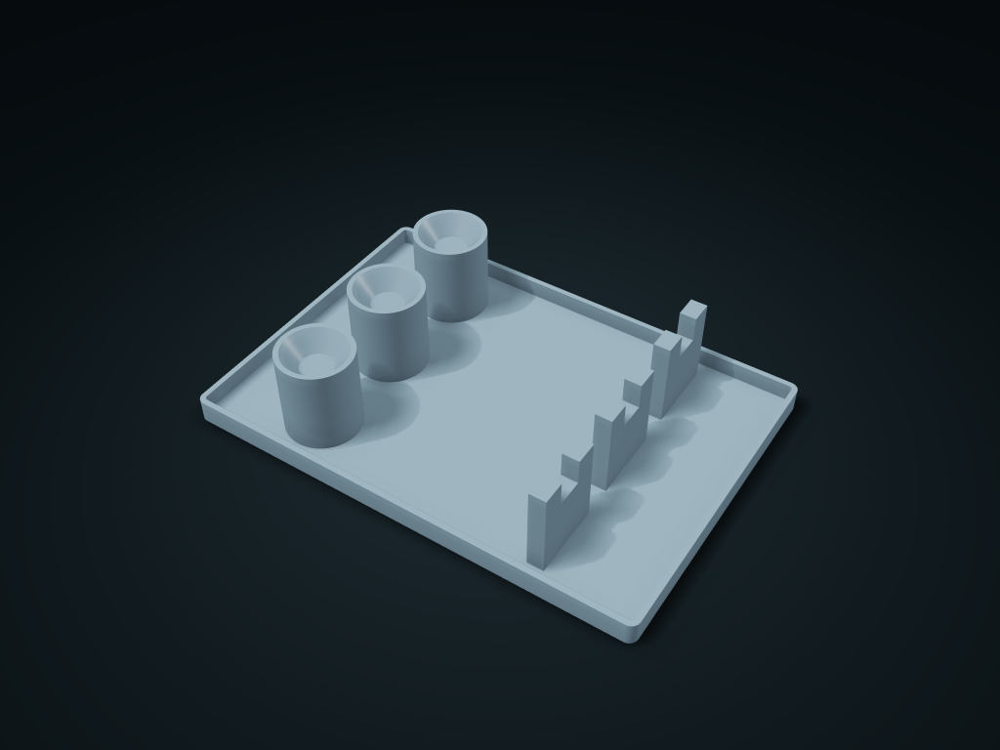

# Measuring Spoon Bowl & Handle Rest Box

A shallow bowl rest and a separate handle fork share the support, with a crumb tray below

**[Preview this model and customize it on boxesmodel](https://boxesmodel.com/models/scoop-saddle-basin)**

## Default model

| Property | Value |
| --- | --- |
| Category | Desktop Organizers |
| Model version | 1.0.0 |
| Default box size | 200 × 140 × 40 mm |
| Included parts | 1 |
| Formats | STL and STEP |
| Units | Millimeters |

Dimensions include the outer outline of the box; see the specifications for usable interior space.

## Dimensions and features

| Detail | Default value |
| --- | --- |
| Use | A shallow bowl rest and a separate handle fork share the support, with a crumb tray below |

## Download the parts

Open a file below and choose **Download raw file** on GitHub. STL is for slicers; STEP is for CAD editing.

| Part | Dimensions | STL | STEP |
| --- | --- | --- | --- |
| Measuring Spoon Bowl & Handle Rest Box | 200 × 140 × 40 mm | [body.stl](body.stl) | [body.step](body.step) |

Each listed part has its own STL and STEP file. Preview colors are illustrative; the manufacturing files do not contain the displayed colors.

## Printing and assembly

- One-piece, printed flat on its base; the spoon bowl sits on a round shallow seat and the handle on a U-fork at the other end, suspended between the two supports.
- Adjust by spoon bowl diameter, handle width and support span; before use, note it only stores cooled, dry tools, and check hygiene and food contact.
- Import at millimeter scale. Check your build volume, orientation, overhangs, supports and mating clearances in the slicer.

## Adjust the design

Visit the [interactive model page](https://boxesmodel.com/models/scoop-saddle-basin) to inspect the 3D model and adjust the available dimensions and layout options. This folder contains the default-size export shown above; custom exports follow the options and pricing shown on boxesmodel.

## License and attribution

Copyright © 2026 boxesmodel. These model files, preview and description are licensed under [CC BY 4.0](https://creativecommons.org/licenses/by/4.0/). You may share, modify and use them commercially with the required attribution. See the [full license](../../LICENSE) and [attribution guide](../../ATTRIBUTION.md).

Suggested credit:

> “Measuring Spoon Bowl & Handle Rest Box” by [boxesmodel](https://boxesmodel.com/models/scoop-saddle-basin), licensed under [CC BY 4.0](https://creativecommons.org/licenses/by/4.0/). Indicate any changes you make.

[Browse all models](../../CATALOG.md) · [About the collection](../../README.md)
