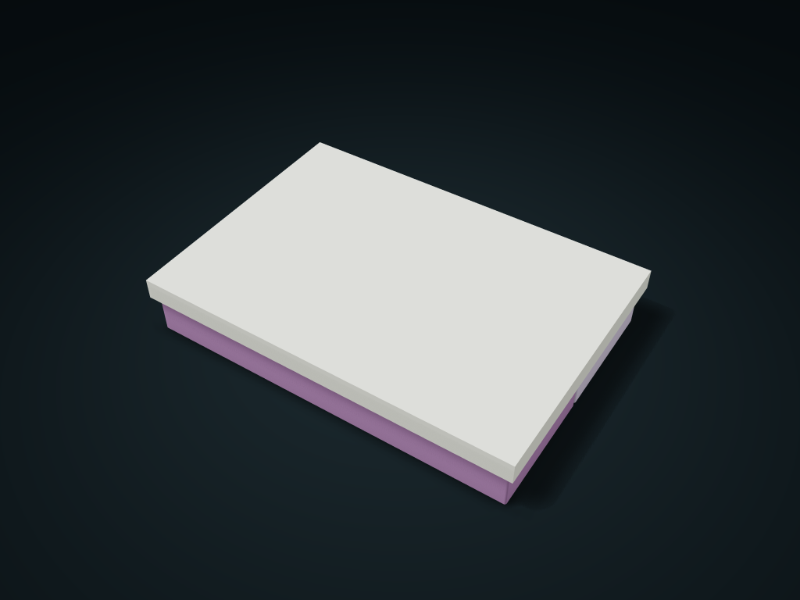

# Shared-Lid Twin Resource Trays

Use two token trays at opposite table ends, then cover them side by side; adjust dividers and lid depth. An outer box must restrain the lid in storage.

**[Preview this model and customize it on boxesmodel](https://boxesmodel.com/models/shared-cap-resource-pair)**

## Default model

| Property | Value |
| --- | --- |
| Category | Desktop Organizers |
| Model version | 1.0.0 |
| Default assembly display size | 184 × 128 × 30 mm |
| Included parts | 3 |
| Formats | STL and STEP |
| Units | Millimeters |

Covers the layout of all parts in the current preview; see Files and dimensions for each part's print size.

## Intended use

- Rigid tokens at least 1 mm thick; allow at least 1 mm handling clearance around their maximum outline. Not for thin paper; side storage needs an outer box to restrain the lid.
- The loose lid has no latch. Support both tray bottoms, never carry by the lid; not for drop protection or spill-proof transport. Check fit and outer-box lid restraint physically.

## Dimensions and features

| Detail | Default value |
| --- | --- |
| Separate resource trays / total cells | 2 / 6 |
| Clear length / width / height per cell | 56.3 / 56.0 / 24.9 mm |
| Wall top to lid inner face | 0.35 mm (requires the outer case lid pressing down) |
| Tray height exposed outside the lid | 19.6 mm |

## Download the parts

Open a file below and choose **Download raw file** on GitHub. STL is for slicers; STEP is for CAD editing.

| Part | Dimensions | STL | STEP |
| --- | --- | --- | --- |
| Front separate resource tray | 178.4 × 60.8 × 27.25 mm | [front-tray.stl](front-tray.stl) | [front-tray.step](front-tray.step) |
| Rear separate resource tray | 178.4 × 60.8 × 27.25 mm | [back-tray.stl](back-tray.stl) | [back-tray.step](back-tray.step) |
| Shared outer lid for both trays | 184 × 128 × 10.4 mm | [cap.stl](cap.stl) | [cap.step](cap.step) |

Each listed part has its own STL and STEP file. Preview colors are illustrative; the manufacturing files do not contain the displayed colors.

## Printing and assembly

- Lift the shared lid straight up first, then put the two trays at the two ends of the table; line them up side by side, then drop the lid on to put them away. Three separately printed parts, no magnets.
- 3 cells per tray, each about 56.3 × 56.0 × 24.9 mm clear; measure items at their maximum shape and leave at least 1 mm of access allowance.
- Tray walls and divider tops are 0.35 mm from the lid's inner face; suits rigid tokens at least 1 mm thick. When stored on its side, the lid must be held down by the game box; not suitable for thin paper pieces.
- This is a loose-fit outer lid with no latch. Support both trays from below when moving; do not carry it by the lid; not for drop protection or spill-proof transport.
- Tray bottom down; flip the lid when slicing so the flat top is on the bed. Fit tolerances and the outer case lid pressing condition need measuring.
- Import at millimeter scale. Check your build volume, orientation, overhangs, supports and mating clearances in the slicer.

## Adjust the design

Visit the [interactive model page](https://boxesmodel.com/models/shared-cap-resource-pair) to inspect the 3D model and adjust the available dimensions and layout options. This folder contains the default-size export shown above; custom exports follow the options and pricing shown on boxesmodel.

## License and attribution

Copyright © 2026 boxesmodel. These model files, preview and description are licensed under [CC BY 4.0](https://creativecommons.org/licenses/by/4.0/). You may share, modify and use them commercially with the required attribution. See the [full license](../../LICENSE) and [attribution guide](../../ATTRIBUTION.md).

Suggested credit:

> “Shared-Lid Twin Resource Trays” by [boxesmodel](https://boxesmodel.com/models/shared-cap-resource-pair), licensed under [CC BY 4.0](https://creativecommons.org/licenses/by/4.0/). Indicate any changes you make.

[Browse all models](../../CATALOG.md) · [About the collection](../../README.md)
