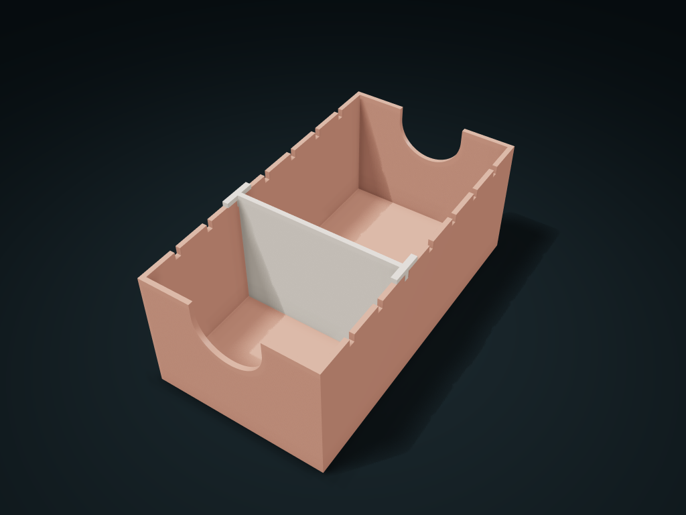

# Sliding Stop Draw & Discard Card Shoe

Share one long box for draw and discard piles; lift and reposition the divider as stacks change. Adjust stops, position and card-grip cutouts.

**[Preview this model and customize it on boxesmodel](https://boxesmodel.com/models/shift-divider-card-shoe)**

## Default model

| Property | Value |
| --- | --- |
| Category | Desktop Organizers |
| Model version | 1.0.0 |
| Default assembly display size | 86 × 160 × 65 mm |
| Included parts | 2 |
| Formats | STL and STEP |
| Units | Millimeters |

Covers the layout of all parts in the current preview; see Files and dimensions for each part's print size.

## Intended use

- Sleeved cards at least 0.35 mm thick; suggested width ≤80.0 mm and height ≥68.2 mm. Size for sleeved width and measured stack thickness; not for thin paper.
- Lift the divider at least 4.4 mm before repositioning; do not force engaged teeth. No locking lid or travel spill protection; check clearance, sleeve friction and repeated repositioning.

## Dimensions and features

| Detail | Default value |
| --- | --- |
| Stop position spacing | 19.9 mm |
| Current draw / discard clear depth | 56.5 / 96.3 mm |
| Recommended maximum card width | 80.0 mm (including sleeve) |
| Current stop position | 3 / 7, counted from the front |

## Download the parts

Open a file below and choose **Download raw file** on GitHub. STL is for slicers; STEP is for CAD editing.

| Part | Dimensions | STL | STEP |
| --- | --- | --- | --- |
| Draw/discard long compartment | 86 × 160 × 62.6 mm | [body.stl](body.stl) | [body.step](body.step) |
| Lift-out sliding divider | 86 × 16 × 62.35 mm | [divider.stl](divider.stl) | [divider.step](divider.step) |

Each listed part has its own STL and STEP file. Preview colors are illustrative; the manufacturing files do not contain the displayed colors.

## Printing and assembly

- Open-top desk storage for standing cards; when the draw area shrinks, lift the divider at least 4.4 mm first, then move it to another stop to free discard space. Do not push hard with teeth engaged.
- Set the outer length by the actual sleeved card width; recommended card width ≤ 80.0 mm and card height ≥ 68.2 mm so 8 mm shows for pinching. Capacity is calculated from the measured card stack thickness.
- Divider bottom gap 0.25 mm, side gap 0.4 mm; suits sleeved cards at least 0.35 mm thick each; thin paper may slip through the bottom gap. No locking lid; not a spill-proof travel box.
- Two printed parts, no hardware. Compartment base down; dividers export as narrow upright plates; add a brim when slicing and check crossbar supports. Before use, check the real slide-in allowance, sleeve friction and repeated repositioning.
- Import at millimeter scale. Check your build volume, orientation, overhangs, supports and mating clearances in the slicer.

## Adjust the design

Visit the [interactive model page](https://boxesmodel.com/models/shift-divider-card-shoe) to inspect the 3D model and adjust the available dimensions and layout options. This folder contains the default-size export shown above; custom exports follow the options and pricing shown on boxesmodel.

## License and attribution

Copyright © 2026 boxesmodel. These model files, preview and description are licensed under [CC BY 4.0](https://creativecommons.org/licenses/by/4.0/). You may share, modify and use them commercially with the required attribution. See the [full license](../../LICENSE) and [attribution guide](../../ATTRIBUTION.md).

Suggested credit:

> “Sliding Stop Draw & Discard Card Shoe” by [boxesmodel](https://boxesmodel.com/models/shift-divider-card-shoe), licensed under [CC BY 4.0](https://creativecommons.org/licenses/by/4.0/). Indicate any changes you make.

[Browse all models](../../CATALOG.md) · [About the collection](../../README.md)
