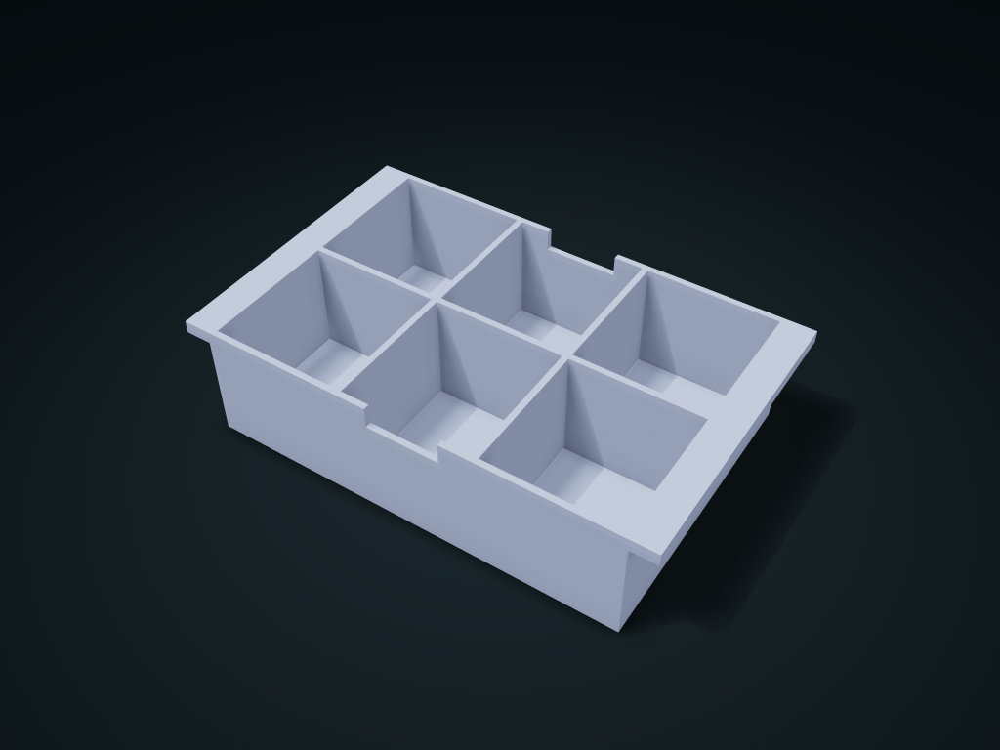

# Shoulder-Hung Upper Divided Box

Rest the tray on toolbox end ledges, with screws above and tools below; lift it out whole. Adjust wing extension, dividers and grip cutouts.

**[Preview this model and customize it on boxesmodel](https://boxesmodel.com/models/shoulder-hung-bin)**

## Default model

| Property | Value |
| --- | --- |
| Category | Desktop Organizers |
| Model version | 1.0.0 |
| Default box size | 180 × 112 × 45 mm |
| Included parts | 1 |
| Formats | STL and STEP |
| Units | Millimeters |

Dimensions include the outer outline of the box; see the specifications for usable interior space.

## Intended use

- Requires continuous ledges at both ends, not brand assumptions. Reference opening at least 161.2×113.2 mm, with ≥5 mm support per end; oversized openings lose support.
- Check at least 2 mm below the box and 6.8 mm under the lid above the ledges. Grip cutouts are for empty/light loads; support both ends when full. Check fit, weight support and drop behavior.

## Dimensions and features

| Detail | Default value |
| --- | --- |
| Single cell clear length / width | 50.1 / 52.4 mm |
| Storage height below the finger notch | 34.6 mm |
| Reference box opening | 161.2 × 113.2 mm |
| Reference end support overlap | 9.4 mm / per end |

## Download the parts

Open a file below and choose **Download raw file** on GitHub. STL is for slicers; STEP is for CAD editing.

| Part | Dimensions | STL | STEP |
| --- | --- | --- | --- |
| Shoulder-wing hanging divided box | 180 × 112 × 45 mm | [body.stl](body.stl) | [body.step](body.step) |

Each listed part has its own STL and STEP file. Preview colors are illustrative; the manufacturing files do not contain the displayed colors.

## Printing and assembly

- The printed outer length already includes the 10 mm shoulder wings at each end; box outer length 160 mm. For toolboxes measured to have continuous shoulders at both ends; fit with a particular brand is not claimed.
- Recommended inner box opening at least 161.2 × 113.2 mm; the end shoulders support at least 5 mm under the wings. Check the actual opening; too large loses support.
- 40.2 mm from the shoulder plane to the box bottom; another 2 mm is left under the box bottom, and the upper lid leaves at least 6.8 mm above the shoulders.
- Put in and lift out straight from above. The front and rear finger notches are for pinching an empty or lightly loaded box; hold a full one from both ends; dividers are one piece with the box floor.
- No assembly hardware needed; print base down; check local supports for the overhangs under the end shoulder wings when slicing. Before use, check the real fit, printed load-bearing and drop resistance.
- Import at millimeter scale. Check your build volume, orientation, overhangs, supports and mating clearances in the slicer.

## Adjust the design

Visit the [interactive model page](https://boxesmodel.com/models/shoulder-hung-bin) to inspect the 3D model and adjust the available dimensions and layout options. This folder contains the default-size export shown above; custom exports follow the options and pricing shown on boxesmodel.

## License and attribution

Copyright © 2026 boxesmodel. These model files, preview and description are licensed under [CC BY 4.0](https://creativecommons.org/licenses/by/4.0/). You may share, modify and use them commercially with the required attribution. See the [full license](../../LICENSE) and [attribution guide](../../ATTRIBUTION.md).

Suggested credit:

> “Shoulder-Hung Upper Divided Box” by [boxesmodel](https://boxesmodel.com/models/shoulder-hung-bin), licensed under [CC BY 4.0](https://creativecommons.org/licenses/by/4.0/). Indicate any changes you make.

[Browse all models](../../CATALOG.md) · [About the collection](../../README.md)
