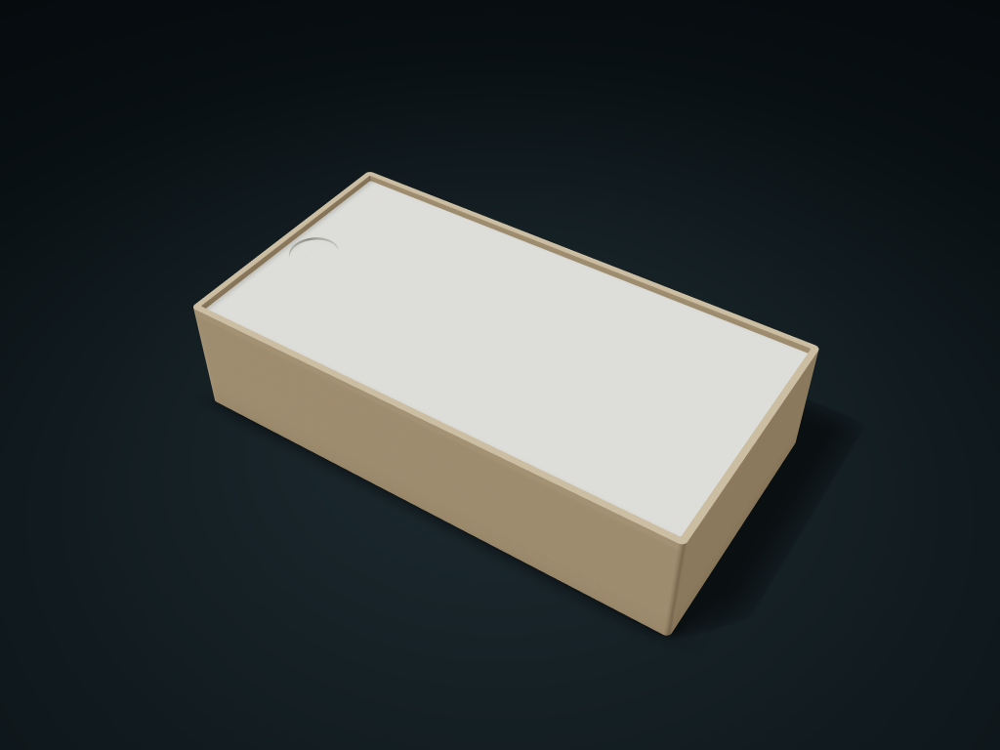

# Side Sliding Lid Box

The lid slides open within the rails, keeping pens, cables and small items close at hand.

**[Preview this model and customize it on boxesmodel](https://boxesmodel.com/models/sliding-box)**

## Default model

| Property | Value |
| --- | --- |
| Category | Lidded Storage |
| Model version | 1.0.0 |
| Default assembly display size | 190 × 100 × 45 mm |
| Included parts | 2 |
| Formats | STL and STEP |
| Units | Millimeters |

Covers the layout of all parts in the current preview; see Files and dimensions for each part's print size.

## Dimensions and features

| Detail | Default value |
| --- | --- |
| Lid opening direction | Pulls out sideways along its length |
| Clear height under the lid | 37.4 mm |

## Download the parts

Open a file below and choose **Download raw file** on GitHub. STL is for slicers; STEP is for CAD editing.

| Part | Dimensions | STL | STEP |
| --- | --- | --- | --- |
| Rail box body | 190 × 100 × 45 mm | [box.stl](box.stl) | [box.step](box.step) |
| Side sliding lid | 187.2 × 96.8 × 2.4 mm | [lid.stl](lid.stl) | [lid.step](lid.step) |

Each listed part has its own STL and STEP file. Preview colors are illustrative; the manufacturing files do not contain the displayed colors.

## Printing and assembly

- The lid slides out along the length from the short side; print the box lid separately with its flat face down.
- Fixed 0.4 mm single-side rail clearance; fits only the box from the same set; no latch or sealing.
- Box base down; before use, check bridging and local supports on the rail top edges, and the real fit.
- Import at millimeter scale. Check your build volume, orientation, overhangs, supports and mating clearances in the slicer.

## Adjust the design

Visit the [interactive model page](https://boxesmodel.com/models/sliding-box) to inspect the 3D model and adjust the available dimensions and layout options. This folder contains the default-size export shown above; custom exports follow the options and pricing shown on boxesmodel.

## License and attribution

Copyright © 2026 boxesmodel. These model files, preview and description are licensed under [CC BY 4.0](https://creativecommons.org/licenses/by/4.0/). You may share, modify and use them commercially with the required attribution. See the [full license](../../LICENSE) and [attribution guide](../../ATTRIBUTION.md).

Suggested credit:

> “Side Sliding Lid Box” by [boxesmodel](https://boxesmodel.com/models/sliding-box), licensed under [CC BY 4.0](https://creativecommons.org/licenses/by/4.0/). Indicate any changes you make.

[Browse all models](../../CATALOG.md) · [About the collection](../../README.md)
