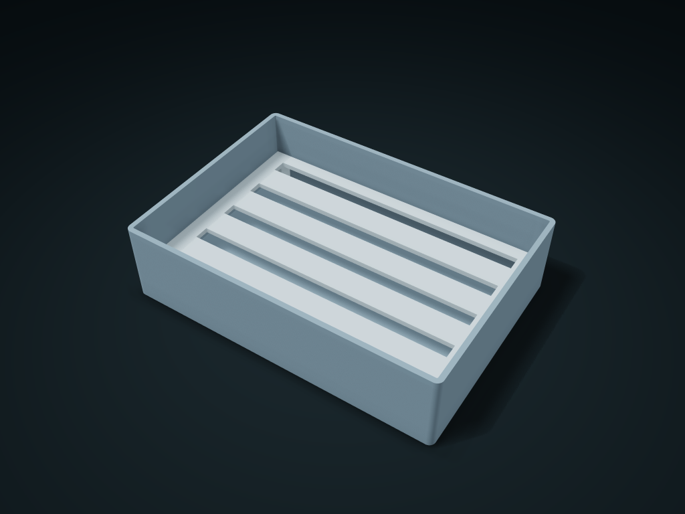

# Lift-Out Soap Dish with Drip Box

Rest soap on a raised grid above the collection cavity; lift the grid to wash. Adjust drain count, width and clearance below.

**[Preview this model and customize it on boxesmodel](https://boxesmodel.com/models/soap-lift-grid-box)**

## Default model

| Property | Value |
| --- | --- |
| Category | Desktop Organizers |
| Model version | 1.0.0 |
| Default assembly display size | 150 × 105 × 38 mm |
| Included parts | 2 |
| Formats | STL and STEP |
| Units | Millimeters |

Covers the layout of all parts in the current preview; see Files and dimensions for each part's print size.

## Intended use

- Soap; water collects below and must be emptied regularly. Check actual space and trial-fit.

## Download the parts

Open a file below and choose **Download raw file** on GitHub. STL is for slicers; STEP is for CAD editing.

| Part | Dimensions | STL | STEP |
| --- | --- | --- | --- |
| Water collection outer box | 150 × 105 × 38 mm | [body.stl](body.stl) | [body.step](body.step) |
| Four-foot lift-out insert | 144.2 × 99.2 × 14.4 mm | [grid.stl](grid.stl) | [grid.step](grid.step) |

Each listed part has its own STL and STEP file. Preview colors are illustrative; the manufacturing files do not contain the displayed colors.

## Printing and assembly

- Print both parts flat base down; the grid's four feet rest directly on the box floor and lift out for washing. Water drains into the bottom cavity; empty it regularly; no hardware.
- Units are millimeters. Measure clearance from your actual items first; check slicing before printing and test-fit the key mating parts.
- Import at millimeter scale. Check your build volume, orientation, overhangs, supports and mating clearances in the slicer.

## Adjust the design

Visit the [interactive model page](https://boxesmodel.com/models/soap-lift-grid-box) to inspect the 3D model and adjust the available dimensions and layout options. This folder contains the default-size export shown above; custom exports follow the options and pricing shown on boxesmodel.

## License and attribution

Copyright © 2026 boxesmodel. These model files, preview and description are licensed under [CC BY 4.0](https://creativecommons.org/licenses/by/4.0/). You may share, modify and use them commercially with the required attribution. See the [full license](../../LICENSE) and [attribution guide](../../ATTRIBUTION.md).

Suggested credit:

> “Lift-Out Soap Dish with Drip Box” by [boxesmodel](https://boxesmodel.com/models/soap-lift-grid-box), licensed under [CC BY 4.0](https://creativecommons.org/licenses/by/4.0/). Indicate any changes you make.

[Browse all models](../../CATALOG.md) · [About the collection](../../README.md)
