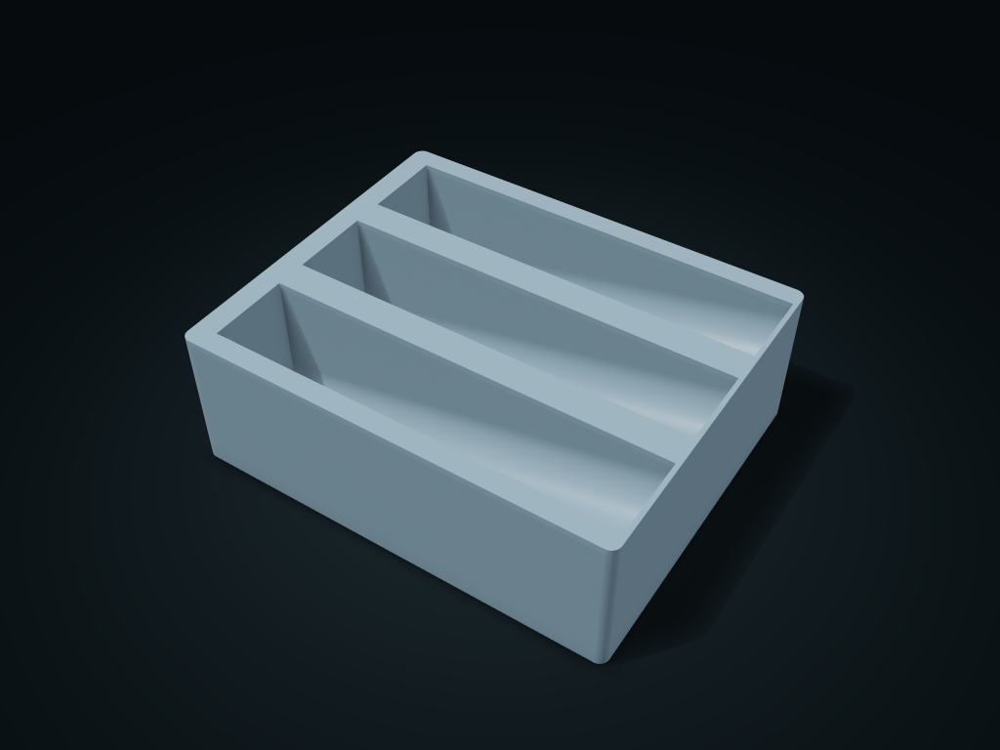

# Reclining Spice Jar Display Box

Tilted arc slots keep bottle labels facing up, with a solid wall at the low end to stop sliding

**[Preview this model and customize it on boxesmodel](https://boxesmodel.com/models/spice-recline-box)**

## Default model

| Property | Value |
| --- | --- |
| Category | Desktop Organizers |
| Model version | 1.0.0 |
| Default box size | 220 × 180 × 75 mm |
| Included parts | 1 |
| Formats | STL and STEP |
| Units | Millimeters |

Dimensions include the outer outline of the box; see the specifications for usable interior space.

## Dimensions and features

| Detail | Default value |
| --- | --- |
| Use | Tilted arc slots keep bottle labels facing up, with a solid wall at the low end to stop sliding |

## Download the parts

Open a file below and choose **Download raw file** on GitHub. STL is for slicers; STEP is for CAD editing.

| Part | Dimensions | STL | STEP |
| --- | --- | --- | --- |
| Reclining Spice Jar Display Box | 220 × 180 × 75 mm | [body.stl](body.stl) | [body.step](body.step) |

Each listed part has its own STL and STEP file. Preview colors are illustrative; the manufacturing files do not contain the displayed colors.

## Printing and assembly

- One-piece, printed flat on its base. Closed bottles lie along the angled slots with the low end against the solid wall; bottle length must not exceed the usable slot length.
- The low-end slot has a stop; it is not a rolling material feeder; after changing the angle, confirm the drawer clear height fits the bottles stored.
- Import at millimeter scale. Check your build volume, orientation, overhangs, supports and mating clearances in the slicer.

## Adjust the design

Visit the [interactive model page](https://boxesmodel.com/models/spice-recline-box) to inspect the 3D model and adjust the available dimensions and layout options. This folder contains the default-size export shown above; custom exports follow the options and pricing shown on boxesmodel.

## License and attribution

Copyright © 2026 boxesmodel. These model files, preview and description are licensed under [CC BY 4.0](https://creativecommons.org/licenses/by/4.0/). You may share, modify and use them commercially with the required attribution. See the [full license](../../LICENSE) and [attribution guide](../../ATTRIBUTION.md).

Suggested credit:

> “Reclining Spice Jar Display Box” by [boxesmodel](https://boxesmodel.com/models/spice-recline-box), licensed under [CC BY 4.0](https://creativecommons.org/licenses/by/4.0/). Indicate any changes you make.

[Browse all models](../../CATALOG.md) · [About the collection](../../README.md)
