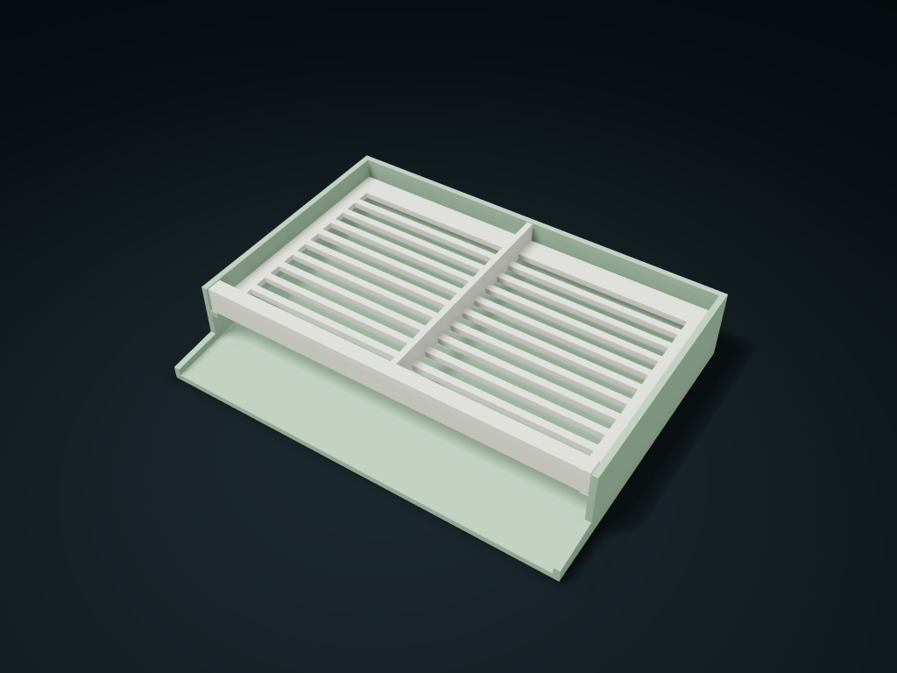

# Waterfall Spout Draining Divided Box

Under the lift-out zoned plate is a continuous sloped floor; water runs out through the wide front opening into the sink.

**[Preview this model and customize it on boxesmodel](https://boxesmodel.com/models/spill-drain-caddy)**

## Default model

| Property | Value |
| --- | --- |
| Category | Desktop Organizers |
| Model version | 1.0.1 |
| Default assembly display size | 160 × 120 × 29.41 mm |
| Included parts | 2 |
| Formats | STL and STEP |
| Units | Millimeters |

Covers the layout of all parts in the current preview; see Files and dimensions for each part's print size.

## Dimensions and features

| Detail | Default value |
| --- | --- |
| Usable zones | 2 zones / clear width 70.0 mm |
| Drainage slots | 20 strips / 5.0 mm wide |
| Front drip lip | 20.0 mm |
| Rear clearance under the support plate | 4 mm |
| Sloped floor slope | 6.0° |

## Download the parts

Open a file below and choose **Download raw file** on GitHub. STL is for slicers; STEP is for CAD editing.

| Part | Dimensions | STL | STEP |
| --- | --- | --- | --- |
| Sloped floor drain box | 160 × 120 × 29.41 mm | [basin.stl](basin.stl) | [basin.step](basin.step) |
| Lift-out zoned slotted plate | 154.4 × 96.8 × 10.4 mm | [grate.stl](grate.stl) | [grate.step](grate.step) |

Each listed part has its own STL and STEP file. Preview colors are illustrative; the manufacturing files do not contain the displayed colors.

## Printing and assembly

- The support plate stands vertically on the ledges on both sides; pinch the front edge to lift it out for washing; 0.4 mm clearance per side. Zones follow the slot rows, and the space below stays open.
- The drip lip reaches over the inside of the sink, and the main body sits flat on the counter; the whole sloped floor drops from back to front, with no water sill at the front opening. This model is not a water container.
- Slice both parts base down and check the overhang of the side support ledges. Before use, check actual drainage flow, surface tension, leakage, water resistance and cleanability; test-print to check the drainage channels before use.
- Import at millimeter scale. Check your build volume, orientation, overhangs, supports and mating clearances in the slicer.

## Adjust the design

Visit the [interactive model page](https://boxesmodel.com/models/spill-drain-caddy) to inspect the 3D model and adjust the available dimensions and layout options. This folder contains the default-size export shown above; custom exports follow the options and pricing shown on boxesmodel.

## License and attribution

Copyright © 2026 boxesmodel. These model files, preview and description are licensed under [CC BY 4.0](https://creativecommons.org/licenses/by/4.0/). You may share, modify and use them commercially with the required attribution. See the [full license](../../LICENSE) and [attribution guide](../../ATTRIBUTION.md).

Suggested credit:

> “Waterfall Spout Draining Divided Box” by [boxesmodel](https://boxesmodel.com/models/spill-drain-caddy), licensed under [CC BY 4.0](https://creativecommons.org/licenses/by/4.0/). Indicate any changes you make.

[Browse all models](../../CATALOG.md) · [About the collection](../../README.md)
