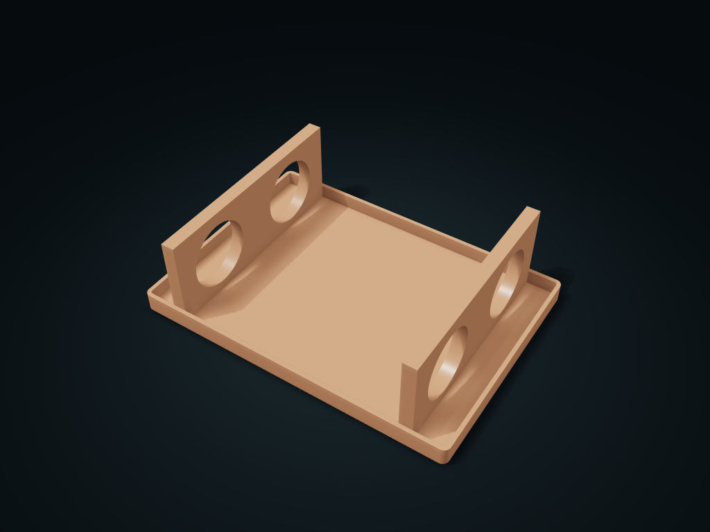

# Ring-Ended Rolled Mat Holder

Lift-off top rings at both ends keep rolled mats from unrolling, with room in the middle for your hand.

**[Preview this model and customize it on boxesmodel](https://boxesmodel.com/models/split-collar-mat-bin)**

## Default model

| Property | Value |
| --- | --- |
| Category | Open Storage |
| Model version | 1.0.0 |
| Default assembly display size | 240 × 170 × 70 mm |
| Included parts | 3 |
| Formats | STL and STEP |
| Units | Millimeters |

Covers the layout of all parts in the current preview; see Files and dimensions for each part's print size.

## Dimensions and features

| Detail | Default value |
| --- | --- |
| Roll positions / band ring clear diameter | 2 × Ø50 mm |
| Recommended rolled mat outer diameter | ≤ 48 mm |
| Recommended minimum roll width | 200 mm |
| Printed parts / purchased | 3 parts / no required purchases |

## Download the parts

Open a file below and choose **Download raw file** on GitHub. STL is for slicers; STEP is for CAD editing.

| Part | Dimensions | STL | STEP |
| --- | --- | --- | --- |
| Lower rings at both ends and an open base tray | 240 × 170 × 35 mm | [bed.stl](bed.stl) | [bed.step](bed.step) |
| Lift-off upper band ring and twin locating feet | 10 × 164 × 43 mm | [keeper_1.stl](keeper_1.stl) | [keeper_1.step](keeper_1.step) |
| Lift-off upper band ring and twin locating feet | 10 × 164 × 43 mm | [keeper_2.stl](keeper_2.stl) | [keeper_2.step](keeper_2.step) |

Each listed part has its own STL and STEP file. Preview colors are illustrative; the manufacturing files do not contain the displayed colors.

## Printing and assembly

- 3 complete printed parts: 1 one-piece base tray and 2 upper band rings with twin locating feet; no purchased axles, screws or glue.
- 2 rolled mat positions; the closed band ring is 50 mm clear; a naturally rolled outer diameter no more than 48 mm is recommended. Effective rolled mat width at least 200 mm; rolled material may extend beyond the box length but needs extra cabinet clearance, and must not overhang either support and sit off-center.
- Front and rear band ring centers 180 mm apart, each ring 10 mm axial support thickness; 4 × 4 mm locating feet inserted 8 mm deep, 0.4 mm clearance per side in the holes; an extra 0.4 mm at the hole bottoms; the upper ring seats on the parting face.
- First lift the two upper rings straight off, then lay the cooled, dry rolled mats flat on the lower half rings; line the locating feet up with the holes and seat them. Remove in reverse: take both rings off, then hold the middle and lift; do not pull a mat with curled edges out of a closed ring.
- Gravity-only assembly with no latch; do not carry the whole tray by the upper ring. The middle base tray only catches debris and does not count as a storage compartment.
- Base tray bottom on the bed; slicing the upper rings with their wide side on the bed is recommended; check supports for the locating feet and arc overhangs. Check slicing and test-print before printing; before use, check the long-term unrolling force. Store only cooled, dry mats; not for ovens, hot pads or high-temperature washing.
- Import at millimeter scale. Check your build volume, orientation, overhangs, supports and mating clearances in the slicer.

## Adjust the design

Visit the [interactive model page](https://boxesmodel.com/models/split-collar-mat-bin) to inspect the 3D model and adjust the available dimensions and layout options. This folder contains the default-size export shown above; custom exports follow the options and pricing shown on boxesmodel.

## License and attribution

Copyright © 2026 boxesmodel. These model files, preview and description are licensed under [CC BY 4.0](https://creativecommons.org/licenses/by/4.0/). You may share, modify and use them commercially with the required attribution. See the [full license](../../LICENSE) and [attribution guide](../../ATTRIBUTION.md).

Suggested credit:

> “Ring-Ended Rolled Mat Holder” by [boxesmodel](https://boxesmodel.com/models/split-collar-mat-bin), licensed under [CC BY 4.0](https://creativecommons.org/licenses/by/4.0/). Indicate any changes you make.

[Browse all models](../../CATALOG.md) · [About the collection](../../README.md)
