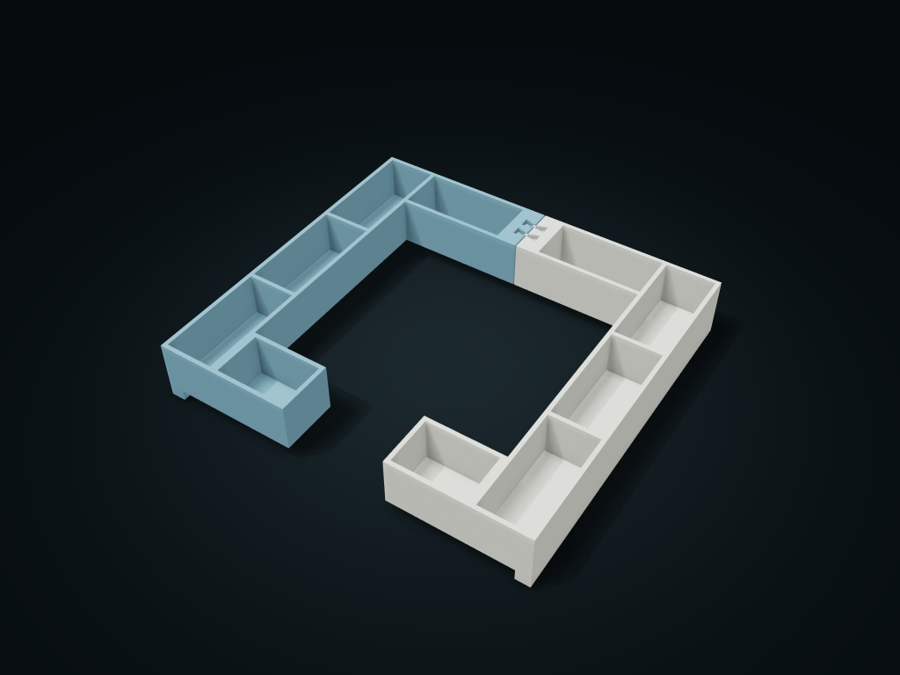

# Twin-Plate See-Through Monitor Top Tray

Sort cold tool covers and spares around equipment, keeping center and front clear; remove keys to split the tray. Adjust clearance, cells and front port.

**[Preview this model and customize it on boxesmodel](https://boxesmodel.com/models/split-service-crown-tray)**

## Default model

| Property | Value |
| --- | --- |
| Category | Desktop Organizers |
| Model version | 1.0.0 |
| Default assembly display size | 260 × 240 × 42 mm |
| Included parts | 4 |
| Formats | STL and STEP |
| Units | Millimeters |

Covers the layout of all parts in the current preview; see Files and dimensions for each part's print size.

## Intended use

- Cold tool covers and small parts; leave space for equipment, knobs and instruments, not brand assumptions. Use a flat stable support; cells and viewing ports do not establish ventilation performance.
- Empty and remove the tray before servicing glass lids, feeders or top controls; port width does not define service access. Keys do not lock against inversion; support both halves and trial-fit loads, movement and tolerances.

## Dimensions and features

| Detail | Default value |
| --- | --- |
| Device keep-out rectangle | 180 × 160 mm； Through floor |
| Front center viewing width | 70 mm |
| Side cells / front and rear compartments | 3 cells per side; 2 compartments front and back |
| Side cell clear width / minimum clear depth | 34 / 76 mm |
| Foot height / clear height above the compartment floor | 8 / 31 mm |
| Suggested colors | Haze blue/cream, violet/lime, sage/warm gray, terracotta/navy, berry/light pink, slate/mustard |

## Download the parts

Open a file below and choose **Download raw file** on GitHub. STL is for slicers; STEP is for CAD editing.

| Part | Dimensions | STL | STEP |
| --- | --- | --- | --- |
| Left half-ring frame and support feet | 129.6 × 240 × 42 mm | [left-frame.stl](left-frame.stl) | [left-frame.step](left-frame.step) |
| Right half-ring frame and support feet | 129.6 × 240 × 42 mm | [right-frame.stl](right-frame.stl) | [right-frame.step](right-frame.step) |
| Vertically inserted double-ended key 1 | 16 × 6 × 31 mm | [key-1.stl](key-1.stl) | [key-1.step](key-1.step) |
| Vertically inserted double-ended key 2 | 16 × 6 × 31 mm | [key-2.stl](key-2.stl) | [key-2.step](key-2.step) |

Each listed part has its own STL and STEP file. Preview colors are illustrative; the manufacturing files do not contain the displayed colors.

## Printing and assembly

- No assembly hardware needed. The central rectangular opening and front center viewing opening stay clear; size them by the maximum envelope of your actual feeder/device/knob/gauge; research sources do not mean this model fits a particular brand or device.
- The two halves drop onto a flat, stable support surface from above on the left and right of the device, with 0.4 mm per side at the rear seam; once aligned, two double-ended keys are inserted from above down to the shoulders. Lift the two keys first, then move the two halves apart to the left and right.
- Long side feet and small rear feet at the bottom support it, and the inner compartment has its own solid floor; side cells store thin tools, and small front and rear compartments hold cold small items. Dividers and viewing openings must not be taken as a promise of ventilation for running devices.
- Empty and remove this tray before servicing the glass top, feeder or top control parts; do not open the glass while the tray is in place, and do not infer the machine's whole service path from the viewing window width.
- The connecting keys only stop the halves separating horizontally; they sit by gravity with no anti-inversion lock; support the bottoms of both halves when moving; device support, load, wobble and tolerance need a real test fit.
- Slice both halves' feet and the key bottoms facing down; check supports for the raised floor and slot shoulder bridges; check slicing before printing, and test-print key mating parts.
- Import at millimeter scale. Check your build volume, orientation, overhangs, supports and mating clearances in the slicer.

## Adjust the design

Visit the [interactive model page](https://boxesmodel.com/models/split-service-crown-tray) to inspect the 3D model and adjust the available dimensions and layout options. This folder contains the default-size export shown above; custom exports follow the options and pricing shown on boxesmodel.

## License and attribution

Copyright © 2026 boxesmodel. These model files, preview and description are licensed under [CC BY 4.0](https://creativecommons.org/licenses/by/4.0/). You may share, modify and use them commercially with the required attribution. See the [full license](../../LICENSE) and [attribution guide](../../ATTRIBUTION.md).

Suggested credit:

> “Twin-Plate See-Through Monitor Top Tray” by [boxesmodel](https://boxesmodel.com/models/split-service-crown-tray), licensed under [CC BY 4.0](https://creativecommons.org/licenses/by/4.0/). Indicate any changes you make.

[Browse all models](../../CATALOG.md) · [About the collection](../../README.md)
