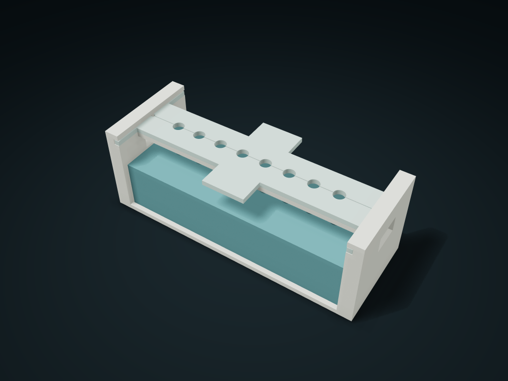

# Twin-Fork Shoulder Row Drop Bin

Short twin forks hold a hand-arranged full row of empty pipette tips; join vertically with the matching closed-bottom receiver, then pull the plates to drop them in; four complete printed parts, with no hidden axles or glue.

**[Preview this model and customize it on boxesmodel](https://boxesmodel.com/models/split-shoulder-row-transfer)**

## Default model

| Property | Value |
| --- | --- |
| Category | Desktop Organizers |
| Model version | 1.0.2 |
| Default assembly display size | 160 × 60 × 56 mm |
| Included parts | 4 |
| Formats | STL and STEP |
| Units | Millimeters |

Covers the layout of all parts in the current preview; see Files and dimensions for each part's print size.

## Dimensions and features

| Detail | Default value |
| --- | --- |
| Supply before printing | 8 identical flat-shouldered empty pipette tips: total length 42, head shoulder outer diameter 8.8, 2 mm above the shoulder, maximum neck diameter 6.2 within at least 5 mm below the shoulder, and maximum belly diameter 5.7 mm further down |
| Complete print list | 1 one-piece stand + 1 front shoulder plate + 1 rear shoulder plate + 1 closed-bottom catch tray (no hardware) |
| Receiver | 141.3×53.3×33mm； 8 clear holes of 7.1 mm, 14.8 mm pitch |
| Shoulder support and drop-in | Shoulder support Z52; nominal shoulder width 0.95; 9 drop; initial overlap inside the compartment 21 mm |
| Access path | Line up by hand → join the whole stand vertically → pull the front and rear plates → the whole row drops → lift the empty stand → take each tip up |

## Download the parts

Open a file below and choose **Download raw file** on GitHub. STL is for slicers; STEP is for CAD editing.

| Part | Dimensions | STL | STEP |
| --- | --- | --- | --- |
| One-Piece Short Fork Guide Wall Stand | 160 × 60 × 56 mm | [frame.stl](frame.stl) | [frame.step](frame.step) |
| Front-pull short fork shoulder plate | 148 × 29.48 × 3 mm | [front.stl](front.stl) | [front.step](front.step) |
| Rear-pull short fork shoulder plate | 148 × 29.48 × 3 mm | [back.stl](back.stl) | [back.step](back.step) |
| Closed-bottom full-row receiver | 141.3 × 53.3 × 33 mm | [receiver.stl](receiver.stl) | [receiver.step](receiver.step) |

Each listed part has its own STL and STEP file. Preview colors are illustrative; the manufacturing files do not contain the displayed colors.

## Printing and assembly

- Before printing, get 8 identical flat-shouldered empty pipette tips: total length 42, head shoulder outer diameter 8.8, 2 mm above the shoulder, maximum neck diameter 6.2 within at least 5 mm below the shoulder and maximum belly diameter 5.7 mm further down. Only for organizing or teaching with non-sterile empty consumables; measure the shape, and do not infer fit from 200 µL/10 µL capacity or brand. The head shoulder bottom must be complete and flat, and the belly must not be wider than the neck again; not suitable for soft, collapsed tips, damaged head shoulders or complex bulging shapes.
- Complete print list, 4 parts: 1 stand, 1 front fork plate, 1 rear fork plate and 1 closed-bottom receiver. No screws, long axles, links, hinges, magnets, glue or springs needed; empty pipette tips are supplied separately and are not printed parts. Outer envelope of the two plates 148 × 29.475 × 3 mm; use files from the same export; the actual shape includes half holes, side runners, pull tabs and the middle stop clearance.
- Receiver outer size 141.3 × 53.3 × 33 mm, 8 blind compartments 7.1 mm clear with 3 mm floors, 14.8 mm pitch. 0.35 mm on each side between the stand and box, with twice the single-side clearance of the blind holes counted in the box's XY play; the assembled outer envelope of the printed set is 160 × 60 × 56 mm.
- Assembly: with the front/rear half holes facing the center line, slide each plate flat along the side slots from the front/back to the 2 mm middle stop. The outer runner has a stop clearance; do not force it past the center line. The slot floor and two back ridge beams support the plate bottom, so the fork plates do not float. The closed neck opening is 6.9 mm clear; the flat shoulders rest on the two plates at Z = 52 mm, with 0.95 mm nominal shoulder support per side and at least 0.6 mm after side play; measure the neck diameter over at least 5 mm below the shoulder, not at one point only.
- Use: place the separate stand on the desk, seat the two plates and line up 8 empty pipette tips by hand from above; the end is 12 mm off the desk. Support the stand by the 18 × 10 mm grip holes on both sides (do not grab the two pull tabs), lift the stand with its row of seated tips, line it up with the matching receiver and lower it straight down; the receiver stays inside the ring feet, and items enter the blind compartment at least 21 mm first. Use the matching receiver; compatibility with purchased 96-well plates or brand interfaces is not promised.
- Hold the stand and slowly pull the two plates out front and back (at least 53.8 mm clearance on each side). Once the head shoulder is released, it drops 9 mm into the closed blind compartment; the compartment opening is 10 mm below the final shoulder, so heads stick out and can be lifted straight up one by one. Then lift the empty stand away; the receiver can stay on the workbench. Not an automatic loose-part sorter; test friction, drop wobble and material strength with a sample first; completely jam-free real use is not guaranteed.
- When lifting the stand, both plates must be at the middle stop and level; the pull tabs have no transport lock; do not tilt, invert or shake. The receiver is open on top, with no lid, dust seal or inverted retention; no sterility, sterilization, laboratory precision, contamination control or reliable load-bearing is promised.
- Print the stand and receiver base down; check supports for the stand's side guide slot roofs when slicing, and clear residue from the slots. Print both plates flat side down. Test-print the half-hole/guide groove fit first and measure empty pipette tips; Check assembly, load and full-row release before use.
- Import at millimeter scale. Check your build volume, orientation, overhangs, supports and mating clearances in the slicer.

## Adjust the design

Visit the [interactive model page](https://boxesmodel.com/models/split-shoulder-row-transfer) to inspect the 3D model and adjust the available dimensions and layout options. This folder contains the default-size export shown above; custom exports follow the options and pricing shown on boxesmodel.

## License and attribution

Copyright © 2026 boxesmodel. These model files, preview and description are licensed under [CC BY 4.0](https://creativecommons.org/licenses/by/4.0/). You may share, modify and use them commercially with the required attribution. See the [full license](../../LICENSE) and [attribution guide](../../ATTRIBUTION.md).

Suggested credit:

> “Twin-Fork Shoulder Row Drop Bin” by [boxesmodel](https://boxesmodel.com/models/split-shoulder-row-transfer), licensed under [CC BY 4.0](https://creativecommons.org/licenses/by/4.0/). Indicate any changes you make.

[Browse all models](../../CATALOG.md) · [About the collection](../../README.md)
