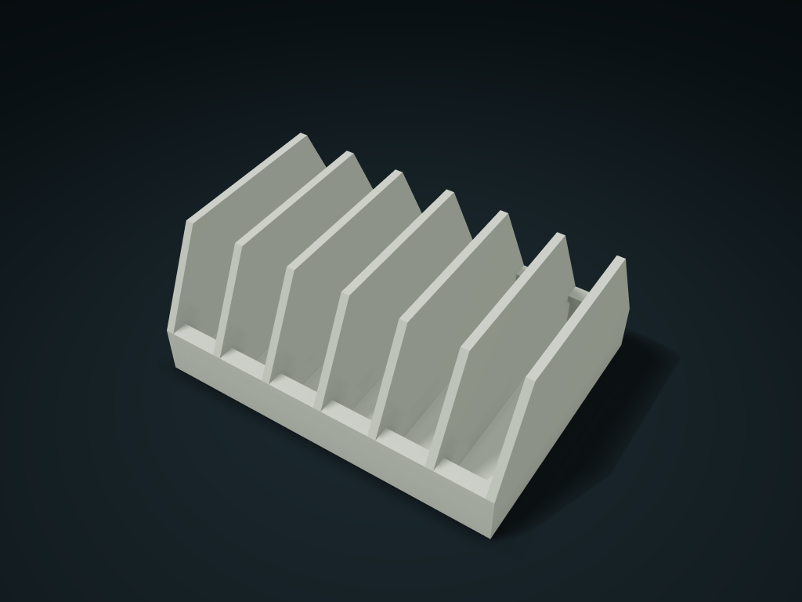

# Spring Plier Handle Limit Box

Squeeze spring-loaded handles to lower pliers, then release under the lips; squeeze again to lift out. Configure handle spacing, thickness and count.

**[Preview this model and customize it on boxesmodel](https://boxesmodel.com/models/spring-plier-rack)**

## Default model

| Property | Value |
| --- | --- |
| Category | Desktop Organizers |
| Model version | 1.0.0 |
| Default box size | 129 × 97.6 × 55 mm |
| Included parts | 1 |
| Formats | STL and STEP |
| Units | Millimeters |

Dimensions include the outer outline of the box; see the specifications for usable interior space.

## Intended use

- Only self-opening spring plier handles that can be squeezed; never pull out forcibly. Measure curves, protrusions, heads and finger clearance; loaded height exceeds printed bounds.
- Lips only block nominal handle ends; check spring force, retention, tipping and wear. No 42 mm grid base, external-interface compatibility or support-free claim.

## Dimensions and features

| Detail | Default value |
| --- | --- |
| Tool positions | 6 positions / clear width 18 mm |
| Center distance of the opened handle ends | 80 mm |
| Pinch together to insert to | ≤ 71.6 mm center distance |
| Handle end limit lip bottom height | 15.6 mm |
| Reference hinge point height | 88.6 mm (excluding pliers jaws) |

## Download the parts

Open a file below and choose **Download raw file** on GitHub. STL is for slicers; STEP is for CAD editing.

| Part | Dimensions | STL | STEP |
| --- | --- | --- | --- |
| Twin-handle limited slot box | 129 × 97.6 × 55 mm | [rack.stl](rack.stl) | [rack.step](rack.step) |

Each listed part has its own STL and STEP file. Preview colors are illustrative; the manufacturing files do not contain the displayed colors.

## Printing and assembly

- One-piece box printed base down, with no moving parts or assembly hardware; the limit lips on both sides are 2–5 mm inward overhangs; check supports and bridging in the slicer; support-free printing is not claimed.
- Only for spring plier handles that can be squeezed and open by themselves. Pinch to within the shown center distance, lower straight to the bottom, then release; pinch together first, then lift; never yank it straight out.
- Measure the handle end center distance with the ends open; the envelope diameter is the thickest round section of the handle; handle length is from the end center to the hinge point. Separately measure bent handles, bumps and the actual plier head shape; do not choose by a straight round handle size alone.
- Each position's clear width must fit both the plier head's sideways envelope and room for fingers; the plier heads and total height once loaded are not in the print envelope; measure the drawer or counter space separately.
- The limit lips only block lifting at the nominal handle ends; before use, check the actual spring force, retention, tip-over stability and wear. This model has no 42 mm grid base and does not claim external interface compatibility.
- Import at millimeter scale. Check your build volume, orientation, overhangs, supports and mating clearances in the slicer.

## Adjust the design

Visit the [interactive model page](https://boxesmodel.com/models/spring-plier-rack) to inspect the 3D model and adjust the available dimensions and layout options. This folder contains the default-size export shown above; custom exports follow the options and pricing shown on boxesmodel.

## License and attribution

Copyright © 2026 boxesmodel. These model files, preview and description are licensed under [CC BY 4.0](https://creativecommons.org/licenses/by/4.0/). You may share, modify and use them commercially with the required attribution. See the [full license](../../LICENSE) and [attribution guide](../../ATTRIBUTION.md).

Suggested credit:

> “Spring Plier Handle Limit Box” by [boxesmodel](https://boxesmodel.com/models/spring-plier-rack), licensed under [CC BY 4.0](https://creativecommons.org/licenses/by/4.0/). Indicate any changes you make.

[Browse all models](../../CATALOG.md) · [About the collection](../../README.md)
