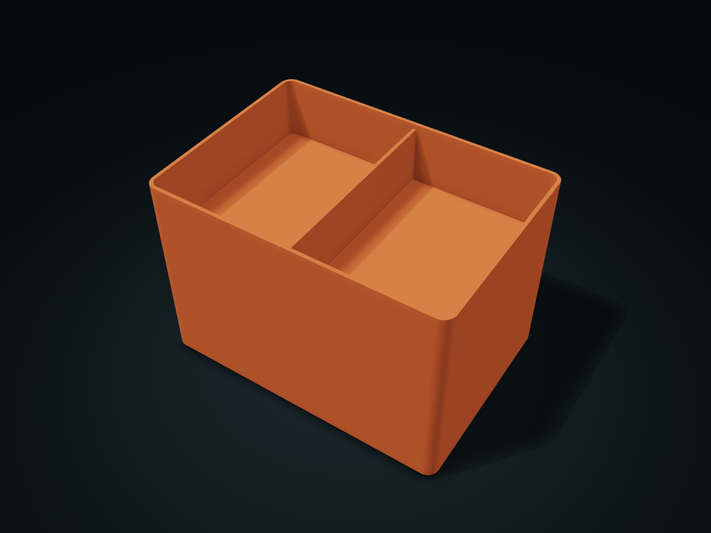

# Stacking Divided Box

Separate parts with a locating base, put away upward.

**[Preview this model and customize it on boxesmodel](https://boxesmodel.com/models/stacked-tray)**

## Default model

| Property | Value |
| --- | --- |
| Category | Stackable Storage |
| Model version | 1.1.0 |
| Default assembly display size | 200 × 140 × 138 mm |
| Included parts | 3 |
| Formats | STL and STEP |
| Units | Millimeters |

Covers the layout of all parts in the current preview; see Files and dimensions for each part's print size.

## Dimensions and features

| Detail | Default value |
| --- | --- |
| Usable clear height between levels | 39.6 mm |
| Number of levels | 3 |

## Download the parts

Open a file below and choose **Download raw file** on GitHub. STL is for slicers; STEP is for CAD editing.

| Part | Dimensions | STL | STEP |
| --- | --- | --- | --- |
| Level 1 | 200 × 140 × 48 mm | [layer-1.stl](layer-1.stl) | [layer-1.step](layer-1.step) |
| Level 2 | 200 × 140 × 48 mm | [layer-2.stl](layer-2.stl) | [layer-2.step](layer-2.step) |
| Level 3 | 200 × 140 × 48 mm | [layer-3.stl](layer-3.stl) | [layer-3.step](layer-3.step) |

Each listed part has its own STL and STEP file. Preview colors are illustrative; the manufacturing files do not contain the displayed colors.

## Printing and assembly

- All levels in the same model package are used together; do not mix sizes, wall thicknesses or versions.
- The locating specification is managed by the platform; test-print to check the real fit first.
- Check supports for the base steps when slicing.
- Import at millimeter scale. Check your build volume, orientation, overhangs, supports and mating clearances in the slicer.

## Adjust the design

Visit the [interactive model page](https://boxesmodel.com/models/stacked-tray) to inspect the 3D model and adjust the available dimensions and layout options. This folder contains the default-size export shown above; custom exports follow the options and pricing shown on boxesmodel.

## License and attribution

Copyright © 2026 boxesmodel. These model files, preview and description are licensed under [CC BY 4.0](https://creativecommons.org/licenses/by/4.0/). You may share, modify and use them commercially with the required attribution. See the [full license](../../LICENSE) and [attribution guide](../../ATTRIBUTION.md).

Suggested credit:

> “Stacking Divided Box” by [boxesmodel](https://boxesmodel.com/models/stacked-tray), licensed under [CC BY 4.0](https://creativecommons.org/licenses/by/4.0/). Indicate any changes you make.

[Browse all models](../../CATALOG.md) · [About the collection](../../README.md)
