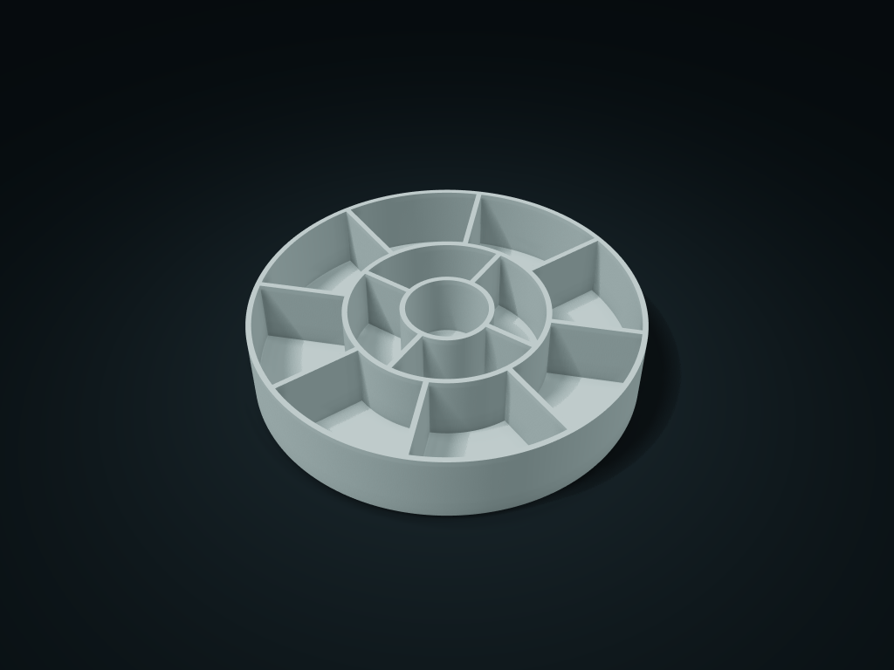

# Staggered Double Ring Pocket Tray

A complete central pocket and two staggered rings, with independently configurable widths and pocket counts.

**[Preview this model and customize it on boxesmodel](https://boxesmodel.com/models/stagger-ring-pocket-tray)**

## Default model

| Property | Value |
| --- | --- |
| Category | Desktop Organizers |
| Model version | 1.0.0 |
| Default box size | 200 × 200 × 38 mm |
| Included parts | 1 |
| Formats | STL and STEP |
| Units | Millimeters |

Dimensions include the outer outline of the box; see the specifications for usable interior space.

## Dimensions and features

| Detail | Default value |
| --- | --- |
| Center Pocket Clear Diameter | 42.0 mm |
| Outer Ring Radial Clearance | 44.6 mm |
| Inner and Outer Ring Pocket Counts | 4 / 8 compartments |

## Download the parts

Open a file below and choose **Download raw file** on GitHub. STL is for slicers; STEP is for CAD editing.

| Part | Dimensions | STL | STEP |
| --- | --- | --- | --- |
| Staggered Double Ring Tray | 200 × 200 × 38 mm | [body.stl](body.stl) | [body.step](body.step) |

Each listed part has its own STL and STEP file. Preview colors are illustrative; the manufacturing files do not contain the displayed colors.

## Printing and assembly

- One-piece body with its base printed down; interior dividers connect to the floor and require no separate assembly.
- Load and remove items from above. Measure the widest item envelope and leave handling clearance; corners, dividers and curved walls occupy interior space.
- Ring pockets are sectors, not rectangles. Radial clearance is not the diameter of an item they can hold; account for sector angle and divider thickness.
- All custom parts are included in the download; no purchased parts are required. Preview colors are for display only; manufacturing STL/STEP files are uncolored.
- Check overhangs, supports and fit before printing; support-free printing, load capacity, sealing and food-contact safety are not promised.
- Import at millimeter scale. Check your build volume, orientation, overhangs, supports and mating clearances in the slicer.

## Adjust the design

Visit the [interactive model page](https://boxesmodel.com/models/stagger-ring-pocket-tray) to inspect the 3D model and adjust the available dimensions and layout options. This folder contains the default-size export shown above; custom exports follow the options and pricing shown on boxesmodel.

## License and attribution

Copyright © 2026 boxesmodel. These model files, preview and description are licensed under [CC BY 4.0](https://creativecommons.org/licenses/by/4.0/). You may share, modify and use them commercially with the required attribution. See the [full license](../../LICENSE) and [attribution guide](../../ATTRIBUTION.md).

Suggested credit:

> “Staggered Double Ring Pocket Tray” by [boxesmodel](https://boxesmodel.com/models/stagger-ring-pocket-tray), licensed under [CC BY 4.0](https://creativecommons.org/licenses/by/4.0/). Indicate any changes you make.

[Browse all models](../../CATALOG.md) · [About the collection](../../README.md)
